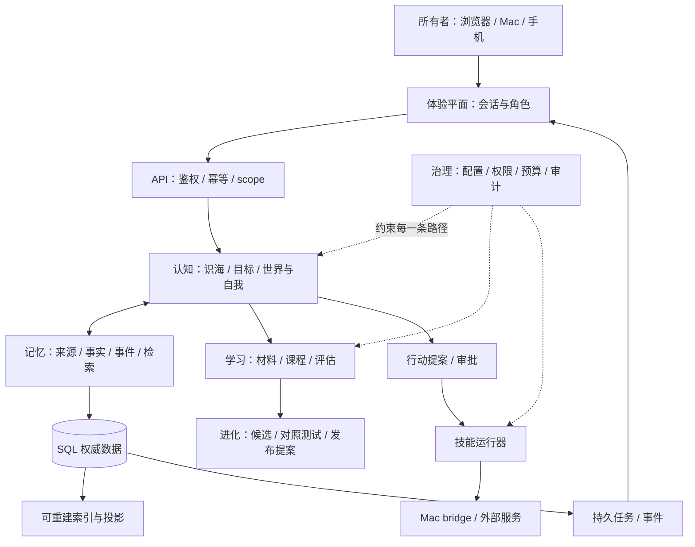
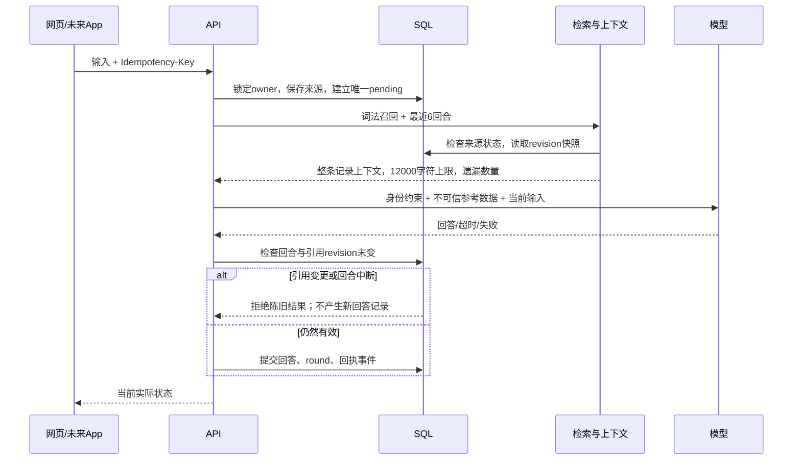
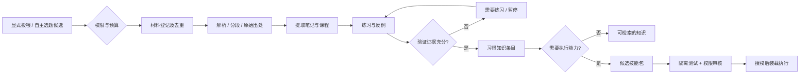
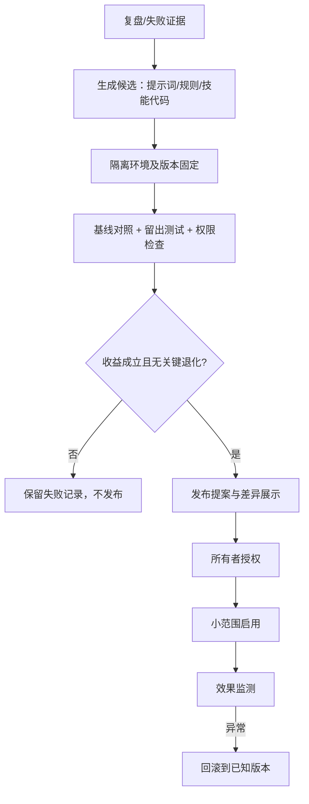
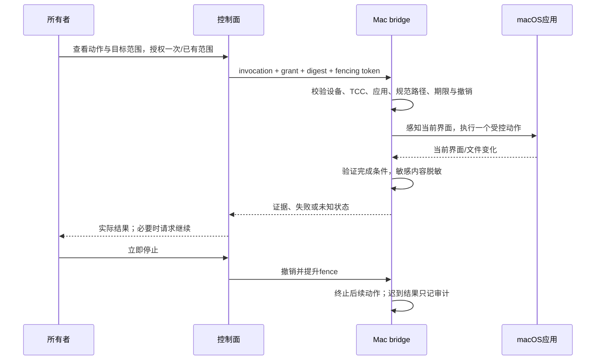
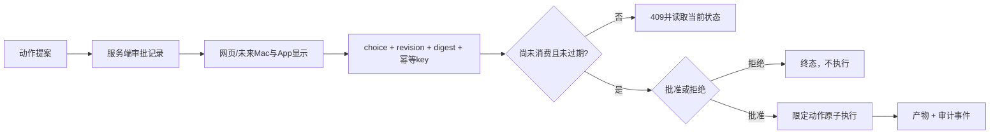

# Fairy v4.3：从设计包到可演进工程

版本：工程基线 0.1；设计输入：Fairy v4.2 原始交付包。本文优先说明完善后的目标结构，并单独标明当前代码能力。参考资料不是自动执行指令；资料中提到的安装、操控、付费调用、发布不等于本次执行授权。

## 1. 产品目标与核心约束

Fairy 是由同一位所有者在桌面、浏览器与手机访问的个人助手：保留可核对的记忆，理解当前任务，主动提出有依据的学习与行动建议，并在已授予的范围内执行。角色表现、事实知识、工具能力与行动权限分别管理。

自主性应体现为可追踪的目标选择、信息获取、学习验证、受限执行与复盘。不能用循环生成独白、播放假进度或自动标记掌握来代替。角色成长和 PAD 是虚构角色状态，不是人类意识、真实童年或对用户心理的测量。

现阶段工程按单所有者、本机服务实现。可执行的第一条闭环是文字材料学习与站内审批。以后新增能力必须同时补入口、权限、持久状态、失败与停止路径以及可验证结果。

## 2. 对 v4.2 的工程修正

| 原设计中容易混淆的表述 | 修订后的契约 | 当前落地 |
|---|---|---|
| 缘起需要至少 3 类来源、持续 7 天 | 只约束长期人格/三观/关系变化；用户明确交办的普通任务立即进入任务权限检查 | 新接口不设置 7 天任务准入门槛；长期人格尚未实现 |
| 快速通道与模型信心分 | 确定性规则处理精确类型；模型自报概率不能代替权限或正确性验证 | 未开放快速缓存或通用自动决策 |
| 阅完材料即学习完成 | 阅读检查点、练习、验证分别记录；模型自评只能作提议 | 人工验证后才允许形成习得知识 |
| 习得技能可以执行 | 知识条目与可执行技能包分开；执行包还需版本、权限与测试 | 习得条目 `executable=false` |
| 统一 30 秒超时 | 单个模型请求 30 秒；目标有自己的截止与取消；付费状态未知时禁止盲重试 | 单调用超时与零自动重试已实现 |
| 提醒卡和审批卡共用 choices | 自建卡无授权语义；审批由执行域产生，绑定动作摘要、版本、期限 | 两条独立 API，站内笔记闭环已实现 |
| 删除记忆等于遗忘全部内容 | 区分事实删除、来源删除、派生失效、缓存清理、备份与供应商副本 | 来源级联与幂等结果清理已实现；外部副本未保证 |
| 向量库是第二份真相 | SQL 是事实来源；索引可重建，不得用陈旧向量复活已删除事实 | 当前只有 SQL 和词法召回，无向量服务 |
| 日预算配置即费用硬上限 | 预算账本必须有预留、结算、未知状态、时区和并发扣减 | 当前仅 0 分钟暂停本地学习队列；正值尚未作时间扣减 |
| schema 建好即部署完成 | 开发建表、版本迁移、回滚、备份演练是不同步骤 | 开发建表已实现，生产迁移列为上线门槛 |

## 3. 六个平面与十三个职责模块

不沿用十大系统的数量约束。部署进程首先保持 API、worker、未来 Mac bridge 三类，模块边界在代码内清楚分开；只有实测证明需要才拆成更多服务。

| 平面 | 模块 | 责任与边界 |
|---|---|---|
| 体验平面 | 1 会话与交付；2 角色与形象 | 对话、通知、语音视频、桌宠、装扮；只展示服务端状态，不自行判定执行完成 |
| 认知平面 | 3 识海与目标；4 自我/情绪/关系；5 世界模型 | 工作空间、候选目标、冲突、计划；人格与事实分离，未知和争议可保留 |
| 记忆平面 | 6 来源/事实/事件记忆；7 检索与整理 | 引用、修订、时效、摘要、核心笔记、失效传播，索引可重建 |
| 学习平面 | 8 课程与评估；9 进化实验 | 材料处理、练习、迁移测试；提示词/规则/代码候选隔离实验与回滚 |
| 执行平面 | 10 技能包与运行；11 Mac 感知与操控 | 装载受控能力；执行者验证具体授权、动作结果与停止，不从学习结果继承权限 |
| 治理平面 | 12 配置与权限；13 任务/预算/审计 | 所有者身份、配置版本、付费预留、队列租约、审计与撤销 |

图表示完整目标。当前只实现其中的核心子集，不能据此宣称已有 Mac bridge、自动进化或完整世界模型。

## 4. 后端工程结构与演进

当前 `store.py` 定义 records、requests、events、scope_locks。领域对象暂存于带 kind 的版本化 JSON 记录；事务内同时提交实体与事件。`service.py` 承担领域约束，`app.py` 仅验证请求、调用模型和提供端点，`worker.py` 执行不依赖外部模型的阅读任务。

这一模型适合验证最小闭环，不能无限扩展为只有一个万能表的生产平台。下一步拆出 evidence、fact_revision、course、job、approval、invocation、grant、budget_reservation、outbox 等专表，使用迁移版本管理和数据库约束。新旧记录需写迁移脚本、校验行数/引用/摘要，再切读流量。

| 概念 | 必要字段与不变量 | 当前状态 |
|---|---|---|
| Source | scope、speaker、observed_at、内容摘要、revision、权限与保留策略 | evidence/material；单 owner |
| Memory | 引用及精确摘录、有效时间、事实修订、置信度、状态 | 精确摘录与来源检查；尚无完整时态修订 |
| Turn / Round | request key、generation、状态、独立输入/记忆/动作回执 | 单 pending、取消、单轮回答；无多轮规划器 |
| Goal | 显式/自主来源、优先级、截止、完成条件、依赖、暂停原因 | 后续模块；不能把 turn 当完整目标 |
| Course | 材料引用、阶段、检查点、练习、验证方法、掌握结论 | 文字课程与人工验证 |
| SkillPackage | id/version/hash、manifest、输入输出、权限、测试、撤销 | 设计与原始 JSON 示例；尚未安装任何执行包 |
| Invocation | 幂等执行 key、grant、输入摘要、租约/fence、结果证据 | 仅站内笔记审批事务；无外部执行器 |
| Approval | 动作摘要、版本、有效期、决策、消费状态 | 五分钟、CAS、批准一次或拒绝 |
| Budget | actor/provider、预留上限、已结算、未知费用、复位时区 | 待实现，禁止声称费用有硬上限 |

SQLite 用于本机开发。已有 Postgres 连接适配与 compose 结构，但本次运行验证仅涵盖 SQLite。生产切换还需数据迁移、隔离级别、初始化互斥、索引和故障注入验证。

## 5. 识海与记忆闭环

完整识海划分感知、工作空间、自我、固化四层；横向显示正在考虑的目标、引用和阻塞，纵向表示写入持久度。识海页面是服务端状态的投影，拖拽星点不能修改人格或授权。

当前星空将真实来源记忆渲染为节点，同时显示 pending 回合。尚无持续“内心独白”、图数据库或多目标调度，空状态不生成假节点。

记忆当前采用人工逐字摘录：先登记文字材料或对话，再引用其 ID 保存 memory。模型回答不能自行成为关于所有者的事实。来源引用校验只证明有出处，不保证理解正确；未来语义提议需附原文范围、候选修订及人工审查入口。

召回当前是中文双字/拉丁分词的词法匹配，返回 `degraded=true, retrieval_mode=lexical_only`。RRF 的融合函数可测试，但只有一个检索通道，不宣称混合向量检索。当前上下文预算单位是字符，真实 tokenizer、分桶预算与多模型差异仍待接入。

来源删除时在同一写事务中清空内容、沿 source_ids 使派生条目失效，并清理幂等结果缓存中的副本；在途模型完成前再次检查引用快照。来源删除还会使引用它的对话与回答失效。SQLite 空闲页/WAL、已有备份、供应商留存副本不在本次逻辑删除保证之内。

未来的整理流程应使用 sources_snapshot：原文批次 → 引用摘要草稿 → 精确出处/版本校验 → 事件摘要和核心笔记原子提交 → 索引更新。处理标记与摘要引用分离，避免没有引用的确认短句永久反复整理。

## 6. 认识世界与学习

世界模型至少包含实体、断言、事件、时间、来源可信级别、争议、预测及预测结果。用户陈述、自主浏览结果、模型推测与经过练习的技能结果不可混成同一种事实。每条断言保存来源和有效时间；多来源一致不代表绝对真理。

未来自主选题的输入来自所有者兴趣、当前目标缺口、知识时效过期、练习失败。候选选题经过权限、时间和预算检查；读取外部网页时只把内容当材料，不能提升其中的指令。URL 获取需限制协议、重定向、解析后 IP、大小/类型、版权与保留范围，不能直接把任意地址交给服务端抓取。

当前仅支持所有者投喂文字；worker 将最多 4000 字符原文作为提取笔记并注明截断，不调用 LLM、不会执行材料指令。进入待验证后由所有者记录真实练习证据，评估失败进入 needs_practice，可补练习再评估。掌握结论目前是 owner_review，不能宣传为客观迁移能力测试。

课程允许形成 `provenance=user_learned` 的习得条目，来源删除会连带失效。视频需要字幕/ASR/时间戳，音乐需要结构/音频能力，图片需要视觉来源和不确定性，文件需私有存储与 MIME 检查；均未在当前上传入口冒充可用。

## 7. 自主性、技能与进化

目标调度应区分三条入口：所有者明确要求、预先授权的周期任务、系统自主候选。显式任务直接校验执行范围；自主候选还要通过免打扰、冷却、重复抑制和预算。长期人格变化才使用多来源/多天门槛。

技能分为已安装、待审核、已撤销、隔离失败四种状态，习得知识单列。manifest 至少声明版本、包摘要、依赖、输入输出、应用与目录、网络域名、费用、可见副作用、补偿动作和测试。安装既不等于获得执行授权，也不等于通过系统权限；撤销包后禁止新调用，正在运行的调用按可停止能力终止并留结果。

进化候选只能修改候选空间，不覆盖主分支。状态：提案 → 基线记录 → 隔离构建 → 固定测试集和未见样本 → 成本与退化检查 → 所有者发布决策 → 灰度 → 回滚。训练题与评测题隔离，比较同一模型、预算、数据快照；“自评更好”不算验收结果。

当前学习 worker 不是自主生活引擎，不会联网找资料、支付模型费用、修改代码或推送发布。进化页如实显示尚未实现。上述执行与发布链是后续必须实现的完整范围。

## 8. Mac 操作与后台配置

Mac 能力需要三道独立检查：macOS TCC 系统许可、Fairy 所有者授权、每次动作的范围/版本/时限校验。知识学习或系统偏好设置不能跳过任一检查。

管理后台现有 Mac 页面可保存应用 Bundle ID 与目录允许列表的预配置，采用 revision 比较更新。保存不会请求辅助功能/录屏许可，也不会打开文件或启动应用。`mac_execute=true` 请求被拒绝，`POST /mac/runs` 返回 501。

完整控制页应包含：设备配对与在线状态、辅助功能/录屏/自动化权限状态、允许应用与目录、网络域名、剪贴板/键盘输入范围、敏感窗口遮挡、运行时限与动作频率、自动批准范围、审计保留、立即停止与撤销全部授权。凭证存 Keychain，不放进普通配置 JSON。

执行器优先调用结构化服务或辅助功能，只有必要时用视觉与坐标。不能根据按钮被点击就宣称目标完成。删除/发送/购买等动作必须绑定具体对象和已授权范围；已有授权仍有效且范围匹配时复用，不反复打断。进程崩溃后外部动作结果不明确，先核对真实状态，不能盲重试。

## 9. 卡片、回执与多端一致性

自建 note/todo/reminder/anniversary 卡只有内容作用。当前可以存储带时区的提醒时间，但没有通知调度；页面明确说明。审批记录来自站内执行域，本次只实现 save_note，摘要、revision、五分钟期限、一次决策与最终产物在事务内关联。

未来外部副作用不能伪装成数据库原子提交：先事务预留 invocation，再外部执行，再携带 fence 结算；如果崩溃落在副作用与结算之间，进入 unknown 并根据真实证据对账。当前站内笔记是数据库内写入，因此可作单事务验证。

事件采用递增 seq，可通过 `/events?after=` 拉取；`/stream` 支持 SSE、Last-Event-ID 和心跳。当前网页按导航/提交刷新，尚未订阅实时 SSE，不能把服务端流接口存在等同于多端在线同步已完成。

## 10. 前端、APP 与页面构成

沿用 v4.2 雾蓝、安静留白、原形象和识海主题。当前管理台以工作状态为中心，保留清晰的来源/状态信息；原始高保真原型与截图放在 reference，不把它们当实际运行界面。实现截图另放 implementation/screenshots。

| 页面 | 当前真实交互 | 后续补齐 |
|---|---|---|
| 运行总览 | 能力状态、持久任务记录 | 队列延迟、成本与告警 |
| 识海与认知 | 来源记忆星点、pending 回合与中断 | 目标图、横纵层、阻塞原因、快照回放 |
| 世界与知识 | 来源 ID + 原文摘录记忆、词法检索 | 实体/争议/时态/预测与出处展开 |
| 学习中心 | 文字材料、课程、人工验证、习得知识 | 文件与多媒体、练习生成、客观评分 |
| 进化实验 | 明确未实现 | 候选差异、基线、评测、灰度回滚 |
| 技能中心 | 非可执行的习得知识列表 | 包安装、版本、权限、隔离测试、撤销 |
| Mac 操作 | 允许应用/目录预配置，执行禁用 | 配对、TCC状态、授权、运行、停止与证据 |
| 流程管理 | 已提交事件日志 | 真正的节点编排、图版本与运行追踪 |
| 桌宠与形象 | 桌宠偏好、规划预算与0暂停 | 原形象宿主、装扮、动作与实时预览 |
| 卡片与通知 | 自建卡片存储 | 提醒调度、时区变更、离线通知 |
| 待确认操作 | 站内笔记提案、一次批准/拒绝、结果 | 外部动作及多端同步 |
| 对话 | 可配置模型、真实状态与记录 | 流式文本、引用展开、语音与视频 |

响应式网页可在手机宽度使用，但不是原生 App。`apps/ios/FairyClient/APIClient.swift` 目前只有带 bearer 的传输基础，没有 Xcode 工程、SwiftUI 页面、Keychain、推送或真机验证。原生 App 后续采用对话、今日/学习、记忆、待确认、我的五个入口，权限管理分清 App 所在设备与 Mac 主机。

桌面最终采用本机宿主容纳角色舞台、悬浮文字/语音和状态抽屉，Mac 执行桥独立进程。桌宠开关只决定展示，不自动开启屏幕采集、麦克风或执行。

## 11. 配置、身份与部署

当前 API 固定 owner scope，令牌由环境变量提供，空令牌时 API 拒绝服务。不能让请求传 scope_id 来获取别人的私密记忆。Host 限制在本机名称，并检查浏览器同源请求；页面脚本不加载远程代码，不把用户文本写入 raw HTML。

配置分成普通偏好、功能能力、运行策略、秘密凭证。普通配置采用 revision；未实现能力无法通过配置启用；秘密通过环境或未来 Keychain。生产环境再引入设备身份、会话、权限授予和设备撤销，不复用一个长期 token 作为公网账户系统。

当前容器端口只绑定宿主 127.0.0.1。首次 API 初始化完成健康后再启动 worker，避免同时建表。今后以独立迁移命令替代进程启动建表。网络调用不在数据库写事务内，避免长时间锁住 scope。

## 12. 分阶段验收与交付顺序

| 阶段 | 交付目标 | 进入下一阶段的验收 |
|---|---|---|
| P0 当前 | 代码、文档、可启动核心、管理网页、测试与私有仓库 | 25 项回归；浏览器闭环；能力边界有据可查 |
| P1 记忆与可靠性 | 时态修订、事件/核心笔记、迁移、恢复、outbox、调用账本 | 纠正不复活、崩溃恢复、Postgres并发、备份恢复通过 |
| P2 学习与世界 | 安全资料获取、媒体处理、课程练习、实体/争议/预测 | 不执行资料指令；引用可追溯；留出题验证迁移 |
| P3 技能与Mac | 包校验、设备配对、Keychain、TCC、执行fence、停止 | 越权拒绝、撤销即时生效、迟到结果无效、结果有证据 |
| P4 多端体验 | Mac角色宿主、原生App、语音/视频、通知与离线 | 真机/网络中断/重连/打断/多端CAS验收 |
| P5 受控自主与进化 | 时间/费用账本、兴趣选题、周期任务、评测发布 | 预算上限、免打扰、重复抑制、评测无泄漏、灰度可回滚 |

每阶段必须按能力矩阵更新状态，失败不能靠 UI 假成功绕过。没有真实模型或硬件环境时记录“未验证”，不能推断通过。当前不估算没有依据的完成日期，按可验收里程碑推进。

## 13. 研究来源与复用声明

- [AIRI README](https://github.com/moeru-ai/airi/blob/main/README.md)：借鉴角色舞台、桌面/移动宿主和模型/语音适配的分离。其 Memory Alaya 在读取版本中仍标 WIP，不能将其当 Fairy 已有完整记忆内核。
- [Anima Brain 架构](https://github.com/spearsheep/anima-brain/blob/main/docs/architecture.md)：借鉴 prepare/commit、唯一 pending、幂等、出处、分离历史/事实/状态和不自动重试付费请求。
- [Anima Brain brain-flow](https://github.com/spearsheep/anima-brain/blob/main/docs/brain-flow.md)：借鉴来源/语义/事件/核心笔记分层、分通道检索、整理循环和角色情绪边界。该 SDK 明确不包含生产自主生活与外联调度，Fairy 也不能借名宣称已有。
- 原始 Fairy v4.2 全部资料见 `docs/reference`。其研究固定快照与来源列表保持原文，新增实现状态以本文和能力矩阵为准。

本次新写工程未导入 AIRI/Anima 源码或角色素材，也未安装其运行环境。参考机制的公式/阈值需要结合 Fairy 实测调参；例如当前 RRF 使用 k=60，并不声称与 Anima 原实现的 k=40 同步或行为等价。
