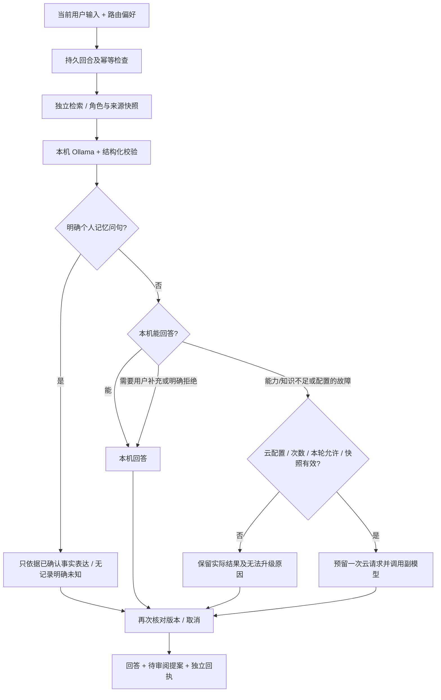
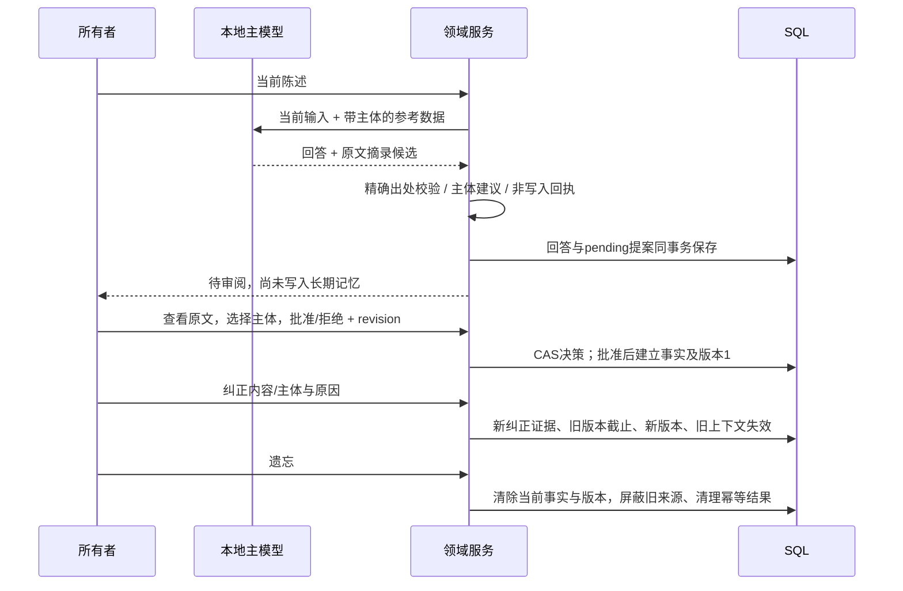

# P1：Ollama 主模型、云副模型与可审阅记忆

工程版本：0.2。本文是 v4.3 / 0.1 工程之后的最新实施记录；原始设计与旧验收报告作为历史保留，不代表当前全部能力。

## 1. 交付与验证

已实现：Ollama 原生推理、已安装模型检测、可持久配置的云副模型、局部升级路由、调用预留日志、记忆提案审阅、主体标注、版本纠正、遗忘传播、事件同步及对应页面。

本机使用已有 `qwen3:4b` 进行真实验证，没有下载模型或读取其他项目的凭证。**62 项回归通过**；另有真实 Ollama 验收、真实 Chromium 网页验收。云分支使用可控 HTTP mock 验证，用户尚未配置云服务，未发出付费云调用。

报告入口：

- `p1-ollama-acceptance.json`：合成数据、输入、最终回答、回答依据、被引用记忆与真实本机调用。
- `p1-browser-results.json`：真实网页、Ollama、审阅、纠正、SSE、手机宽度与遗忘。
- `screenshots/p1/`：模型页、对话、原文审阅、版本纠正和手机记忆页。
- `tests/test_core.py`、`tests/test_p1.py`：接口、来源、并发、角色与语义回归。

“真实模型验证”表示实际访问 Ollama，并验证服务最终返回内容；**不表示原始模型草稿在任意问题上都没有语义错误**。支持的个人偏好问句会经过来源约束与确定性表达，报告明确标记依据。

## 2. 模型与路由

`ModelSettings` 保存非秘密配置到 `model_config` 记录。首次启动从 `FAIRY_OLLAMA_*` 初始化，默认回环地址 `http://127.0.0.1:11434`、模型 `qwen3:4b`，之后以后台保存的配置为准。当前 Ollama 地址只允许本机回环，不能把云模型代理地址当作本地计算。

`ModelRouter` 调用 `/api/chat`，关闭流式输出以原子验证结构化 JSON，使用 schema 提取自然语言回答、处理结果和原文记忆候选；不使用模型思考输出，不提供工具。窗口、输出和超时有上限；上下文按整条记录选择，使用保守 UTF-8 字节上界并预留输出，必需输入过大时拒绝，不静默截断。



可配置的自动升级信号：能力不足、知识不足、服务不可用、超时、结构不完整。信号是可解释路由条件，不是可靠正确率测量；模型过度自信仍可能漏报，需要持续评估。每轮可选择 `auto`、`local_only`、`cloud_assist`。需要澄清、明确拒绝和缺失用户私密记忆，不靠换云模型猜测。

云端适配 HTTPS 的 OpenAI 兼容 `/chat/completions`、`max_tokens` 与普通文本响应，尚未适配原生 Anthropic 协议或所有服务商的特殊参数。云模型没有自动联网或工具能力。默认只发送当前问题；选择 `approved_memories` 后可额外发送本轮检索到的已确认记忆，不发送完整历史、本地草稿、思考内容或待审阅提案。

## 3. 费用与故障语义

每个回合的 local/cloud 阶段分别预留一条 `model_invocation`，同阶段禁止重复派发。网络请求在 SQL 写事务之外执行，完成后结算状态与可用的 token 用量。模型名、升级原因和错误码可审计，提示原文与密钥不写入调用日志。

云请求按 UTC 日期计数，失败、超时和未知结果也消耗一次额度。次数上限不等于金额上限；没有价格时不编造金额。超时后结果及费用可能未知，记录 `unknown`，不自动重试。每轮最多一次云调用，不进行云到云的循环升级。

重启检查已超过调用截止时间与宽限期的 `started` 记录，将其标记结果未知并终止对应 pending 回合，不自动重发。尚未到期的 pending 可从对话页中断。取消、配置修订、来源删除或记忆修订发生后，后续云派发和回答提交再次校验快照。

## 4. 密钥与配置

密钥写入本机私有目录的不可变凭证文件，文件 `0600`、目录 `0700`，SQL 只保存随机引用。配置提交成功后轮换/清除旧引用并清理旧文件；清理失败记录无敏感内容的维护事件。事务失败产生的孤立文件不被激活，仍需要后续运维清理。

当前没有 Keychain 集成或应用层文件加密，不能宣传为系统钥匙串。密钥绑定完整接口根地址，更换地址不复用旧密钥。环境密钥也绑定 `FAIRY_CLOUD_BASE_URL`，修改环境与重启后才生效。GET、事件、调用日志和校验失败响应均不回显密钥。云副模型默认禁用，缺少模型/地址/密钥不能开启。

## 5. 记忆：原文、主体与规范事实分别保留

原文证据保持逐字内容，不能为改人称而覆写。新增 `subject`、`statement` 与来源说话者：

```json
{
  "text": "我现在喜欢喝温水。",
  "subject": "owner",
  "statement": "用户现在喜欢喝温水。",
  "reviewed": true,
  "source_ids": ["原文证据ID"]
}
```

`text` 是可核对的摘录，`statement` 是带主体的第三人称表达；二者不混为助手自述。主体可为 owner、assistant、other、unspecified。第一人称只作待审阅主体建议，审阅者可以修正；说话者是用户不代表每个陈述的主体都是用户。复杂转述与语义蕴含没有自动证明，仍由来源审阅确认。



提案只能引用当前用户消息的逐字内容，不能把模型回答、历史推测或材料中的执行指令当作当前用户事实。默认 `review`；`off` 不产生新对话提案，但保留历史并可使用已有确认记忆。显式手工保存仍视为所有者主动确认。

已确认事实可纠正内容与主体，必须携带 revision 和原因。版本保留各自的原文引用和有效区间；当前召回只使用有效版本。纠正会使引用旧事实的对话派生失效，旧原始证据仍可手动查看。历史来源删除不会抹掉具有独立新来源的当前纠正。

遗忘清除当前事实及其版本，清理相关提案、缓存和派生回答，屏蔽这些旧来源进入后续上下文；不会声称销毁原始证据、数据库空闲页、备份或供应商副本。

## 6. 本次语义问题的定位与修复

原验收的时间顺序是：先输入合成陈述“请记住，我喜欢喝茉莉花茶”，再确认，再纠正为“我现在喜欢喝温水”。所以前两步出现茶符合当时输入，不能用纠正后的值反向判定前序幻觉。这些是测试资料，不是用户的真实偏好。

实测暴露的有效问题有：确认前模型偶尔说“我记住了”；逐字第一人称记录可能被读成助手偏好；遗忘后出现“用户询问我……”旁白；最近对话可能让召回测试绕过长期检索。

修复采用可检验的边界：

1. 明确的单一“请记住”请求返回真实 pending 回执，常见不实记忆写入断言被替换；此文本检测不是任意语义幻觉的完整检测器。
2. 模型上下文携带 speaker、subject、第三人称 statement 和标为原文的 quote；当前输入中的“我”属于用户，“你”属于助手。
3. 对明确的饮品偏好问句，独立检索已确认事实，移除最近对话，只接受对应主体的记录。缺记录说明没有可用记录，不能依靠换云模型猜测。
4. 该类问句的最终表达由来源约束产生，记录 `answer_basis`、`question_subject`、`used_memory_ids`；不会宣称模型草稿本身已通过通用语义评测。
5. 其他复杂问句继续由模型处理，上述规则不宣称覆盖任意指代消解、实体冲突或全部自然语言问法。

新增反例测试：初始就确认温水、历史和模型草稿却声称茶时，最终回复必须为温水；遗忘后，即使模型继续编造偏好也必须明确未知；询问“你喜欢喝什么”不得泄露用户偏好或让助手冒认；主体由 other 纠正为 owner 后，版本与召回同步变化。

## 7. 最终真实运行示例

合成输入顺序及最终回复：

| 步骤 | 当时的事实状态 | 最终回复 |
|---|---|---|
| statement | 当前输入为茶，尚未确认 | 已生成关于你的待审阅记忆提案，确认后才会保存 |
| recall | 已确认茶 | 根据你已确认的记忆，你喜欢喝茉莉花茶 |
| corrected_recall | 已纠正为温水 | 根据你已确认的记忆，你现在喜欢喝温水 |
| after_forget | 当前事实已遗忘 | 目前没有可用的、已确认的你的饮品偏好记录，所以我不知道你喜欢喝什么 |
| assistant_preference | 问句主体为助手 | 我没有真实的饮品偏好；用户个人偏好与角色设定分别记录 |

这些结果是本次限定场景的验证，不表示全领域事实准确率已达标。完整原始输入、引用 ID 与路由依据保存在 JSON 报告。

## 8. 新接口

| 接口 | 责任 |
|---|---|
| GET/PUT `/v2/models/config` | 脱敏配置与CAS更新、只写密钥 |
| GET `/v2/models/ollama` | 查询本机已安装模型，不下载 |
| GET `/v2/models/invocations` | 有界调用审计，不含提示或密钥 |
| POST `/v2/turns` | 输入与auto/local_only/cloud_assist路由 |
| GET/POST `/v2/memory/proposals` | 提案列表或主动登记逐字提案 |
| POST `/v2/memory/proposals/{id}/review` | 批准/拒绝与主体审阅 |
| PATCH `/v2/memories/{id}` | 内容/主体纠正与原因 |
| GET `/v2/memories/{id}/history` | 当前条目的版本与出处 |
| DELETE `/v2/memories/{id}` | 按版本遗忘 |
| GET `/v2/sources/{id}` | 查看仍有效的原文 |
| GET `/v2/stream` | 带鉴权头的SSE与游标重连 |

实际字段见 `contracts/openapi.json`。旧有手工记忆接口保留兼容，旧记录读取时补主体视图，未改写原始交付包。

## 9. 部署与剩余工作

本轮推荐在宿主 Mac 上运行 API，连接本机 Ollama。新增对象使用现有版本化 records 表，不破坏 0.1 数据；没有因此宣称完成生产 schema 迁移体系。已有 Postgres/容器模板未执行专项验收，仍需补版本迁移、备份恢复和多进程启动竞争测试。

记忆召回与模型上下文已接入本地 Ollama 语义重排（默认 `bge-m3:latest`，保留词法降级，遗忘与纠正会清除对应的派生嵌入缓存，不留隐藏副本），真实 bge-m3 live 验收通过、全程本地不出云。后续仍需通用时态冲突处理、更完整的主体消解与语义评测、真实云服务验证、金额预留结算和 Keychain 集成。Mac深度执行、原生App签名真机、语音视频、自主浏览和进化发布仍未实现。

GitHub Actions 前次受账号账单/支出限制而没有启动 runner；本次以本机报告为已验证依据，不更改用户账单设置，不因远端未执行而宣称 CI 通过。

实现依据：[Ollama chat API](https://docs.ollama.com/api/chat)、[结构化输出](https://docs.ollama.com/capabilities/structured-outputs)、[本机模型列表](https://docs.ollama.com/api/tags)。
