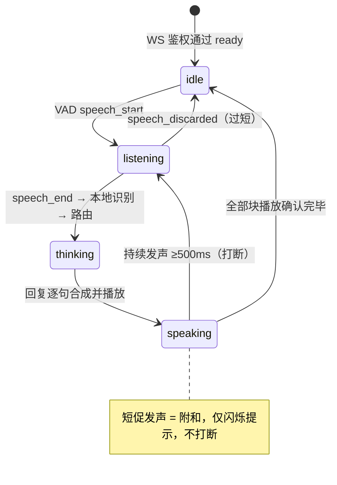
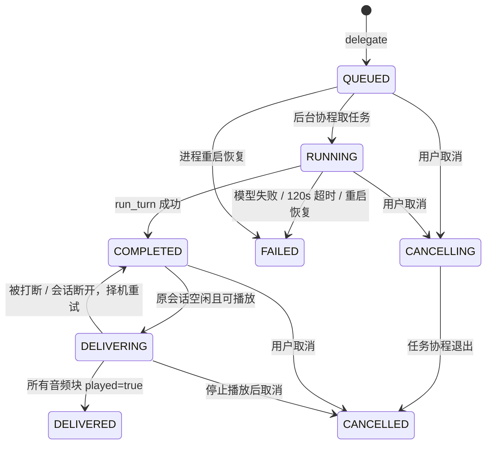
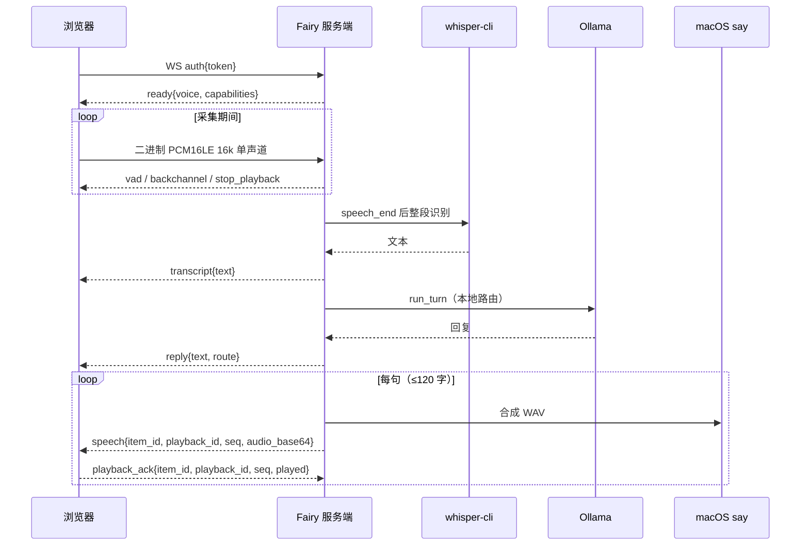

# 全双工语音与对比进化（2026-11-22）

本次迭代学习两个开源项目并把它们的优点落进 Fairy 后端与前端：

- [inclusionAI/Realtime-Venus](https://github.com/inclusionAI/Realtime-Venus)（Apache 2.0）：全双工语音交互的运行时语义。
- [google-research/harness2](https://github.com/google-research/harness2)（Apache 2.0）：无标准答案条件下，用行为对比驱动提案与经验沉淀。

两者都只借鉴设计思想，未复制代码；Fairy 的实现全部落在本地模型与本地设备上。

## 一、从 Venus 借鉴了什么

Venus 的核心不是"边听边说"的口号，而是三条可验证的运行时规则：

1. **完成不等于送达（completion ≠ delivery）。** 后台任务算出答案只是 COMPLETED；只有答案真正播放给用户、并收到逐块播放确认后，才算 DELIVERED。Fairy 的后台委派完整实现了这条语义。
2. **打断与附和要区分。** 用户说话不一定是打断：短促的"嗯""对"是附和（backchannel），应该忽略并继续播放；持续发声才是真正的插话（barge-in），应立即停止播放并转入聆听。Fairy 用能量 VAD 的持续时长做区分。
3. **后台任务有完整生命周期。** QUEUED → RUNNING → COMPLETED → DELIVERING → DELIVERED，外加 FAILED 与 CANCELLING → CANCELLED；进程重启后状态可恢复，不会出现"永远在跑"的僵尸任务。

### 会话状态机

### 后台任务生命周期

关键实现事实（`server/fairy/duplex.py`）：

- **送达条件**：原会话在线、状态 idle、无正在播放的音频、播放锁空闲、无进行中的语音输入。原会话在线时，任一条件不满足就等待，0.5s 轮询。原会话离线后，可由同一所有者的空闲会话接收，以保留重连恢复。
- **逐块确认**：每个音频块带 `item_id + playback_id + seq`，重试沿用任务 ID 并生成新的播报 ID，客户端播放完（或被停止）回 `playback_ack{played}`；服务端每块等待一个确认（180s 上限）。`played=false` 的块记为 stopped，整条任务回到 COMPLETED 等待下次送达。
- **重启恢复**：`create_app` 时 DELIVERING → COMPLETED（答案还在，重新送达）；QUEUED/RUNNING/CANCELLING → FAILED（error=process_restarted）。
- **重连认领**：新 WS 连接建立时 `adopt_completed` 认领属于该会话的 COMPLETED 任务，答案不会因为刷新页面而丢失。
- **取消**：终态任务取消返回 409；DELIVERING 先停播放；活任务转 CANCELLING 并 cancel 协程。
- **繁忙保护**：委派执行遇到 409 scope_has_pending_turn 时每秒重试，120s 后 FAILED(busy_timeout)，不会挤占用户正在进行的对话。

### 打断与附和的判定

能量 VAD（20ms 帧）：连续 2 帧有声判定开始，连续 30 帧无声判定结束。

- speaking 状态下持续发声 **≥500ms** → 发 `stop_playback`，客户端立即停播并回 ack(played=false)，会话转 listening。
- 短促发声（<500ms 即结束）→ 发 `backchannel{duration_ms}`，客户端光环闪烁 600ms 示意"听到了"，播放继续。
- 阈值是能量法的工程折中，后续可换神经 VAD（如 Silero）而协议不变。

### 语音链路（全本地）

- 识别：whisper-cli + ggml-small，`speech_end` 后整段识别（非流式增量，见"边界"）。
- 合成：macOS `say`（Tingting），22050Hz WAV base64 下发；超过 600 字的回复截断，句子按 ≤120 字切分、<8 字合并。
- 音频不落盘（`audio_persisted=false`），不经过云端（`cloud_used=false`）。
- 浏览器采集：getUserMedia（回声消除/降噪/自动增益）→ ScriptProcessor 降采样到 16k Int16 → WS 二进制帧。服务端中转，无需 TURN/媒体服务器。

### WS 协议（/v2/duplex/ws）

连接后 5 秒内必须发 `auth{token}`（所有者 token 或已配对设备 token，constant-time 比较），否则 4401 关闭；Origin 不在本机白名单（127.0.0.1/localhost/::1，`FAIRY_ALLOW_LAN=1` 可放开）返回 4403。

客户端 → 服务端：

| 消息 | 说明 |
| --- | --- |
| `auth{token}` | 鉴权，5s 限时 |
| 二进制帧 | PCM16LE 16kHz 单声道，单帧 ≤65536 字节 |
| `text{text}` | 文字输入（≤16000 字），与语音同路由 |
| `interrupt` | 手动打断 |
| `delegate{text}` | 后台委派，立即返回 work 视图 |
| `playback_ack{item_id,playback_id,seq,played}` | 逐块播放确认，played 必须为布尔值，旧客户端可省略 playback_id |
| `ping` | 心跳，回 pong |

服务端 → 客户端：

| 消息 | 说明 |
| --- | --- |
| `ready{session_id,state,voice,capabilities}` | 鉴权成功 |
| `state{state}` | idle/listening/thinking/speaking |
| `vad{event,duration_ms}` | speech_start / speech_end / speech_discarded |
| `transcript{text}` | 识别结果 |
| `reply{text,turn_id,route}` | 模型回复与路由 |
| `speech{item_id,playback_id,kind,seq,total,text,audio_base64,sample_rate,final}` | 音频块；kind=reply\|work；TTS 失败时 audio_base64=null |
| `stop_playback{item_id,playback_id}` | 打断，立即停播 |
| `backchannel{duration_ms}` | 附和提示 |
| `work{work}` | 任务状态变更推送 |
| `error / asr_error{detail}` | 错误 |

REST 配套：`GET /v2/duplex/status`、`GET /v2/duplex/works`、`POST /v2/duplex/works/{id}/cancel`。能力清单新增 `full_duplex_voice`、`duplex_delegation`、`duplex_barge_in`。WS 端点不出现在 OpenAPI 契约中（协议见上表）。

## 二、从 Harness² 借鉴了什么

Harness² 的 Propose–Probe–Compose 不依赖标准答案，而是比较候选之间的**行为差异**，并把差异沉淀为可追溯的经验。Fairy 的隔离进化实验据此增强（`server/fairy/evolution.py`）：

1. **Probe → 行为对比（contrasts）。** 每个候选相对基准，按固定用例分出四类：`gained`（新增通过）、`regressed`（回退）、`both_pass`、`both_fail`，记录的是用例输入原文而非下标，证据可直接阅读。
2. **Compose → 组合建议。** 当 ≥2 个候选的新增通过用例互不重叠、且各自都没有回退时，逐例按用例位置比较，允许同一输入用于不同验收条件。在符合条件的组合中，优先选择覆盖新增通过用例最多的一组，给出 `compose_suggestion{candidates, case_sources, rationale=disjoint_gains_no_regressions}`。这只是建议，组合后仍需重新评测，不自动合并。
3. **经验账本（lessons）。** 登记发布写入 adoption 经验（得分变化 + 新增/回退例数 + 用例原文证据）；回退写入 caution 经验（提醒后续提案先复核失败样例）。每条经验带 experiment_id 与证据，持久入库；新实验自动携带最近 5 条经验（prior_lessons）作为上下文。
4. **权重不可变。** 评分器固定（scoring_immutable=true），候选不能修改评分；实验通过也不改变运行版本（runtime_changed=false），发布仅是账本登记，回退可恢复上一条发布。

### 前端呈现

- **全双工对话页（apps/web/duplex.js）**：中央光环按状态变化——idle 慢呼吸、listening 双环涟漪、thinking 轨道旋转、speaking 声纹条跳动；附和时环闪 600ms。对话记录区分用户/助手/后台任务结果并标注路由；后台任务面板 newest-first，QUEUED/RUNNING/COMPLETED/DELIVERING 可取消，状态标签直接展示"完成≠送达"的中间态。动效遵循 fairy-ui-design 技能：蓝白色系、transform/opacity 动画、prefers-reduced-motion 静态降级、暗色模式适配。
- **自主与进化页（apps/web/p5.js）**：每个实验卡片用标签展示各候选"新增通过 N / 回退 M"（回退用警示色），组合建议展示候选与各自贡献例数；新增"经验账本"面板，采纳/警示标签 + 经验文本 + 证据计数。

## 三、测试与验收

- `tests/test_duplex.py`：VAD  onset/offset、附和与打断分流、逐块 ack 与 stopped、委派全生命周期（含 busy 重试、超时、取消、重启恢复、重连认领）、WS 鉴权/Origin/超大帧、text 输入路由。全部使用 fake_voice，不依赖真实 TTS。
- 进化测试覆盖 contrasts 四类划分、compose 触发条件（重叠增益/有回退时不建议）、lessons 写入与 prior_lessons 注入。
- 全量回归：`FAIRY_TEST_POSTGRES_URL=… .venv/bin/python -m pytest tests -x -q`（PostgreSQL，无 SQLite）。
- Live 验收：`node scripts/acceptance_duplex.mjs`（真实 whisper-cli 识别 + say 合成 + Ollama qwen3:4b 回复，WebSocket 直连本机服务），2026-11-22 实测 41.07s 全部通过，报告存于 `docs/implementation/duplex-acceptance.json`：
  - 语音轮：识别「你好,我喜歡喝溫水。」，本地路由 answered（cloud_used=false），4 个 TTS 分块全部收到播放回执；
  - 打断：播报中持续说话触发 `stop_playback`，打断语句被正确识别「等一下,我想打断你,先别说了。」；
  - 附和：800ms 短促声音被忽略（backchannel），15 个分块完整播完，未误停；
  - 委派：工作经 QUEUED→RUNNING→DELIVERING→DELIVERED，结果语音逐块回执，回复正确引用记忆「根据最近的对话，你提到喜欢喝温水，所以今天适合喝温水。」（用户视角，无人称错位）；
  - 取消：进行中工作取消后状态 CANCELLED。
- 依赖修正：uvicorn 处理 WS 升级需要 `websockets` 库（TestClient 不需要，故单测未暴露）；已在 `pyproject.toml` 增加 `websockets>=13,<16`，并同步安装到服务运行时 venv（该 venv 是仓库 venv 的副本，须用其 `python -m pip` 安装）。

- 设备撤销后，已连接的语音 WebSocket 会在下一次状态检查时关闭（每秒检查一次）。
- 用户主动打断回复后，会话释放播放状态，已完成的后台任务可继续播报。

## 四、边界与后续

- VAD 是能量法，嘈杂环境下可能误判；协议已预留替换神经 VAD 的空间。
- 识别是 speech_end 后整段进行，没有流式增量字幕；`transcript` 在识别完成后一次性下发。
- TTS 依赖 macOS say，仅本机可用；Linux 部署需接本地 TTS 引擎，接口不变。
- 云端 ASR/TTS/副模型路由保持预留配置，当前全链路本地。
- 委派执行复用 run_turn 的串行锁，同一 scope 同时只跑一个回合，这是有意的保守设计。
