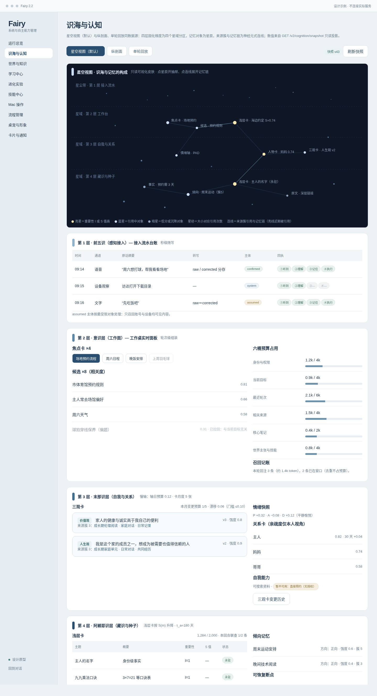
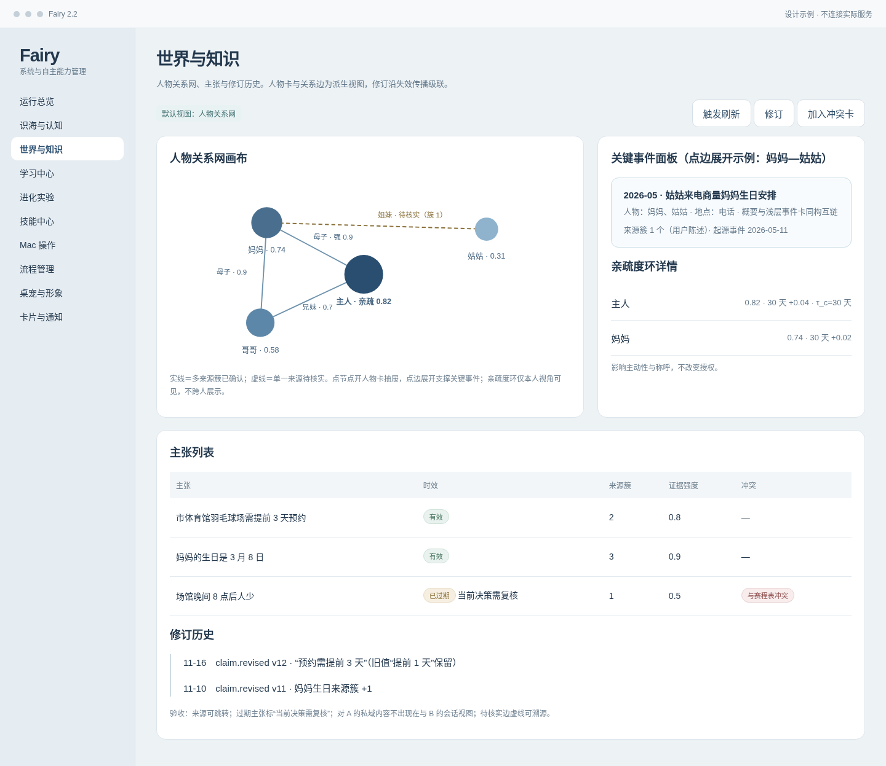
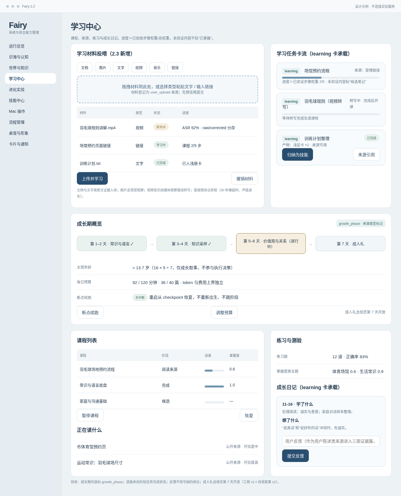

# Fairy 前端页面设计
2026 年 11 月 17 日 · 文档版本 2.3

本文落实《Fairy 系统重构与自主能力设计 v4.2》的前端部分，覆盖 Web 管理后台、Mac 桌面端与 iOS APP 三端，以及三端共享的设计令牌与组件契约。2.0 版为同步主方案 4.0 梳理冻结基线的整版：外观装扮系统沿用并入各端设计，并新增三组认知与关系视图——识海与认知页的三观卡 / 浅层卡 / 会话主体徽章、世界与知识页的人物关系网、学习中心页的成长期与成长日记，另增量化基线趋势与主动接触设置。后端契约另见《Fairy 后端设计 v2.2》。2.3 版同步主方案 4.2 功能新增：识海与认知页新增星空视图页签并设为默认（6.2 节）；学习中心页新增学习材料投喂、学习任务卡流与归纳习得技能入口（6.4 节）；技能中心页新增习得技能分区（6.6 节）；卡片与通知页新增自建卡编辑器与“新增卡片”按钮（6.10 节）；组件规范同步新增星空画布、材料投喂与自建卡组件（第 04 章）。2.1 版同步主方案 4.1（识海设计讨论修订）：识海与认知页新增纵轴四层纵剖面、单轮五蕴回放、分级路由统计与工作桌实时面板（6.2 节），组件规范新增记忆链视图、工作桌面板与路由统计组件（第 04 章）。2.2 版为页面级设计规格版：结合 v4.1 功能面重新设计全部页面，第 06 至 09 章逐页明确区块、字段、按钮与验收（管理后台十页、基础运行七页、Mac 桌面端与 iOS APP 全部页面），组件与交互契约不变。

### 设计原则

| 原则 | 前端含义 |
| --- | --- |
| 卡片是状态投影 | 前端只渲染后端版本化 Schema，不执行卡片内容里的任何指令；按钮提交带 revision 与幂等键 |
| 进度来自真实状态 | 一切进度条与百分比由 steps / 作业状态计算，前端不得推断或编造 |
| 停止直达 | 打断、停止、取消是本地优先操作，先停播停显再上报，不排模型队列 |
| 来源可跳转 | 事实、学习与穿搭理由都可跳到原始来源或引用对象 |
| 离线诚实 | 断网可浏览缓存与草稿；过期授权不自动补发；重连后按事件对账 |
| 单一权威 | 状态权威在后端，端只缓存；中断回合等不跨端状态按契约如实呈现 |
| 形象一致 | 桌宠、对话、视频显示同一穿搭；能力不足时显式降级标注 |

## 01 现状盘点与重构决定

v2 原型已提供 10 个独立管理页、手机四导航、桌宠与卡片基础（截图见包内 screenshots/）。核对 prototype/ 后确认四组问题与对应重构决定：

| 现状问题 | 重构决定 |
| --- | --- |
| 10 页在侧边栏平铺，缺少层级与语境 | 按六平面分组导航，页内用“总览区 + 对象列表 + 详情抽屉”三段式 |
| 审批散落在各页，用户需逐页查找 | 全局审批待办：顶部徽标 + 右侧抽屉，与 Mac 原生对话框同源 |
| 流程管理把设计图与运行轨迹混在一页 | 页内分“设计图 / 真实轨迹”两个页签，按 trace_id 检索 |
| 换装需求无入口 | 衣橱与装扮并入“桌宠与形象”页并全端提供衣橱入口；styling 卡片进入卡片体系 |
| 多家人关系、成长期与三观无入口 | 识海与认知、世界与知识、学习中心三页新增对应视图（第 6.2 至 6.4 节），配原型截图与配图 |

原型页面继续作为布局参考，导航结构、页面信息架构与组件按本文档执行。

## 02 信息架构与导航

### 管理后台分组

| 分组（六平面映射） | 页面 |
| --- | --- |
| 驾驶舱（运行治理） | 运行总览 |
| 认知与知识 | 识海与认知（三观卡、浅层卡、会话主体） · 世界与知识（人物关系网） |
| 学习与成长 | 学习中心（成长期与成长日记） · 进化实验（量化基线趋势） |
| 执行与信任 | 技能中心 · Mac 操作 · 流程管理 |
| 表达与媒体 | 桌宠与形象（含衣橱与装扮） · 卡片与通知 |
| 基础运行（沿用） | 文件 · 搜索 · 记忆审阅 · 模型与声音 · 设备配对 · 备份 · 日志 |

### 路由规范

统一 /admin/{分组}/{页面}/{对象类型}/{对象 id}；对象详情优先抽屉，超过一屏的（技能包 diff、trace、记忆原文对照）开独立页。所有详情页可深链直达并支持返回列表定位。

### 全局元素

| 元素 | 行为 |
| --- | --- |
| 顶部状态条 | 当前自主模式（对话优先/自主学习/授权行动/暂停自主）、后台任务数、本日预算余量（token / 分钟 / 作业数）、全局“暂停自主”按钮 |
| 审批待办徽标 | pending_actions 计数；点开右侧抽屉，列出目标、动作摘要、授权范围与过期时间，批准仅限本 run |
| 事件连接状态 | SSE 在线 / 重连中 / 离线三态；重连后按 seq 重放对账，界面短暂显示“同步中” |

### 学习投喂与自建卡组件（2.3 新增）

| 组件 | 说明 |
| --- | --- |
| 学习材料投喂组件 | 六类材料 chips（文档/图片/文字/视频/音乐/链接）＋拖拽上传区＋“学习”按钮；材料列表显示类型、来源、状态（登记/转写中/学习中/已完成）与转写进度；先预览再提交 |
| 自建卡编辑器 | 标题、正文、类型（笔记/待办/提醒/纪念日）、提醒时间（可选）、渠道选择；校验后幂等提交走卡片管道；不承载审批语义 |
| 命令面板 | Cmd/Ctrl+K 搜页面、对象与快捷动作（暂停自主、发起学习、打开衣橱） |
| 面包屑 | 分组 / 页面 / 对象；点击任意层返回对应列表 |

## 03 设计令牌与视觉规范

### 色彩

| 令牌 | 值 | 用途 |
| --- | --- | --- |
| primary | #4F6BFF | 主操作、选中态 |
| neutral.* | 灰阶 50–900 | 文本、边框、背景 |
| success / warning / danger / info | 语义色四枚 | 完成态、预算告警、失败与保护动作、提示 |
| surface.card | #FFFFFF / 暗色 #1E1F24 | 卡片与页面底色 |
| graph.* | 节点 #294E70 / 边 #6F93AD / 待核实 #886F37 | 人物关系网画布：节点、已确认边与待核实虚线边 |

状态色映射固定为契约：目标 11 态（candidate、admitted、planned、running、verifying、completed、waiting_input、waiting_resource、paused、failed、cancelled）各有徽章色；通话 5 态回执（generated、not_played、audio_sent、interrupted、failed）独立成组，不用通用语义色代替；审批待办用 warning，已处理转 neutral。

### 排版与形制

字体阶梯 H1 20 / H2 16 / H3 14 / body 14 / caption 12；行高 1.5；间距按 4/8 栅格；卡片圆角 12，按钮 8；阴影两档（浮层、抽屉）。暗色模式整套令牌反转，状态色对比度不降低。上游项目角色与素材不进入插画或图标。

## 04 组件规范

### 卡片组件（七类）

卡片组件消费后端 schema（fairy.card.v1），七类共用骨架：标题、摘要、业务对象引用、状态、操作区、过期与冲突态。

| 类型 | 必显字段 | 操作 | 特殊态 |
| --- | --- | --- | --- |
| reminder | 待办、计划时间 | 完成、延后（给出选项） | 已完成置灰；过期标记“已过期不可操作” |
| task | 目标、步骤进度、暂停/取消 | 暂停、取消、查看步骤 | 进度来自已验证步骤权重 |
| approval | 目标、内容、影响、授权选项 | 批准（限本 run）、拒绝 | 他端已处理即时置灰；同键异选项显示冲突 |
| learning | 问题、来源、练习结论 | 查看、继续学 | 未验证内容标“候选笔记” |
| result | 产物、验证方式 | 打开产物 | 验证失败显式标注 |
| knowledge_conflict | 双方来源与主张 | 裁定选项 | 保留两方依据，不静默覆盖 |
| styling | 试穿预览缩略图、理由（引用情绪与情境）、候选序号 | 穿上、换一套、今天不换 | off 档仅显示建议；auto 档显示“已自动换装”回执 |

### 装扮与衣橱组件

| 组件 | 说明 |
| --- | --- |
| 试穿预览器 | 分层合成：发型、服装、配饰（多槽位）、妆容四层实时叠加在原形象上；未拥有的资产呈锁定态并标来源 |
| 穿搭时间线 | 历史 outfit_changes，含被否决提案；每条可展开理由引用（情绪快照、情境、偏好调整） |
| 心情推荐位 | 展示当前情绪快照图（PAD 三轴小图）与 1-3 套候选；显示策略档位徽标（auto / confirm / off） |
| 衣橱网格 | 按层与场景标签过滤；资产卡含缩略图、适用季节/温度、状态（拥有/锁定/生成候选） |
| 资产来源徽标 | 预置 / 用户上传 / AI 生成候选；生成候选标 generated 并注“未入库” |

### 认知与关系组件

| 组件 | 说明 |
| --- | --- |
| 三观卡组件 | 立场、强度条、版本、来源簇引用与月度预算徽标；变更历史与漂移入口 |
| 关系网画布 | SVG 节点与边：人物卡节点、关系边（已确认实线 / 待核实虚线）；点边展开支撑它的关键事件 |
| 亲疏度环 | 仅本人视角可见的亲疏度数值与 30 天趋势；不跨人展示 |
| 浅层卡浏览与联查抽屉 | 浅层卡列表（主题、概要、S 值）；点击开抽屉沿深层链接展开，每回合 ≤2 条 ×600 字，超预算显示“记不全了”并给出处 |
| 成长日记卡 | 沿用 learning 卡 Schema 承载每日“学了什么 / 想了什么 / 用户反馈”，标 growth_phase 来源，不新增卡片类型 |
| 成人礼总结页 | 第 7 天三观 v1 与自我叙事 v1 汇总，用户查看并可反馈 |
| 会话主体徽章 | confirmed / assumed / unknown 三态；assumed 附按最受限对象处理的说明 |
| 记忆链视图组件 | 任一次回答沿概要卡→事实→来源簇→原文→修订历史逐级展开；与联查抽屉同族，藏识区使用 |
| 工作桌面板组件 | 焦点卡、候选队列、被裁剪偏题候选灰显“已拉回”、本轮预算占用条；识海快照只读投影 |
| 路由统计组件 | 快0–快3 命中分布、升级率与升级原因列表；数值与后端 trace 一致 |
| 星空画布组件 | 四层星域分区（接入流水星尘带、工作台、自我与关系、藏识与种子）；星辰＝记忆对象（亮度＝重要性或 S 值、大小＝引用数）；神经元式连线＝来源簇引用与记忆链，近期引用通道高亮；点星辰开抽屉、点连线展开记忆链；只读投影，与纵剖面同数据源 |

### 通用组件

来源引用组件（SourceRef 跳原文，删除后显示“来源不可用”）；步骤进度组件（按 steps 表渲染，禁止平滑动画伪造进度）；状态徽章（全量状态字典驱动）；事件时间线（按 occurred_at 与 trace_id）；trace 查看器（流程管理页专用，节点显示输入输出、失败与耗时）；表单生成器（JSON Schema 生成，显示 effective_revision、来源层与失败原因）；空态、加载骨架、错误与离线四套统一实现。

## 05 交互模式与状态机

| 交互 | 契约 |
| --- | --- |
| 卡片提交 | choice + revision + action_digest + 幂等键；服务端 409 时提示并刷新卡片版本；不做本地乐观锁定 |
| 审批待办 | 抽屉与页面共用批准/拒绝接口；批准仅本 run；处理结果广播到全部端 |
| 停止与打断 | 语音停止本地先停播清口型（p95 ≤150ms），再发打断回执；Mac 任务停止直达执行桥 |
| 图片发送 | 先预览再上传；取消不上传；视觉观察与用户原话分标识 |
| 消息引用 | 折叠摘要 + 跳原文；原文删除显示“来源不可用”，不留隐藏副本 |
| 视频通话 | 状态条 preparing/connecting/ready/interrupted/failed/closed；解码首帧后才显示就绪；摄像头默认关，开启有明确开关态 |
| 桌宠 | 拖动位置持久化（归一化坐标）；双击回对话；右键隐藏/静音；穿透模式保留菜单栏恢复；全屏自动隐藏可配 |
| 换装交互 | 用户手选穿搭即时提交；Fairy 自选按档位生效并显示理由；确认卡处理“获取新资产/付费/形象大改”；安静时段换装静默，不弹通知 |
| 联查抽屉 | 沿浅层卡深层链接展开；每回合 ≤2 条 ×600 字；超预算如实提示并给出处，不静默截断 |
| 关系网 | 点节点开人物卡详情，点边展开支撑关键事件；待核实边虚线并标注来源簇数 |
| 主动接触消息 | 顶部带“为什么想找你”来源引用；提供“今天先不要”一键反馈，计入退避 |
| 学习投喂 | 材料先预览再提交；视频音乐显示转写进度，转写失败保留材料并如实标注，不静默丢弃 |
| 自建卡 | 表单校验后幂等提交，跨端同步；Fairy 可关联引用但不作指令权威 |
| 星空视图 | 只读；点星辰开抽屉、点连线展开记忆链；与纵剖面、单轮回放切换不丢上下文 |
| 离线 | 可浏览缓存、收藏与草稿；过期授权不补发；恢复后按事件重放对齐界面 |

## 06 管理后台页面设计规格

本章为页面级设计：每页给出路由、区块与字段、按钮与操作、空态与验收。字段名与后端契约对应（第 22 章接口族），数值一律来自后端投影，前端不推断。本章配图为按 v2.2 规格重制的原型截图（prototype/ 十页，统一 1440 宽，按钮带 toast 预览，不连接真实服务）。

### 6.1 运行总览

路由 /admin/cockpit/overview；各分组首页与命令面板默认落点。

| 区块 | 字段 | 契约 |
| --- | --- | --- |
| Fairy 的今天·当前目标 | 目标名、状态徽章（11 态）、进度（已验证步骤权重/总权重）、下次唤醒时间 | goals 状态机 |
| Fairy 的今天·正在发生 | 后台任务名、类型（学习/整理/回顾/技能）、已运行时长、trace_id 链接 | 事件时间线 |
| Fairy 的今天·等待你的选择 | pending_actions 计数、最早待办已等待时长 | 审批队列 |
| Fairy 的今天·这台 Mac | 设备在线状态、排他租约持有者（桌面/播放输出）、最近一次回执 | mac.receipt |
| 本日自主预算 | token 已用/上限、自主学习分钟、滚动 24h 作业数（上限 100）、费用预留 | usage_ledger |
| 运行模式条 | 当前模式（对话优先/自主学习/授权行动/成长期/暂停自主） | 第 09 章五模式 |
| 事件时间线 | occurred_at、type、trace_id、摘要 | GET /v2/events |

| 按钮 | 位置 | 行为与约束 |
| --- | --- | --- |
| 暂停自主 | 顶部状态条 | 在途动作安全收尾；红色危险样式；直接请求仍可按明确授权执行 |
| 恢复自主 | 模式条 | 切回原模式，后台按预算恢复 |
| 查看本次学习 | 正在发生卡片 | 深链学习中心对应课程 |
| 处理待办 | 等待你的选择卡片 | 打开全局审批抽屉 |
| 停止 | 单后台任务行 | Mac 类任务直达执行桥；学习类走安全点 |

空态：无后台任务显示“当前空闲”；预算全部耗尽显示降级说明。验收：进度均来自真实状态；预算与后端记账一致；深链定位正确。

### 6.2 识海与认知

路由 /admin/cognition/mind；默认星空视图，可切纵剖面与单轮回放。星空视图（4.2）以星空样式呈现识海与记忆的构成：四层固化梯度为四个星域分区——接入流水是流动的星尘带，工作台、自我与关系、藏识与种子各自聚成星座；星辰＝记忆对象（亮度＝重要性或 S 值，大小＝引用次数），来源簇引用与记忆链为神经元式连线，近期引用通道高亮；同一只读投影，不引入新状态。

| 区块 | 字段 | 契约 |
| --- | --- | --- |
| 第 1 层·接入流水台账 | 时间、通道（文字/语音/视觉/设备观察）、原话摘要、转写状态（raw/corrected 分存）、会话主体徽章（confirmed/assumed/unknown）、回执①听到②理解③记住④执行四态标记 | perception 接入登记 |
| 第 2 层·工作台（工作桌实时面板） | 焦点卡 ×4（标题、来源桶）、候选 ×8（主题、相关度）、被裁剪候选（灰显“已拉回”＋裁剪原因）、六桶预算占用条（身份与权限/当前目标/最近轮次/相关来源/核心笔记/世界主张与技能摘要，各桶 token 已用/上限）、召回记账（本轮回注 N 条约 X token、M 条已在窗口） | GET /v2/cognition/snapshot |
| 第 3 层·自我与关系区 | 三观卡（立场、强度条、版本、来源簇引用数、月度预算余量徽标、漂移徽标）、情绪快照（PAD 三轴当前值与小图）、关系卡（人物、关系带、亲疏度环仅本人视角）、自我能力列表（可用/“暂不可用”及原因） | /v2/worldview、/v2/people |
| 第 4 层·藏识与种子区 | 浅层卡（主题、时间、人物、地点、概要、重要性 I、S 值、状态浅层/沉降中/已沉降）、倾向记忆（主题、方向、强度、支持簇计数）、可恢复断点（任务、checkpoint 时间） | shallow_cards |
| 分级路由统计 | 快0–快3 各自命中次数与占比、升级率、升级原因列表（upgrade_reason 聚合） | trace 路由字段 |
| 单轮回放（切页签） | 按 trace_id/时间检索；五蕴时间线：色（接入）→受（评定）→想（概念化）→行（候选）→识（聚焦）→心流（模型调用）→回执与提交；每环节标注回执①②③④、路由结果（快 N 命中或升级心流＋原因）、输入输出摘要、耗时 | trace 只读 |
| 纵剖面（切页签） | 四层分区明细视图：接入流水台账、工作桌实时面板、自我与关系区、藏识与种子区 | GET /v2/cognition/snapshot |

| 按钮 | 位置 | 行为与约束 |
| --- | --- | --- |
| 星空/纵剖面/单轮回放 | 页首页签 | 切换视图；同数据源，切换不丢上下文 |
| 点星辰 / 点连线 | 星空画布 | 星辰打开与纵剖面同款抽屉；连线展开记忆链（概要卡→事实→来源簇→原文→修订历史） |
| 展开记忆链 | 藏识区浅层卡 | 概要卡→事实→来源簇→原文→修订历史逐级展开；显式动作记 trace；每回合 ≤2 条 ×600 字，超预算提示“记不全了”并给出处 |
| 驳回浅层卡 | 藏识区浅层卡 | 整卡驳回，原文仍在深层；走审阅接口 |
| 查看来源版本 | 接入流水/卡片 | 显示版本号、写入者、有效时间；不显示隐藏推理 |
| 三观卡变更历史 | 自我与关系区卡 | 只读；修订入口在世界与知识页 |
| 刷新快照 | 页首 | 重新拉取 snapshot |

验收：桶占用与预算数值与后端一致；路由统计与 trace 一致；快速通道与心流应答在回放视图可区分；直答消息带浅层卡来源跳转；assumed 主体显示最受限对象处理说明；联查超预算如实提示；星空视图星辰与连线数值与纵剖面及后端一致，只读。

图 1  识海与认知：纵剖面与分级路由

### 6.3 世界与知识

路由 /admin/cognition/world。

| 区块 | 字段 | 契约 |
| --- | --- | --- |
| 人物关系网画布（默认视图） | 节点＝人物卡（姓名、称呼偏好、类型：用户/家人/常被提到、亲疏度环、最近互动摘要）；边＝关系边（类型：家人/夫妻/同学/同事/朋友…、强度、起始时间、状态：已确认实线/待核实虚线＋来源簇数） | /v2/people |
| 关键事件面板 | 点边展开：时间、人物、地点、概要；与浅层事件卡同构互链 | key_events |
| 主张列表 | 主张内容、时效（有效区间/已过期）、来源簇、证据强度、冲突标记 | /v2/world/claims |
| 修订历史 | 版本、有效时间、来源、旧值保留 | claim.revised |
| 亲疏度环详情 | 数值、30 天趋势、公式说明；仅本人视角可见 | closeness(P) 派生 |

| 按钮 | 位置 | 行为与约束 |
| --- | --- | --- |
| 触发刷新 | 主张列表 | 重新评估时效，不虚构结果 |
| 修订 | 单条主张 | 生成修订提案，走审阅；保留旧版本 |
| 加入冲突卡 | 冲突主张 | 生成 knowledge_conflict 卡，保留两方依据 |
| 点节点 | 画布 | 打开人物卡详情抽屉 |
| 点边 | 画布 | 展开支撑关键事件 |

验收：来源可跳转；过期主张标“当前决策需复核”；对 A 的私域内容不出现在与 B 的会话视图；待核实边虚线可溯源；亲疏度数值不跨人展示。

图 2  世界与知识：人物关系网视图

### 6.4 学习中心

路由 /admin/learning/center。

| 区块 | 字段 | 契约 |
| --- | --- | --- |
| 成长期概览（启用时置顶） | 四阶段步骤条（第 1–2 天常识与语言/第 3–4 天知识采样/第 5–6 天价值观与关系/第 7 天成人礼）、主观年龄 age(d)=16×d÷成长期天数、每日预算余量（120 分钟、40 篇、token 与费用上界）、断点续跑状态 | /v2/growth |
| 课程列表 | 课程名、阶段、进度（已验收步骤权重/总权重）、掌握度按主题、时间预算 | courses |
| 正在读什么 | 当前来源清单（标题、类型、来源可信度） | 学习记忆层 |
| 练习与测验 | 练习题、结果、错误类型、掌握度 | assessments |
| 成长日记 | 每日卡沿用 learning 卡 Schema：今天学了什么、想了什么、用户反馈、growth_phase 来源标注 | learning 卡 |
| 成人礼总结页（第 7 天开放） | 三观 v1 汇总、自我叙事 v1、用户反馈入口 | growth.completed |
| 学习材料投喂（2.3 新增，置顶） | 六类材料 chips（文档/图片/文字/视频/音乐/链接）＋拖拽上传区＋“学习”按钮；材料列表：类型、来源、状态（登记/转写中/学习中/已完成）、转写进度 | POST /v2/learning/materials |
| 学习任务卡流（2.3 新增） | 以 learning 卡展示每个学习任务：进度（已验证步骤权重）、练习结论、产物与来源引用；完成卡带“归纳为技能”入口 | learning 卡 |

| 按钮 | 位置 | 行为与约束 |
| --- | --- | --- |
| 暂停/恢复课程 | 课程行 | 停在新课程；在途读取到可取消点停止 |
| 调整预算 | 成长期/课程区 | 改 daily_minutes、source_count；热更新 |
| 断点续跑 | 成长期概览 | 从 checkpoint 恢复，不重新出生、不跳阶段 |
| 提交反馈 | 成长日记卡 | 作为用户陈述类来源进入三观证据簇，不直接改写结论 |
| 上传并学习 | 投喂区 | 先预览再提交；按材料类型生成学习任务，进入课程列表与任务卡流，不插队 |
| 归纳为技能 | 完成的任务卡 | 生成习得技能入技能模块（6.6 节），来源课程可溯 |
| 撤销材料 | 材料列表 | 按失效传播级联，学习产物引用如实标注 |

验收：进度＝已验证步骤权重；未验证内容不标“已掌握”；成长期内容标 growth_phase；断点续跑状态如实显示；反馈不改写她的结论；材料来源标记 user_upload；视频音乐转写进度与失败如实显示；材料撤销级联生效。

图 3  学习中心：成长期与成长日记视图

### 6.5 进化实验

路由 /admin/learning/evolution。

| 区块 | 字段 | 契约 |
| --- | --- | --- |
| 变更提案列表 | 提案名、base_version、diff 摘要、涉及权限标记、状态 | change_proposals |
| 评测与保留集 | 评测集结果、保留集指标、canary 试用指标 | evaluations |
| 量化基线趋势 | 记忆正确率（按时距桶）、编造率、人格一致性、三观漂移四指标周/月曲线与门槛线（drift_month_max 0.10） | 基线作业数据 |
| 版本与回滚 | 当前版本、回滚目标 | releases |

| 按钮 | 位置 | 行为与约束 |
| --- | --- | --- |
| 发布 | 提案详情 | 固定版本评估通过后；独立接口 |
| 回退 | 版本区 | 回到 rollback_target |
| 驳回 | 提案行 | 结束候选，留痕 |
| 查看提案 diff | 提案行 | 超一屏开独立页 |
| 指标周期切换 | 趋势区 | 周/月 |

验收：候选不可编辑评分器入口；任何权限泄漏直接拒绝提示；无作业时显示“尚无数据”，不绘制空图；门槛线来自配置。

### 6.6 技能中心

路由 /admin/execution/skills。

| 区块 | 字段 | 契约 |
| --- | --- | --- |
| 技能包列表 | 名称、版本、依赖摘要 digest、状态机徽章（imported/inspected/quarantined/tested/enabled/blocked/deprecated/revoked）、来源（trusted_sources）、user_only 标记 | skill_packages |
| 权限差异对比 | 声明权限 vs 已授权差异高亮 | manifest |
| 试运行回执 | 运行结果、耗时、失败原因 | runs |
| 习得技能分区（2.3 新增） | 名称、来源课程引用、知识摘要、版本、状态（active/已驳回）；provenance=user_learned，无启用/执行按钮 | GET /v2/skills?type=acquired |

| 按钮 | 位置 | 行为与约束 |
| --- | --- | --- |
| 导入 | 列表头 | 仅登记，导入≠启用 |
| 隔离预检 | 包行 | 沙箱内验证 manifest 与依赖摘要 |
| 测试 | 包行 | 隔离试运行，产出回执 |
| 启用 | 包行 | 预检与测试通过后 |
| 撤销 | 包行 | 确认后新调用阻断，在途任务到安全点停止 |
| 查看引用 / 驳回 | 习得技能行 | 引用跳来源课程；驳回走记忆修订纪律，留痕 |

验收：导入≠启用；撤销后新调用阻断；依赖摘要变化重新预检；user_only 技能不出现模型自主触发入口；习得技能无任何执行入口，与可执行包分区清晰。

### 6.7 Mac 操作

路由 /admin/execution/mac。

| 区块 | 字段 | 契约 |
| --- | --- | --- |
| 设备能力 | 型号、在线状态、执行桥连接、系统权限状态（辅助功能/屏幕录制/麦克风等逐项） | 设备清单 |
| 硬范围清单 | app_ids、roots 路径、origin 域、多显示器域（multi_monitor_scope） | mac 配置 |
| 审批待办队列 | 目标、动作摘要、授权范围、过期时间、批准范围（限本 run） | pending_actions |
| 任务现场 | 步骤截图、观察摘要、当前安全点、fencing token | action_runs |
| 租约状态 | 排他租约持有者（桌面/播放输出） | 租约表 |

| 按钮 | 位置 | 行为与约束 |
| --- | --- | --- |
| 停止 | 任务现场区，红色 | 直达执行桥，不排模型队列；本地优先 |
| 批准/拒绝 | 待办行 | 批准仅限本 run；桥端再次校验 |
| 对账 | 页首 | 未完成动作与回执核对 |

验收：Fairy 自身界面显示为不可操作目标（置灰）；硬范围外目标不可选；锁屏与人工介入有状态记录；停止后租约释放或冻结如实显示。

### 6.8 流程管理

路由 /admin/execution/flows。

| 区块 | 字段 | 契约 |
| --- | --- | --- |
| 设计图页签 | 版本化契约生成的流程图、节点契约（输入输出 Schema）、可导出 | 流程版本 |
| 真实轨迹页签 | trace_id 检索、事件流（occurred_at、type、输入输出、失败与耗时、重试） | trace 只读 |
| 节点面板 | 能力、预算、环路、权限校验结果 | 编辑时校验 |

| 按钮 | 位置 | 行为与约束 |
| --- | --- | --- |
| 编辑流程 | 设计图页签 | 生成新版本；先验证节点能力、预算、环路与权限；前端拖线不授予权限 |
| 试运行 | 新版本 | 走技能试运行同族回执 |
| 导出设计图 | 设计图页签 | 导出契约图 |
| 检索 trace | 轨迹页签 | 按 trace_id/时间过滤 |

验收：缺失步骤不虚构，不拿模型描述填补；真实轨迹只读；设计图与轨迹分离不混排。

### 6.9 桌宠与形象

路由 /admin/expression/avatar。

| 区块 | 字段 | 契约 |
| --- | --- | --- |
| 原形象与桌宠 | 资产预览（avatar_asset_id 固定）、设备显示开关（服务器策略＋本机开关双条件）、比例、位置、穿透、全屏隐藏、静音、主动气泡 | avatar_media 配置 |
| 衣橱网格 | 按层（hairstyle/outfit/accessory/makeup）与场景标签（居家/外出/节日/季节与温度区间）过滤；资产卡：缩略图、来源徽标（预置/用户上传/生成候选）、状态（拥有/锁定/未入库）、适用季节温度 | appearance_assets |
| 试穿预览器 | 四层实时叠加在原形象上；未拥有资产锁定态并标来源 | 分层合成 |
| 当前穿搭 | 各层选择、outfit_version、生效表面（桌宠/对话/视频，各自“完整/降级合成图”状态）、变更来源（用户指定/Fairy 自选/场合推荐）、理由引用 | outfit_states |
| 穿搭时间线 | 历史 outfit_changes 含被否决提案；每条可展开理由（情绪快照、情境、偏好调整） | 着装历史 |
| 心情穿搭 | 策略档位（auto/confirm/off）、生成新资产开关（默认关，走授权）、资产来源白名单、当前情绪快照（PAD 三轴小图）、1–3 套候选 | styling_proposals |
| 通话与媒体 | 通话回执五态统计（generated/not_played/audio_sent/interrupted/failed）、媒体降级状态、摄像头快照策略（≤2 秒采样、JPEG ≤640 像素、新鲜度 5 秒）、call_max_minutes | call_sessions |

| 按钮 | 位置 | 行为与约束 |
| --- | --- | --- |
| 穿上/换一套/今天不换 | 候选卡 | auto 档在拥有资产内自动生效；confirm 档发 styling 卡；off 档仅建议 |
| 上传资产 | 衣橱网格 | 走授权管道；digest 登记 |
| 安装生成候选 | 生成候选资产 | 必出确认卡（获取新资产/付费/形象大改）；内容审核通过后入库 |
| 保存着装偏好 | 心情穿搭区 | 写入 wardrobe_preferences 软约束（色系/风格/禁忌项），不进入身份核心 |
| 切换策略档位 | 心情穿搭区 | 热更新 |

验收：桌宠关闭不改变装扮与采集状态；穿搭变更后各表面一致或显式降级；AI 生成候选呈“未入库”锁定态；安静时段换装静默；Fairy 自选理由可跳情绪快照。

### 6.10 卡片与通知

路由 /admin/expression/cards。

| 区块 | 字段 | 契约 |
| --- | --- | --- |
| 类型开关 | 八类卡逐类开关（reminder/task/approval/learning/result/knowledge_conflict/styling/custom） | enabled_types |
| 自建卡编辑器（2.3 新增） | 标题、正文、类型（笔记/待办/提醒/纪念日）、提醒时间（可选）、渠道选择 | POST /v2/cards |
| 渠道与设备 | 各渠道启用状态、设备可达性 | channels |
| 安静时段与频率 | quiet_hours、daily_limit、progress_min_seconds | cards_notifications |
| 确认备用入口 | 文字备用入口开启状态 | 控制策略 |
| 模板预览 | 各类卡渲染预览；styling 卡含试穿缩略图 | 卡片 Schema |
| 主动接触设置 | proactive_daily_cap（默认 3）、proactive_backoff_base（默认 2 分钟指数）、每周总量、触发类别开关（纪念日/久未联系/明确牵挂） | 第 09 章策略 |

| 按钮 | 位置 | 行为与约束 |
| --- | --- | --- |
| 新增卡片 | 页首 | 打开自建卡编辑器；校验后幂等提交，跨端同步（2.3） |
| 试运行预览 | 主动接触设置 | 仅展示将生成的候选，不实际发送 |
| 保存 | 页尾 | 热更新；安静时段只影响通知不删任务 |

验收：关闭外观卡不关闭保护入口；设置变更热更新生效；主动消息必附来源引用；“今天先不要”计入退避；自建卡走同一管道（幂等、revision、跨端 CAS）且不承载审批语义。

## 07 基础运行页面（沿用）

沿用 v2 原型七页，路由归入 /admin/support/*，字段与按钮按既有实现，仅列关键约束：

| 页面 | 核心字段 | 关键按钮与约束 |
| --- | --- | --- |
| 文件 | 附件与产物列表、saved 回执状态 | 上传（先临时写再原子移动，回执后可见）、下载、删除 |
| 搜索 | 关键词、范围过滤 | 全局检索；结果带来源跳转 |
| 记忆审阅 | 整理 review 作业队列、批次内容、失败原因 | 纠错、显式重试（不盲目付费重发）、删除按第 23 章边界文案（删事实保留原文转写，不承诺“彻底清除”） |
| 模型与声音 | model_endpoint、凭据状态（真实探测、掩码显示）、voice_id、emotion_voice 映射 | 探活、切换（先探活再切换）；凭据不入前端明文 |
| 设备配对 | 配对设备、本地令牌状态 | 撤销配对（立即失权） |
| 备份 | backup_policy、最近备份 | 恢复（先应用删除清单与失效授权） |
| 日志 | ID、类型、耗时、版本、原因 | audit.jsonl 索引查看；正文不进库 |

## 08 Mac 桌面端页面设计

| 窗口/元素 | 区块与字段 | 按钮 |
| --- | --- | --- |
| 主对话窗 | 对话流（消息状态 streaming/completed/interrupted、七类卡渲染、来源引用折叠摘要）、输入栏、语音与视频入口 | 发送、语音输入（raw/corrected 分存展示）、发起视频通话、引用消息（跳原文） |
| 执行状态横幅 | Fairy 控制桌面时置顶：当前目标、步骤摘要、租约持有 | 红色停止按钮（直达执行桥） |
| 桌宠宿主 | 原生浮动窗：当前穿搭合成图、位置归一化坐标、多屏夹回可见区 | 拖动、双击回对话、右键菜单（隐藏/静音/打开衣橱）、穿透模式保留菜单栏恢复 |
| 审批原生对话框 | 目标、动作摘要、授权范围、过期时间（与后台待办同源） | 批准（限本 run）/拒绝；处理完广播其他端 |
| 主动接触消息 | 对话流内轻量卡片：“为什么想找你”来源引用 | “今天先不要”（计入退避） |
| 衣橱窗 | 复用试穿预览器与衣橱网格；换装后桌宠即时刷新合成图 | 试穿、穿上、换一套 |

约束：打断本地先停播清口型（p95 ≤150ms）再发回执；情绪语音降级时消息旁显示“当前引擎不支持情绪韵律”徽标，不冒充情绪化语音。

## 09 iOS APP 页面设计

底部四导航：对话、互传、搜索、设置。

| 页面 | 区块与字段 | 按钮 |
| --- | --- | --- |
| 对话页 | 消息流（七类卡、styling 卡含预览与理由）、头部语音/视频入口、输入栏（拍照/相册/文件/引用）、主动接触轻量卡（来源引用）、会话主体徽章 | 发送、图片先预览再上传（取消不上传）、点头像开衣橱抽屉、“今天先不要” |
| 衣橱抽屉 | 试穿预览、今日穿搭、穿搭历史（复用组件） | 试穿、穿上、换一套、今天不换 |
| 视频通话页 | 状态条（preparing/connecting/ready/interrupted/failed/closed）、数字人就绪以解码帧为准（就绪前显示原形象合成立绘含当前穿搭）、摄像头开关态 | 静音、摄像头开关、打断、挂断 |
| 互传页 | 文件列表、上传回执 | 上传、下载、删除 |
| 搜索页 | 全局搜索、范围过滤 | 检索、来源跳转 |
| 设置页 | 桌宠本机开关、装扮策略档位、权限状态、安静时段、“情绪韵律”开关（关闭或引擎不支持时固定韵律＋降级徽标） | 各项开关；断网行为同离线契约 |

约束：断网可浏览缓存与草稿，过期授权不自动补发，重连后按 seq 对账；消息引用原文删除显示“来源不可用”。

## 10 多端一致性与同步

状态权威在后端；端只缓存并订阅事件流（cards.updated、outfit.changed、mac.receipt、call.interrupted、person.updated、worldview.revised、shallow.promoted、growth.completed 等）。重连后按 seq 重放，界面显示对账进度。中断回合仅本端保留 interrupted 标记，跨端如实显示“未完成”。装扮变更以 outfit.changed 驱动三端刷新；表面能力不足时显示降级徽标（如“本表面显示合成图”），不冒充完整换装。

## 11 可访问性与性能

对比度 ≥4.5:1；全部操作可键盘完成；支持系统字号缩放；动效可在设置关闭。事件到达至界面更新 p95 ≤ 1 秒（后台与前台争用分别测）；长列表虚拟化；图片懒加载；语音停播本地 p95 ≤ 150ms 不依赖网络。

## 12 前端验收清单

| 领域 | 验收 |
| --- | --- |
| 卡片 | 七类卡渲染后端 Schema；同键重复提交返回原结果；异选项 409 有提示；他端处理即时同步 |
| 审批 | 抽屉批准仅限本 run；处理结果广播；过期不可操作 |
| 进度与状态 | 全部进度来自真实状态；徽章与状态字典一致 |
| 装扮 | 手选即时生效；自选按档位；越界动作必出确认卡；理由可跳情绪快照；关闭后不再自选；三表面一致或降级标注 |
| 语音与视频 | 本地打断 p95 ≤150ms；就绪以解码帧为准；回执五态区分显示 |
| 离线 | 缓存可浏览；草稿可保存；过期授权不补发；重连对账可见 |
| 关系网与三观 | 三组视图与后端投影一致；待核实边虚线可溯源；联查超预算给出处；会话主体徽章三态正确；亲疏度仅本人视角可见 |
| 成长与分层 | 成长期进度来自真实状态；成长日记按 learning 卡渲染；浅层卡 S 值与升降层动态一致 |
| 情绪语音与主动接触 | 降级徽标如实显示；主动消息必附来源引用；“今天先不要”计入退避 |
| 投喂、自建卡与星空（2.3） | 材料先预览再提交、转写进度与失败如实；习得技能无执行入口；自建卡跨端同步且幂等；星空视图数值与纵剖面及后端一致 |
| 可访问性 | 键盘全量操作；对比度达标；减动效生效 |

## 13 与 v2 原型的差异对照

| 项 | v2 原型 | 本设计 |
| --- | --- | --- |
| 导航 | 10 页平铺 | 六平面分组 + 全局元素 |
| 审批 | 页内静态卡 | 全局待办抽屉，三端同源 |
| 流程页 | 单页混排 | 设计图与轨迹分页签 |
| 形象 | 桌宠开关为主 | 增衣橱、试穿预览、心情穿搭与 styling 卡 |
| 三观与关系视图 | 无 | 新增三观卡、浅层卡联查、人物关系网与会话主体徽章（第 6.2 至 6.3 节） |
| 成长期视图 | 无 | 新增成长期进度、成长日记与成人礼总结页（第 6.4 节） |
| 量化与主动设置 | 无 | 进化实验页量化基线趋势区；卡片与通知页主动接触设置（第 6.5、6.10 节） |
| 状态呈现 | 文案为主 | 状态字典 + 徽章 + 事件时间线 |
| 投喂与自建卡（2.3） | 无 | 学习材料投喂与任务卡流、习得技能分区、自建卡编辑器、识海星空视图（6.2、6.4、6.6、6.10 节） |
| 离线 | 未定义 | 明确缓存、草稿与对账契约 |

原型 HTML 已按第 06 章规格重制（十页，Fairy 2.2），本版三张配图即重制后的页面截图。本文档与《Fairy 系统重构与自主能力设计 v4.1》冲突时，以后者为准。流程源文件 diagrams/wardrobe.mmd 提供装扮流程可编辑版。

原型包 prototype/ 本版按 v2.2 规格重制十个管理后台页（Fairy 2.2）：三观卡、浅层卡、人物关系网与成长日记等视图已并入各主页面；旧的三张独立视图页（worldview / people / growth）随之移除。Mac、iOS 与基础运行沿用既有原型，规格见第 07 至 09 章。
