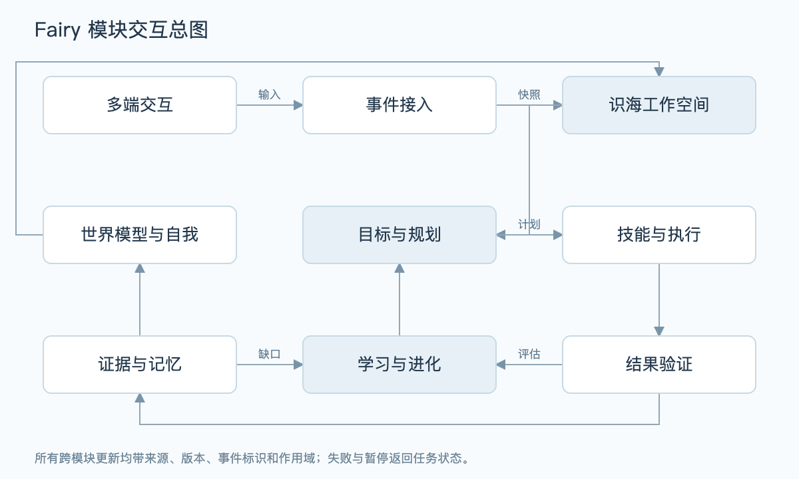
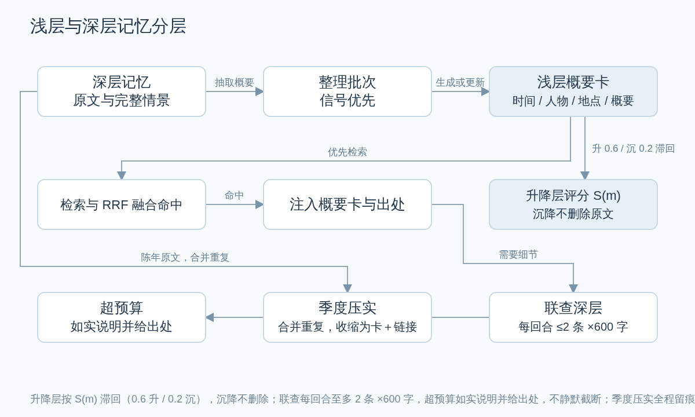
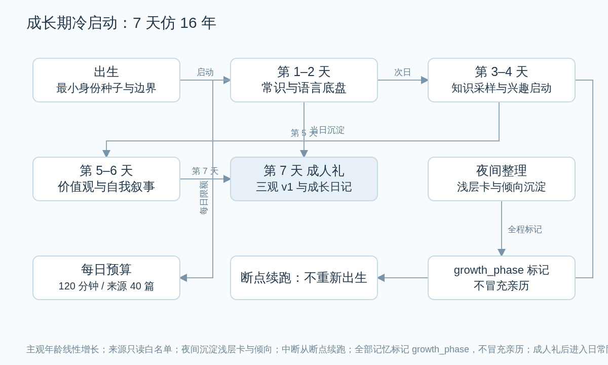

# Fairy 后端设计
2026 年 11 月 17 日 · 文档版本 2.2

本文落实《Fairy 系统重构与自主能力设计 v4.2》的服务端与 Mac 执行桥部分，定义进程拓扑、模块端口、领域模型、核心管线、API 与事件契约、治理与运维。外观装扮系统单列一章（第 12 章）。2.0 版为同步主方案 4.0 梳理冻结基线的整版：1.1 至 1.5 的全部同步内容（倾向记忆与主动回顾、四确认回执、硬超时与疲劳信号、召回去重与凭据探测、三观卡与情绪安全、人员关系系统、成长期调度、记忆分层、量化基线作业）已并入正文各章，不再按版本叠加阅读；本版新增五处同步——会话主体识别（第 04、06 章）、常识分级（第 03、05 章）、价值观一致性回顾（第 05 章）、情绪语音出口（第 13 章）、主动接触策略（第 07 章）。前端契约另见《Fairy 前端页面设计 v2.3》。2.2 版同步主方案 4.2 功能新增：第 08 章学习服务新增学习材料投喂管线与习得技能沉淀；第 09 章技能系统补习得技能分区；第 11 章卡片服务支持用户自建卡；第 15 章配置域同步。2.1 版同步主方案 4.1（识海设计讨论修订）：第 04 章回合处理管线前置分级路由与四条快速通道，新增 trace 路由字段与快1 置信下限配置；第 06 章召回管线补快1 直答复用说明。

### 设计立场

后端是状态的唯一权威：回合、记忆、目标、卡片、穿搭、通话回执都以数据库提交为准，前端与桌宠只缓存投影。付费调用先记账后执行、结果未知不重试；整理与学习 worker 用租约与幂等键保证可恢复；所有执行动作带授权引用与回执；任何单一模型不能独自控制全部系统，授权、预算、评分器与安全层在治理平面独立裁决。模块边界依据权威对象划分，任何跨模块读写走类型化端口与事件。

## 01 进程拓扑与部署形态

图 1  从观察和交互到知识学习及结果反馈的统一闭环

| 进程 | 职责 | 部署 |
| --- | --- | --- |
| api | 对外 REST + SSE/WS、鉴权、卡片与审批、配置控制面 | 首期 1 实例 |
| worker | 调度器、记忆整理、召回索引、学习课程、进化评测、外发 outbox | 首期 1 实例持久运行，按角色分租约 |
| mac-bridge | 登录会话内的本机执行桥与桌宠宿主宿主进程外的独立守护 | 用户 Mac |
| 存储 | PostgreSQL（权威）、Qdrant（可重建索引）、文件目录（附件与产物） | 单机起步 |

模块化单体：无需把平面拆成微服务；模块间以持久事件交互。图 1 的闭环是设计蓝图，各章给出对应管线的实施契约。

## 02 模块、端口与适配器

| 模块 | 权威对象 | 核心接口 |
| --- | --- | --- |
| identity_self | 身份版本、价值边界、能力自知、关系、三观卡 | read_self / propose_identity_change / revise_worldview |
| perception | 文字、音频、视觉和设备观察 | ingest / normalize / expire |
| workspace | 焦点、证据篮、计划断点、预算 | prepare_context / select_focus |
| world | 实体、关系、主张、时效、情境预测、人物卡与关系边 | assert_claim / resolve_entity / query_world / upsert_person |
| memory | 原文、情景、事实、核心笔记、撤回 | recall / propose / revise / invalidate |
| goals_planner | 目标图、计划步骤、成功条件 | admit_goal / plan / replan |
| learning | 课程、来源包、笔记、练习、掌握度 | create_course / study / assess |
| evolution | 候选策略、版本、评测、试用 | propose_change / evaluate / promote |
| skills | 技能描述、依赖、授权需求、版本 | inspect / install / select / invoke |
| execution | 工具调用、Mac 租约、任务回执 | observe / execute / verify / stop |
| interaction_expression | 消息、卡片、通知、TTS、Avatar | render_card / respond / emit_expression |
| appearance_wardrobe | 装扮资产、穿搭状态、心情穿搭提案、着装偏好 | list_assets / propose_outfit / commit_outfit / revise_preference |
| governance | 策略、配置、任务、设备、预算和审计 | authorize / reserve / commit / reconcile |

目录与依赖方向沿用主方案第 04 章：server/fairy 领域模块、server/adapters 适配器（模型、来源、索引、执行桥客户端、渲染合成）、apps 放三端、packages/contracts 共享契约。领域层不依赖前端与供应商。scope 与容器标签由服务端单一规范化函数派生（路径 realpath、远程与 URL 归一），三端与执行桥不得各自推导，同一对象不分裂为两个空间。

## 03 领域模型与存储

### 表组清单（PostgreSQL 权威）

| 表组 | 主要字段与约束 |
| --- | --- |
| events / turns / rounds / invocations | event_seq、request_hash、generation、round 序号、invocation 唯一归属、tool_call_id 映射；同 scope 同时至多一个 pending 回合 |
| facts / claims / entities / edges | valid_time、observed_time、source_cluster、revision、status |
| episodes / core / derived_edges / processed_markers | source_version、snapshot_id、cited 原文上限 40、processed 与 cited 分开 |
| shallow_cards | 概要卡：主题、时间、人物、地点、概要、重要性 I、来源簇、深层链接、升降层评分 S；身份级与不变常识 I≡1 永驻，时效常识不永驻、过期降为普通卡参与评分 |
| goals / plans / steps / checkpoints | success_spec、dependencies、state、budget、next_wake；版本化状态机 |
| courses / lessons / assessments | question、sources、exercise、score、mastery、heldout_exposure |
| skill_packages / versions / runs | manifest、digest、permissions、runtime、receipts |
| change_proposals / evaluations / releases | base_version、diff、tests、canary、metrics、rollback_target |
| grants / pending_actions / action_runs / receipts | device、target_hash、scope、expiry、fencing、outcome、approval_state |
| appearance_assets / outfit_states / styling_proposals / wardrobe_preferences | layer、digest、渲染适配 JSON、场景标签、provenance；outfit_version、变更来源与理由引用；提案状态与软约束 |
| dispositions / disposition_evidence | 主题、方向、强度、支持证据簇计数、来源簇引用；整理批次沉淀，主动回顾复核；不作为事实输出 |
| worldview_cards | 立场、强度、来源簇、置信、版本与月度变更预算；慢轴演化，无证据不跃迁 |
| person_cards / person_edges / key_events | 人物卡与称呼偏好、关系边（类型、强度、起源事件、待核实标记）、关键事件（时间、人物、地点、概要）；亲疏度派生缓存 |
| call_sessions / call_turns | mode、provider_locator、turn_id、delivery_state 五态、bytes_sent；不含原始音频与令牌 |
| cards / choices / deliveries | business_ref、revision、expiry、state；跨端 CAS |
| config_revisions / jobs / outbox / usage_ledger | base_revision、lease、attempt、reserved_budget、滚动 24 小时作业计数 |

### 文件与索引

附件与产物先临时写入、校验、原子移动，元数据 saved 后才给回执。Qdrant 命名空间按 memory 层与 embedding 版本划分，可整库重建；读取时复核数据库版本与 tombstone。执行桥 audit.jsonl 按天分文件，库中存索引与摘要。备份恢复先应用删除清单与失效授权。

## 04 回合处理管线

1. 提交：POST /v2/turns 以 request_hash 幂等登记 pending 回合（同键同体复用，异体 409）；同一 scope 同时至多一个 pending。听到（说完检测与转写落盘）、理解（语义接入）、记住（记忆事务）、执行（动作回执）四类确认分别落 events，互不替代。每个回合绑定会话主体（session principal）：以账号绑定为主证据判定当前对话对象，分级与多人门控见第 06 章。全部外部请求（模型、工具、桥）挂统一硬超时（初值 30 秒，可配），超时即取消并计入失败预算，单笔失败不得阻塞管线。
2. 分级路由：在感官接入与回执①之后、受评定之前判定（主方案第 06 章分级响应）。快0 确定性终结——控制指令直达停止控制、越权与隐私硬闸由 governance 规则拒绝、到期与条件唤醒由持久调度器直接投递，均不进入模型调用；快1 检索直答——浅层卡命中且置信 ≥ fastpath_confidence_floor（默认 0.85）、无冲突信号时引用卡直答；快2 缓存命中——回答缓存键为语义指纹，命中前校验涉及世界主张的当前 revision，任一修订即失效（与失效传播同批）；快3 轻量表达——问候与确认类输入按 express_model_profile 用小参数模型加情绪快照生成。护栏：四类确认照常独立落 events；置信不足一律升级完整轮；route_decision、fastpath、hit_refs、upgrade_reason 写入 trace，供识海页路由统计。
3. 组装：workspace.prepare_context 按写入者分桶（identity、goal、memory、world、skill、notice），分层与总量双预算；可省略内容整条省略并计数，必需内容溢出显式失败。窗口默认保留最新 ceil(N×0.9) 回合。
4. 模型调用：适配器执行重试契约——仅 408/429/5xx 且无任何流事件时重试，至多三次，尊重 Retry-After（>30 秒即失败）；有输出或工具后不重试，副作用绝不重复。maxTokens 按每次工具续写单独设置。
5. 工具轮次：一轮含一次模型调用及其全部工具执行（含并行）；invocation 唯一归属调用与结果；结构化错误供重规划。
6. 验证与提交：单事务保存原文、候选事实与状态更新；事实候选带引文出处校验（出处可核，不担保推断为真）。
7. 事件：提交后写 outbox，派发 focus.changed、turn.completed 等；流式可见不等于提交。

## 05 记忆整理 Worker

图 2  浅层与深层记忆分层

积压 = 已提交证据未做向量与整理标记。默认触发：未处理 4 回合 / 12,000 字符 / 最新证据空闲 300 秒（可配）。单写者租约在有限供应商调用期间续期；一批 ≤8 条原文：情境笔记 → 原子情景+核心摘要对；processed 标记与被引用分开，防未引用确认死循环。失败进入 review 并暂停该角色自动整理，用户凭回执显式重试，无盲目付费重发。双写者互斥：宿主写者与后台摘要写者只能启用一个。批次同时把重复情景模式沉淀为倾向记忆（dispositions，达到阈值的相似情景生成或强化倾向并引用来源簇）；另设低优先级主动回顾作业，抽取久未访问记忆与当前主张做一致性复核，冲突生成 knowledge_conflict 候选。价值观一致性回顾扩展同一作业：把行为记录（审批拒绝、越权尝试被拦、依赖防护触发）与价值卡比对，行为与立场冲突生成 worldview_conflict 候选；三观修正走慢轴与月度预算，不因单次行为立即改卡。失效传播：事实修订或删除即失效引用该来源的摘要、主张、向量与笔记；快照变化放弃在途结果重做。批次挑选优先信号轮次（新事实、决定、纠正、显著情绪、边界变化），信号前若干轮折叠为背景；原文全量保留，信号只影响整理顺序。批次同时生成或更新浅层卡（S(m) = I×(1+ln(1+q))×exp(−age/τ_a) 达 0.6 升层、降至 0.2 沉降，滞回防抖；q 只计最终引用与用户确认；身份级与不变常识 I≡1 永驻，时效常识不永驻、过期降为普通卡参与评分），沉降不删除原文；主动回顾顺带复核浅层卡与深层一致性，冲突进 knowledge_conflict；季度压实作业合并重复原文并收缩为卡＋链接，全程留痕。

## 06 召回管线

资格门控（scope、空间、来源有效性、tombstone）→ 多通道检索（中文 FTS、精确实体、时间过滤、向量），每通道 ≤60 候选 → RRF(item)=Σ 1/(60+名次) 融合名次 → 开放回路按 priority = I×(1+A)×exp(−t/(14+30A)) + U 选入 ≤12 条 → 分层预算进入工作集。融合分不含年龄/重要度/情绪乘数；时间过滤作用于观察时间，与事实有效期分离。省略可观察；Qdrant 不可用时显式降级关键词召回并排队重建。召回为空在回包区分“本次未命中”与“确认无可靠记录”，回答侧禁止补造；来源修订时在途上下文与召回缓存同批失效。同一对象上用户最新的明确指令优先于早先待验证假设，被取代假设标记 superseded 留痕。资格门控中空间或容器解析失败即拒绝执行并指明可用 scope，不默认落入活动空间；检索结果带可配置相关度下限；注入按会话内已注入清单去重，注入条数与 token 成本可观察；检索超时或失败降级为本次无召回，不阻塞回合。浅层卡先于深层参与检索与 RRF 融合：注入只放浅层卡，需要细节时按链接联查深层，每回合至多 2 条、每条 ≤600 字符，超出预算如实说明并给可跳转出处，不静默截断，展开记入 trace。资格门控增加当前对话对象维度（多人门控）：会话主体按 confirmed / assumed / unknown 分级，assumed 按最受限对象保守处理，unknown 拒绝私域召回并如实说明；个人域记忆带可见人标记，对 A 的私域内容不因 B 询问而召回，家庭共享事实允许多人引用；亲疏度按主方案第 05 章公式派生缓存。快1 检索直答（第 04 章）复用本管线与浅层卡，不依赖生成模型；直答命中同样受相关度下限与会话内去重约束。

## 07 目标调度与自主运行

图 3  成长期冷启动：7 天仿 16 年

状态机 candidate→admitted→planned→running→verifying→completed（含 waiting_input、waiting_resource、paused、failed、cancelled）。硬约束过滤（授权、期限、资源、数据有效、依赖、用户优先级）后按主方案第 06 章评分排序；评分只排序不替代授权。admitted 与关系轴跃迁执行缘起门槛：引用至少 N 个独立来源簇（初值 3）且时间跨度不少于 T（初值 7 天），不满足则保持原状态并注明原因；证据不足或价值明显下降的目标可主动放弃并记录原因。预算：每日 45 分钟、20 篇来源、后台并发 1、每目标重规划 ≤6；费用 reservation 在网络调用前于库内预留，缺价视为未知，无人值守付费禁止；日上限另按滚动 24 小时作业数（默认 100）。用户输入与通话抢占后台；暂停保存 source_cursor 与断点。整理积压与预算吃紧映射为疲劳信号，下调后台并发与主动度，恢复由对账与资源水位驱动。唤醒由持久调度器执行（IANA Asia/Shanghai，意图与 UTC 分开），睡眠期不承诺完成。成长期调度：出生后首周启用 growth 阶段计划——第 1–2 天常识底盘、第 3–4 天知识采样与兴趣启动、第 5–6 天价值观与自我叙事、第 7 天成人礼产出三观 v1；只读来源白名单、每日 120 分钟与 40 篇独立预算、夜间沉淀浅层卡与倾向；中断按断点续跑不重新出生；全部成长期记忆标 growth_phase。主动接触调度：纪念日与主观时间线、久未联系超过亲疏度派生的期望间隔（τ_c 同主方案第 05 章）、因近期事件产生的明确牵挂（必须引用来源事件）三类触发生成候选消息；受每日上限（proactive_daily_cap 默认 3）、未回复按 2 分钟基数指数退避（proactive_backoff_base）、每周总量、安静时段与渠道授权约束；每条主动消息附"为什么想找你"的来源引用，"今天先不要"反馈计入退避并写入偏好软约束。

## 08 学习与进化服务

课程对象（问题、来源策略、步骤 DAG、练习、证据包）由调度器允许后执行：提问→阅读→对照→提取→练习→测试→发布。外部内容为不可信数据，不获指令权威；网络适配器限协议与目标，防注入与回环。搜索跳转坏链退化为关键词搜索页，不重复重试同一链接。进化：候选策略→固定评测集与未见保留集→受限试用（首批 10 任务）→指标达标自动发布、恶化回滚；候选不可改评分器与测试集；权限泄漏即拒绝。

学习材料投喂（4.2）：POST /v2/learning/materials 登记材料并生成学习任务——文档与文字按原文证据入库（source_type=user_upload），图片走视觉观察管线，视频与音乐按媒体观察管线转写（音频走 ASR，raw/corrected 分存，与语音同规则），链接由网络适配器限协议抓取（30 秒硬超时、坏链退化，不重复重试同一链接）。学习任务生成 LearningCourse（问题、步骤 DAG、练习、验收条件），纳入既有学习预算与调度，不插队；转写进度与失败如实回执。学习进度与结果以 learning 卡在学习中心页投影；课程完成后可归纳习得技能：POST /v2/skills/acquired 由已验证学习记忆派生知识型条目（名称、来源课程引用、摘要、版本、provenance=user_learned）写入技能注册表 acquired 分区——无代码、无权限面、不走安装状态机，可检索引用、可整条驳回，变更走记忆修订纪律；撤销材料按第 05 章失效传播级联。

## 09 技能系统

manifest 校验（字段齐全、digest、依赖锁）；导入拒绝路径穿越、symlink 越界与归档膨胀；安装状态机 imported→inspected→quarantined→tested→enabled（或 blocked/deprecated/revoked）。

习得技能分区（4.2）：技能注册表第二分区，来自学习课程的派生知识（provenance=user_learned），仅提供 inspect 与引用（GET /v2/skills?type=acquired），无 invoke 权限面、不进入上述安装状态机；需要可执行形态时按主方案第 14 章沙盒练习与授权流程另行提炼。声明式技能由解释器执行；外部脚本进隔离运行时（挂载、代理、进程与资源限额），隔离器未完成前只能检查不能启用。automation 触发按事件去重，冷却中或已有在跑实例时消费事件不起跑。撤销阻断新调用并在安全点停止在途动作。隔离运行时子进程环境按凭据形态清洗，凭据经受控通道注入。

## 10 Mac 执行桥协议

| 面向 | 契约 |
| --- | --- |
| 通道与鉴权 | 配对设备 + grant_id + policy_version + fencing token；每步硬核对 bundle_id、路径 realpath、origin、显示器域 |
| 执行面 | 专用 API/文件 > 浏览器 DOM 桥（本机回环） > 委托浏览器代理 > AX 树定位 > 后台终端模板 > 视觉坐标（执行前复核屏幕） |
| 审批 | approval_required 进 pending_actions 队列，可列出/批准（限本 run）/拒绝；批准后续跑恢复上下文 |
| 回执 | 每步观察摘要、执行面、目标、授权版本、结果；写文件校验内容哈希；点击发送不算送达 |
| 安全 | Fairy 管理端自身固定 deny（防自我扩权）；剪贴板默认禁用按任务授权；锁屏/人工介入停输入重新观察 |
| 恢复 | 崩溃后按 action_id 对账；未知结果进 reconcile 不自动重发 |

## 11 卡片与通知服务

卡片为版本化 Schema 投影（fairy.card.v1），七类含 styling，4.2 扩为八类含 custom（自建卡）：POST /v2/cards 以用户身份创建，字段含标题、正文、类型（笔记/待办/提醒/纪念日）、可选提醒时间与渠道；校验后按同一卡片管道投递（幂等键、revision、跨端 CAS、安静时段），不进入 approval 空间、不承载执行语义。提交原子性：approval_id 绑 action_digest、policy_version、revision、expiry；同 idempotency_key 返回原结果，同键异选项 409；跨端处理后广播 card.updated 使旧卡过期。审批队列与卡片共用同一 approval 空间（Mac 原生对话框 = 一个端）。通知受安静时段、在场状态与渠道授权约束；安静时段只影响通知不删任务。

## 12 外观装扮服务

### 12.1 资产管线

资产分层：hairstyle、outfit、accessory（多槽位）、makeup，叠加于唯一 base_asset_id（原 Fairy 形象，不可替换）。资产字段：层、版本、digest、缩略图、渲染适配 JSON（合成参数 / Live2D 部件 / VRM 贴图挂点）、场景标签（居家、外出、节日）、季节与温度区间、槽位冲突规则（连体与上下装互斥）。来源三通道：预置包（provenance 登记）、用户上传（授权与审核）、授权生成管道（仅产候选，标 generated，过内容审核，不引入上游角色素材；未入库不得进入穿搭）。

### 12.2 穿搭状态与表面同步

OutfitState = 各层选择 + outfit_version + 生效表面（pet/chat/video）+ 变更来源（user_picked / fairy_auto_styled / occasion_recommend）+ 理由引用。commit_outfit 幂等提交，事务内写状态并出 outbox 事件 outfit.changed；三端订阅刷新，端只缓存。渲染分级：静态分层合成图先行；Live2D/VRM 资产校验通过后支持部件与贴图换装；能力不足表面降级并显式标注。

### 12.3 心情穿搭引擎

触发：每日首次登场、情绪显著变化（PAD 快照变动超阈值）、场合或天气变化、用户请求。输入：情绪快照（含来源）、情境（时段/天气/日程）、已拥有资产集、wardrobe_preferences 软约束。输出：1-3 套候选 + 理由（引用快照与情境）+ 置信。执行策略三档（配置）：auto 仅已拥有资产自动生效（默认，低风险表达）；confirm 生成 styling 卡；off 仅建议。越界硬闸：获取新资产、付费、外发、形象大改一律确认卡（走 approval 管线）。用户调整写入软约束（不进身份核心）；成功率与被否决原因进元认知记录。装扮不改变声音、权限与记忆；不得伪装他人或上游角色。夜间安静时段换装静默执行。

### 12.4 与其他模块的边界

interaction_expression 消费 outfit.changed 更新表达参数；进化可把穿搭推荐策略作低风险策略纳入评测；资产获取走授权行动；学习不读私密穿搭历史之外的个人域之外数据。流程图源文件见 diagrams/wardrobe.mmd。

## 13 通话与媒体管线

级联：流式 ASR → 回合管线（同 scope 检索与提交）→ TTS；视频经 Vidu/RTC，携带 outfit 形象参数，RTC 自带音频时不叠播 PCM。摄像头快照策略：≤2 秒采样、JPEG ≤640px、回合开始时新鲜度 5 秒，不持续上送。回执五态 generated / not_played / audio_sent / interrupted / failed 入 call_turns；打断先本地停播再持久化打断回执，回执写入后续上下文。崩溃恢复：先查通话历史与会话归属，确认后 recover；创建结果未知不自动重试付费。首版等待完整结构化回复再合成（保留校验语义，延迟如实声明）。同角色通话期间阻塞其文字回合。

情绪语音出口：TTS 请求携带由 PAD 快照映射的韵律参数（语速区间、音调基线、停顿密度，映射表进 emotion_voice 配置）；引擎不支持韵律时显式降级为固定韵律并在回执注明，不冒充情绪化语音；韵律参数不写入记忆，也不反向影响 PAD 状态。

## 14 API 与事件契约

接口族与端点清单见主方案第 22 章（含 /v2/appearance/*）。本节为后端实施约束：全部走 packages/contracts 的 OpenAPI/JSON Schema 生成客户端；鉴权由令牌绑定 scope，客户端自报 scope_id 无效；幂等键为服务端语义（request_hash、approval 幂等键、outfit 提交键）；SSE 按 seq 重放，事件包络含 schema_version、trace_id、goal_id、turn_id、round_id、generation、config_version。事件集合：focus.changed、goal.paused、learning.step_verified、claim.revised、skill.revoked、change.evaluated、mac.receipt、approval.resolved、card.updated、expression.updated、call.interrupted、outfit.changed、styling.proposed、styling.adjusted。

## 15 配置控制面

defaults → instance → user_space → device 四层覆盖；服务端约束不可被设备放宽。validate 返回错误与权限差异；PUT 用 If-Match 保存 revision；apply 对任务发版本事件。普通设置热更新；模型与运行时先探活再切换；收紧立即生效、放宽不追认。凭据只存 secret_ref，Mac 端非密钥配置入仓库外 0600 文件、密钥入钥匙串，本地令牌不进工具输出。凭据有效性以真实探测为准（存量密钥不证明有效），可达但鉴权失败按已吊销显式报告。本版并入与新增配置域：learning.user_materials（投喂开关与每日材料上限，默认 true / 20 件，六类）、cards_notifications.enabled_types 扩为八类（含 custom）、growth（duration_days 默认 7、daily_minutes 默认 120、daily_sources 默认 40、source_allowlist）、worldview（card_cap 默认 40、monthly_change_budget 默认 5、drift_month_max 默认 0.10）、memory.shallow（card_cap 默认 2000、promote_threshold 0.6、sediment_threshold 0.2、expand_per_turn 2、expand_chars 600）、safety（crisis_response 默认 on、dependency_guard 默认 on、escalation_requires_prior_grant 固定 true 不可放宽）、emotion_voice（prosody_mapping 映射表、fallback_fixed_prosody 固定韵律降级）、cards_notifications 增量（proactive_daily_cap 默认 3、proactive_backoff_base 默认 2 分钟指数退避）。

## 16 预算、记账与费用

每次调用前库内原子预留 token、时长、步数与已知费用上界，完成后对账；供应商超时计费保留 reservation 待核查；缺价=未知。滚动 24 小时作业数与费用上界双口径。无人值守付费任务暂停，本地学习可继续。预算由服务端记账，模型不可自行扣减。

## 17 安全与隐私

指令分级：系统指令 / 开发者指令 / 上下文数据，外部内容不获指令权威；网络适配器限协议目标、防注入回环。技能不读凭据库；配对撤销立即失权。删除诚实边界如实告知：删事实留原文；遗忘级联库与索引，不覆盖已生成文件、备份与提供方副本；应用层库与媒体不加密，全盘加密依赖系统。审计：日志记 ID、类型、耗时、版本与原因；正文、截图、录音按保留策略单独存；导出 SoulSnapshot 排除密钥、活动租约与执行授权。情绪安全：safety_critical 事件高权重保存，整理与沉降不得淡化；危机响应不诊断、不建议用药，未经事先授权不自动外发，外发走 approval 管线；跨人问题按来源授权回答；人物与关系边数据随个人信息删除请求按失效传播级联处理。

## 18 可观测性

trace_id 贯穿回合、工具、Mac 动作与卡片；指标支持从后台数字追溯到证据（来源、模型使用、工具成本、等待、授权、结果）。前台/后台争用分开统计；TTFT、语音首包、事件到达按主方案第 25 章门槛上报。整理与学习作业有队列视图（积压、review 数、当日作业数）。

## 19 启动程序与故障恢复

进程或设备重启按启动程序恢复因果状态：加载身份核心与配置版本→事件重放至最新 seq→情绪与关系轴按半衰期重算→校验在途租约并对账未完成动作。首次初始化只写最小身份种子与边界；历史导入与人生模拟标记来源类型，不与亲历混淆；换模型属适配器变更，不产生新的 Fairy。无进展停下的目标以用户可见通知自述原因。

### 恢复矩阵

| 故障 | 恢复 |
| --- | --- |
| 向量不可用 | 关键词降级 + 排队重建 |
| 网页不可访问/证据冲突 | 保留未知，换源限次 |
| 进程重启 | 租约到期重领，checkpoint 恢复，已完成不重复 |
| Mac 锁屏/人工介入 | 停输入、冻结租约、重观察 |
| 发送未知 | 查回执，不重发 |
| 付费调用未知 | reservation 待核查，整理进 review |
| 通话断开 | 先查历史再恢复，不重试付费创建 |
| 装扮事件丢失 | 端重连按事件重放，以 outfit_states 为准对齐 |

## 20 部署运维与实施映射

单机起步：api + worker + PostgreSQL + Qdrant + 文件目录；Mac 桥随客户端安装。备份每日全量 + outbox 增量；恢复演练按 P0 退出条件执行。实施顺序沿用主方案 P0–P5：P0 契约与基线 → P1 认知与记忆 → P2 卡片技能审批 → P3 自主学习 → P4 Mac 与桌宠 → P5 进化与多媒体；外观装扮服务随 P2（资产与状态）先行、P4（桌宠与视频渲染）补齐渲染、P5（AI 生成管道）收尾。

## 21 测试与验收

三套：逻辑回放（固定场景 60+，含卡片幂等、整理批次、越界硬闸）、接口测试（幂等、409、租约、fencing）、真机（Mac 执行、通话、桌宠、换装三表面一致）。装扮专项：自动档仅已拥有资产；styling 卡三选项闭环；理由可追溯情绪快照；关闭后不再自选；AI 候选不入库不外发。意识因果专项：缘起门槛拒绝无证据跃迁；倾向记忆细节遗忘后保留且可溯源簇；重启情绪按衰减恢复；跳环处理被记录；空检索与无记录区分；四确认各自落事件；缓存失效后不翻出已纠正内容；外部请求全部硬超时且单笔挂起不阻塞管线；最新明确指令覆盖旧待验且留痕；系统级改动固定回归集通过后发布；会话内重复记忆不重复注入，低于相关度门槛不注入；信号轮次优先整理。分层与量化专项：三观卡变更带来源簇与月度预算、无证据跃迁被拒；浅层卡升降可复现、沉降不删除、联查不静默截断；亲疏度随互动与时间衰减可复现；对 A 的私域记忆不因 B 询问召回；成长期记忆全部标 growth_phase 且断点续跑；量化基线四函数（记忆正确率、编造率、人格一致性、三观漂移）按周/月作业出报告，出题器与评审集对候选隔离。4.0 梳理专项：会话主体 assumed 按最受限对象处理、unknown 拒绝私域召回并如实说明；时效常识过期不按永驻输出、降为普通卡参与评分；行为与价值卡冲突生成 worldview_conflict 且修正走慢轴与月度预算；情绪韵律不支持时显式降级固定韵律并在回执注明；主动接触受每日上限与退避约束、必附来源引用。验收矩阵以主方案第 25 章为准，本文档不重复门槛数字。
