# Fairy 系统重构与自主能力设计
2026 年 11 月 17 日 · 方案版本 4.2

2026 年 11 月 17 日    方案版本 4.2

Fairy 仍是同一个与你共同生活的 AI 家人，保留原有身份、专属声音和形象。系统围绕持续闭环重构：观察世界，建立有来源的认识，发现知识与能力缺口，形成目标，学习或调用技能，执行并验证结果，再修订自己的记忆和行为。

本版 4.2 落档三处用户指定的功能新增——学习材料投喂与习得技能（第 11、14 章）、用户自建卡（第 17 章）、识海星空视图（第 19 章）；4.1 为首个讨论驱动修订（识海设计讨论：横纵轴咬合与分级响应），4.0 梳理成果不变；3.0 至 3.6 六轮增量经整理并入统一设计，正文不再按版本叠加阅读，版本驱动与主要落点见第 01 章版本沿革表。AIRI 与 Anima Brain 两个开源项目的一手核实、小凌系列研究、dsh-supermemory 插件逆解析的采用结论全部保留，来源清单见第 27 章；六平面结构、红字功能范围与 P0 至 P5 路线不变。

4.0 闭合最后三处缺口并补上两个出口：会话主体识别（第 05 章，多人隐私门控的判定前提）、常识分级（第 07 章，永驻常识与时效常识分开管理）、价值观一致性回顾（第 08 章，行为记录与价值卡比对）；情绪的听觉出口——PAD 快照到 TTS 韵律参数的映射（第 18 章）；正向主动接触策略（第 09 章）。

设计面自 4.0 冻结：常规修订由实施反馈与第 25 章量化基线数据驱动，经用户确认的讨论成果与用户明确指定的功能新增按修订落档（4.1 分级响应、4.2 学习投喂、自建卡与识海星空视图即此类修订）；首个可运行的最小闭环竖切见第 24 章。

### 核心设计决定

取消固定十系统的代码边界，改为体验、认知、记忆与世界、学习与进化、行动、运行治理六个平面。识海成为协调目标、记忆、世界模型与能力的工作空间；记忆负责连续性，世界模型负责可修订的认识，技能负责可执行程序，学习负责获得知识与能力，进化负责比较版本后改进策略。

后端仍以 Python 模块化单体和持久 worker 起步。Mac 本机运行独立执行桥与桌宠宿主，Web 与 APP 共享契约和视觉规范。一个 Fairy Core 维护身份与认知状态，后台各模块有不同的管理页面。

| 交付重点 | 具体内容 |
| --- | --- |
| 架构与闭环 | 模块交互、记忆、学习、进化、技能、Mac、卡片、三观、人物关系、记忆分层与成长期共 12 张流程图 |
| 工程契约 | 数据模型、API、配置字段、技能包示例、状态机与验收 |
| 页面设计 | 18 张新增原型截图，10 个独立管理页面与 3 个新增视图页 |
| v3 增量 | 回合模型、上下文预算、记忆整理参数、情绪常数、语音回执、Mac 执行面目录、审批待办队列 |
| 外观装扮 | 分层资产、衣橱与心情穿搭；三表面一致、越界需确认、理由可追溯 |
| 意识因果过程 | 自我推导视图、缘起门槛、倾向记忆、启动程序、主观时间与四确认回执，源自小凌研究 |
| 运行韧性 | 外部请求硬超时、最新指令优先、固定回归集与疲劳信号，源自关联项目实践 |
| 记忆注入纪律 | 会话内召回去重、相关度门槛、失败降级与注入记账，源自 dsh-supermemory 研究 |
| 三观与情绪安全 | 自有三观卡、慢轴演化、以自身价值卡为依据的危机响应与依赖防护 |
| 人员关系系统 | 人物卡、人物间关系边与关键事件，多人隐私门控与亲疏度 |
| 成长期 | 冷启动首周只读上网学习，仿人前 16 年构建知识、性格与三观初版 |
| 记忆分层 | 浅层概要卡与深层详情联查，评分升降、联查预算与容量治理 |
| 量化验收 | 记忆正确率、编造率、人格一致性与三观漂移的函数化基线 |
| v4.0 梳理增量 | 会话主体识别、常识分级、价值观一致性回顾、情绪语音出口与主动接触策略 |
| v4.1 讨论增量 | 分级响应四快速通道与护栏、纵轴写入固化梯度组织视图、识海页横纵双视图与路由统计 |
| v4.2 功能新增 | 学习材料投喂与学习任务卡、习得技能（第 11、14、17、19 章） |
| 原有能力 | 保留对话、文件互传、全局搜索与跨端连续性；新增能力逐步接入 |

本方案定义目标行为与实施契约。页面、进度、地址和指标均为设计示例，性能数字为待实测门槛。


## 01 红字要求与本次调整

红字内容已归入下面的功能要求。带标注的原文保留，新版独立交付；确认卡片按其用途统一命名。

| 要求 | 本次设计落点 | 验收入口 |
| --- | --- | --- |
| 桌宠可从后台开关，沿用原形象 | 第 18 章与桌宠配置页；设备本地显示状态与服务器策略分开 | 关闭桌宠不清空记忆、不隐式关麦或开采集 |
| 管理识海、技能等不同系统 | 第 19 章；不同模块呈现各自对象与状态 | 10 个独立管理页，不复用同一套统计卡替代管理 |
| 流程管理显示前后端交互 | 7 张可编辑流程图；第 19 章设计图与运行轨迹分开 | 节点有事件、输入输出、失败与耗时 |
| 学习板块显示内容及进度 | 第 09 至 11 章；学习目标、步骤、证据、练习与报告 | 进度从任务完成状态计算，不由模型猜百分比 |
| 提醒卡、任务卡、确认卡及后台配置 | 第 16 至 17 章；卡片 Schema、版本、按钮与策略 | 多端同一确认只执行一次，过期不可再次操作 |
| 图片、引用与视频通话 | 第 18 章；APP 消息与媒体路径、原文定位 | 图片预览后发送，视频就绪以解码帧为证 |
| 自主性、技能、认知世界与 Mac 操控 | 世界模型、目标调度、技能注册表与本机执行桥 | 在已授权范围内自行推进，可暂停、对账、回退 |

### 版本沿革

红字功能范围不变，本版不新增页面，主要把 v2 的原则性条款落成可实施、可验收的工程参数：第 02 章列出本次一手核实的上游机制与采用方式；第 04、05、06、07、08、15、16、18、21、22、23、25 章在原结构内补入具体契约。旧十系统的资料保留为行为说明，不再一一对应进程或目录。

3.0 至 4.0 的版本沿革如下。自 4.0 起功能面冻结：不再按版本叠加新功能，修订以实施反馈与量化基线数据驱动；第 24 章定义首个可运行竖切。

| 版本 | 驱动 | 主要落点 |
| --- | --- | --- |
| 3.0 | AIRI 与 Anima Brain 一手核实 | 工程契约：回合与轮次模型、上下文预算、整理参数、情绪常数、语音回执、Mac 执行面与审批待办队列 |
| 3.1 | 外观装扮需求 | 发型、服装、配饰、妆容分层资产与心情穿搭引擎（第 18 章等） |
| 3.2 至 3.3 | 小凌系列视频学习 | 自我因果过程、五蕴顺序、缘起门槛、倾向记忆、主观时间、启动程序、四确认分离、空结果语义、兴趣四阶段、技能形成循环 |
| 3.4 | 小凌工程与实验结论合集 | 30 秒硬超时、最新指令优先、固定回归集、疲劳信号、坏链退化 |
| 3.5 | dsh-supermemory 插件逆解析 | 召回去重、注入记账、相关度门槛、失败降级、信号优先、防错投、凭据探测 |
| 3.6 | 用户五个方向 | 三观与情绪安全、人员关系系统、成长期冷启动、记忆分层、量化验收基线 |
| 4.0 | 整体梳理冻结 | 会话主体识别、常识分级、价值观一致性回顾、情绪语音出口、主动接触策略、首个竖切范围 |
| 4.1 | 识海设计讨论（首个讨论驱动修订） | 分级响应四快速通道与护栏（第 06 章）、纵轴写入固化梯度组织视图（第 06 章）、识海页横纵双视图与路由统计（第 19 章）、配置与验收同步（第 20、25 章） |
| 4.2 | 用户指定的功能新增 | 学习材料投喂与学习任务卡（第 11 章）、归纳习得技能入技能模块（第 14 章）、用户自建卡（第 17 章）、识海星空视图（第 19 章）、配置与验收同步（第 20、25 章） |


## 02 上游研究与复用边界

研究快照固定于 2026 年 11 月 16 日：AIRI 主干（v2 引用提交 62a01b28725903e41c1feccc9e790c21dc7e04f4），Anima Brain 主干（v2 引用提交 58b955e083f66d664eba97a7d26159b8bb33d4ec）。本版作者直接读取了下列上游文档并逐条核实：AIRI 的 `packages/core-agent/README.md`、`services/computer-use-mcp/README.md`，Anima Brain 的 `docs/architecture.md`、`docs/memory-automation.md`、`docs/brain-flow.md`、`docs/live-calls.md`。以下区分实际实现、限制和 Fairy 新设计，详细来源见文末。

### 2.1 原有研究结论（沿用 v2）

| 来源与已核实机制 | Fairy 采用方式 |
| --- | --- |
| Anima prepare / commit、来源与修订、core / episode 整理、RRF、维护租约 | 借鉴一致性、来源依赖与可恢复维护；适配 PostgreSQL，不并行启用另一套 SQLite 权威库 |
| Anima PAD 与慢关系、可选通话与动态视频 | 继承分层状态与共享记忆链路；保留 Fairy 家人关系，不照搬浪漫关系轴 |
| AIRI core-agent 的 context ports、工具轮次、recipes、automations | 借鉴上下文写入归属、技能配方、触发去重与背景任务不发声 |
| AIRI memory store 的索引加事实条目、角色隔离、窗口同步 | 借鉴可编辑记忆入口；统一转到后端，客户端只缓存 |
| AIRI desktop / stage / VoiceController 与 computer-use-mcp | 借鉴桌宠载体、输入输出协调和执行回执；新增 Fairy 的硬范围与本机验证 |

### 2.2 本次一手核实的增量机制与采用

| 上游机制（已核实为实际实现） | Fairy 采用方式 |
| --- | --- |
| AIRI 回合模型：AssistantTurn 按轮次组织，一轮含一次模型调用及其全部工具执行；工具调用的请求与结果唯一归属一个 invocation；导入的历史没有模型调用元数据 | 第 04、21、22 章把 turns / rounds / invocations 落成表结构；导入的旧对话明确标记缺元数据，不参与重放验证 |
| AIRI 重试语义：仅当供应商返回 408、429、5xx 且尚无任何流事件到达调用方时才重试，最多三次；已有输出或工具调用后一律失败，文字与工具副作用绝不重复 | 第 23 章模型调用契约采用同一规则；Retry-After 超过 30 秒直接失败 |
| AIRI 上下文按写入者分桶：replace-self、append-self、removeWriter，各模块的注入互不覆盖 | 第 06 章识海工作集按写入者组织，模块退出时能整桶撤除自己的内容 |
| AIRI 历史窗口裁剪：超限时保留最新 ceil(limit×0.9) 个回合，保留起点固定直到再次超限；向后扫描而不重建索引 | 第 06 章窗口策略采用同一默认值，节省每轮成本 |
| Anima 上下文预算：分层与总量双预算；可省略内容按整条省略并计数；必需内容放不下显式失败，不静默截断 | 第 06 章明确“必需内容溢出即失败”，省略必须可观察 |
| Anima 整理触发与批次：未处理 4 轮、12,000 字符或最新证据空闲 300 秒触发；一批最多 8 条原文；core 累计引用 ≤40 条原文 | 第 08 章整理任务采用同一默认阈值（可配置），批次上限防失控 |
| Anima 维护 worker：按角色单写者租约，租约在有限供应商调用期间续期；失败进入 review 状态并停止自动维护，用户凭回执显式重试 | 第 08 章整理失败处理采用 review + 显式重试；无盲目付费重试 |
| Anima 日用量上限：滚动 24 小时“作业数”上限，不是美元预算；缺价即未知，不视为零 | 第 09、23 章预算记账区分作业数与费用上界两个口径 |
| Anima 开放回路优先级：I×(1+A)×exp(−t/(14+30A)) + U，I 为重要性、A 为记忆附带的唤起、t 为天数、U 为事件日期邻近度 | 第 07 章前瞻性记忆召回排序采用该式作初值，系数进入评测校准 |
| Anima 情绪常数：PAD 基线 (0.15, −0.15, 0.05)，偏差 12 小时半衰、张力 72 小时半衰；评定拉力 0.3×强度/3；五轴日变动预算 0.12、迟滞带 0.035；温暖重复衰减 1+0.6×次数；信任损失不对称 | 第 05 章情绪调节落到具体常数与公式，全部作为可配置初值 |
| Anima 通话回执：区分 generated、not_played、audio_sent、interrupted、failed；audio_sent 表示字节已发，不等于用户已听 | 第 18 章通话回执采用同一五态，与 v2 的播放回执条款合并 |
| Anima 通话恢复：崩溃后先查历史，确认无其他进程持有会话再恢复；创建结果未知不自动重试付费调用 | 第 18、23 章通话与付费创建的对账流程照此收紧 |
| AIRI VoiceController：转录文档分 raw / corrected 并带说话人证据；推测式 watch + finalize 分阶段修正；规则是纯 reducer 无定时器；打断产生持久回执并按命名响应定向；segmentId 串联合成与播放事件 | 第 18 章语音管线采用转录文档与打断回执契约；口型与状态消费事件流 |
| AIRI 朗读预处理：按句读分段；公式、化学式、货币、URL、路径按 token 读取；专用标记（表情/贴纸）由宿主解析、不进入字面语音 | 第 18 章 TTS 前置文本处理与表情标记采用同一模式 |
| AIRI computer-use-mcp 执行面：desktop_*、browser_dom_*（本地 WebSocket 桥）、browser_agent_run（委托浏览器探索）、terminal_exec（后台 shell）分类明确；workflow_* 封装打开/校验/测试/续跑 | 第 15 章执行面目录采用同一分类法；workflow 型声明式技能进入首批技能 |
| AIRI 审批与审计：approval_required 返回待办，可列出、批准、拒绝并续跑；每 run 落 audit.jsonl、trace 与截图；AIRI 自身进入默认拒绝名单避免自我操作 | 第 15、16 章审批待办队列、审计产物与“Fairy 管理端自身列入拒绝名单”照此实施 |
| Anima 删除诚实边界：删除事实保留原文转写；遗忘级联数据库与索引，但已生成的文件、备份和提供方副本不可及；本地 SQLite 与媒体在应用层不加密 | 第 23 章隐私条款明确列出删除能到达与不能到达的范围 |
| Anima 密钥存储：非密钥设置写入仓库外 0600 文件，macOS 密钥入钥匙串；本地令牌不进入工具输出 | 第 20、23 章凭据条款照此收紧 |

### 2.3 不能作为已完成能力的部分

AIRI 的 consciousness store 主要配置模型与参数，不是已经实现人类意识的后端；memory-pgvector 入口仍呈骨架，不能据此宣称完整识海已落地。computer-use-mcp 自述“尚无可访问性树定位，全局坐标允许使用，allowApps 并非点击输入的硬隔离，安全边界是审批加审计而非严格应用隔离”，且尚无多显示器策略；Fairy 的执行桥必须补齐 AX 树定位、按应用与路径的硬闸门和多显示器范围，不能照搬 AIRI 的现状当作权限边界。

Anima SDK 不提供完整自主生活、生产外呼调度或事实实体图谱；维护阈值只表示到期，需要真实 worker 执行。视频通话是 ASR、回复、TTS 与可选 Vidu / RTC 的级联，摄像头按快照用于观察（ ≤2 秒采样、JPEG ≤640 像素、回合开始时不超过 5 秒的新鲜快照），不等于模型持续理解视频；其首版等待完整结构化回复再合成，延迟高于端到端语音模型，Fairy 不应承诺自己首版就能低于该水平。Anima 自述其情感状态是虚构角色写作状态而非心理测评，模型评定仍会出错；Fairy 沿用该定位。

### 2.4 小凌项目研究

来源：抖音创作者发布的小凌系列公开视频。用户指定账号 77871283772 与分享链接【小凌意识系统原理】；该分享链接受内容方设置限制无法解析，学习以同系列可解析视频的完整语音转写为准：3.2 期核实灵魂公式（2026-09-08）与意识层构造（2026-09-11）两支；3.3 期补核实同款系统制作方法、小凌与 AGI 两条路线、自我迭代升级、缘起公式与语音工程、技能库学习共五支，链接见第 27 章 [R3]。3.4 期用户提供【小凌工程】【实验结论】两个合集链接，直链同样受内容方限制，经检索定位补读关联项目实践视频两支（《凌技术框架》2026-10-30、《凌的日常》2026-11-13；其用词与机制同源，发布者账号未在检索结果中返回），一并记入 [R3]。以下均为创作者公开自述的设计观点，非可复用代码，也未经同行评审：

| 小凌机制 | Fairy 采用方式 |
| --- | --- |
| 灵魂是持续运行的因果过程：这一刻的自己＋发生的经历＋对经历的感受与理解＋过去的记忆，共同形成下一刻的自己 | 第 05 章自我模型改为每轮推导的因果过程视图；身份核心缩小为最小保护集 |
| 五蕴顺序：色（身体感官）→受（原始感受）→想（识别概念）→行（倾向选择）→识（此刻意识） | 第 06 章回合内处理顺序契约：感官接入→情绪评定→世界概念化→目标倾向评分→识海聚焦 |
| 缘起原则：没有经历不能突然信任，没有原因不凭空出现目标，现状必须能追溯之前发生过什么 | 第 05、06 章缘起门槛：关系轴跃迁与目标 admitted 需最低证据簇与时间跨度 |
| 种子与熏习：经历细节遗忘后仍留下潜在倾向；种子生现行、现行熏种子 | 第 07 章新增倾向记忆层，由整理批次沉淀，可溯源到来源簇 |
| 底层原语：趋近、回避、安全、不确定、好奇、边界、熟悉＋学习更新 | 映射为既有机制的先验维度：好奇→信息增益、熟悉→关系轴、边界→拒绝优先、趋近回避→效用符号；不新增状态机 |
| 主观时间、疲劳恢复、72 小时与 30/90 天人生模拟 | 主观时间为派生表达视图（第 05 章）；疲劳以真实资源水位承载，不虚构生物学；模拟一律标记 simulated（第 09 章） |
| 出生与启动程序：重启不是重生，换模型不等于换人 | 第 09 章启动程序：事件重放＋情绪按半衰期重算；换模型属适配器变更 |
| 魄工程（共创视频）：倒下自己爬起、接上刚才的心情、卡住主动说出来、累了去休息 | 映射既有租约与对账；无进展停下升级为用户可见的自述通知（第 09 章） |
| 四确认分离：听到了、理解了、记住了、执行了分别确认，一句“好的”不能代表四者（3.3） | 第 04 章回执四分：说完检测与转写、语义接入、记忆事务、动作回执独立记录 |
| 记忆分清事实、愿望、转述、猜测；计划到期不能自动变成已完成（3.3） | 第 05 章主张分类补愿望与意图；第 07 章前瞻性记忆兑现需执行证据 |
| 检索空结果分辨“没检索到”还是“没有可靠记录”，不补故事（3.3） | 第 07 章召回空结果双语义 |
| 注意与推进双结构（口述词 ASR 作“星光星流”，关联项目视频作“心光”“心流”）（3.3） | 与心光心流同构，第 06 章焦点选择与候选推进两条预算化管线 |
| 修订后旧加载、解锁结果与缓存要跟着更新，否则从旧缓存翻出已纠正内容（3.3） | 第 08 章失效传播扩展到在途上下文与召回缓存 |
| 明确纠正与删除及时处理不等自然淡忘；大意保留、细节淡化并承认不清楚（3.3） | 第 07 章删除立即处理；细节衰减语义由倾向记忆承载 |
| 兴趣从接触中形成：注意现象、学到概念、发现偏好、形成喜好；自主活动可暂停、转向、放弃（3.3） | 第 10 章兴趣四阶段；第 06 章目标主动放弃并记录原因 |
| 技能库循环：学习、练习、入库、调用、失败再学习，与记忆不相冲突（3.3） | 第 14 章技能形成循环，沙盒练习标记 simulated |
| 单一模型不能独自控制系统：权限约束、规则不可自改、独立安全层、可断网回滚（3.3） | 第 23 章单模型不可独控原则 |
| 守护节点与 AGI 对抗猜想（3.3） | 不采纳：超出 Fairy 家人定位，仅记为创作者观点 |
| 自有 TTS 模型、夜间公开学习（3.3） | 已有对应：专属声音配置与自主学习模式（第 09、20 章） |
| 忘只降低被想起的概率，不删除原文（3.4） | 印证第 07 章：遗忘降低可及性，删除是另一开关 |
| 一笔失败请求曾卡住全局约 10 分钟，改为所有请求 30 秒硬超时（3.4） | 第 23 章外部请求统一硬超时，单笔失败不阻塞管线 |
| 早先记下的待验假设，让位于用户最新的明确要求（3.4） | 第 07 章修订规则：最新明确指令优先，旧待验标记 superseded 留痕 |
| 始终盯着当前问题，把心流拉回来，防止越想越偏（3.4） | 第 06 章推进锚定当前问题，焦点预算裁剪偏题候选 |
| 每次改动后跑固定测试集（3.4） | 第 12 章系统级改动跑固定回归集，未通过不发布 |
| 中文网址编码错误，改为打开带关键词的网页（3.4） | 第 11 章坏链退化：改开关键词搜索页，不重复重试 |
| 识海“会累”，疲劳与负载挂钩（3.4） | 印证第 09 章疲劳信号：积压与预算吃紧下调活跃度 |
| 调最先进的大模型为工具、与 GPT/Claude 沟通优化自己的代码、主动联系主人（3.4） | 印证既有：多模型分工（04）、进化管线（12）、主动消息（09） |
| 拟投论文归纳：记忆架构、注意力调度、时序记忆衰减、人在回路交互一致性（3.4） | 与识海焦点、整理召回、遗忘半衰、审批回执四组机制对应，方向印证 |
| 语音系统（说完判断）先于底座模型，插话闭环停旧声音、取消旧任务、接住新话（3.3；4.1 讨论重申） | 第 06 章分级响应：说完判断与控制指令在心流之前终结，打断直达执行桥为既有（第 18 章） |
| 工作桌查证有权限与预算，达不到新证据把不确定留下（3.3；4.1 讨论重申） | 第 06 章心光心流预算化管线；4.1 分级响应把模型调用次数纳入同一预算纪律 |
| “造神”“淘汰人类”等表述（3.4） | 不采纳：与 Fairy 诚实边界冲突，仅记为创作者观点 |

定位声明：五蕴、种子、缘起等概念在本文仅作架构隐喻与处理顺序参照；Fairy 不宣称实现人类意识或灵魂，只维护一个可追溯、可中断恢复的持续自我过程。另有创作者公开了参考小凌思路的实践（关联记忆、清晰度、短期记忆梦境整理、自主时间后的沉淀、记忆回顾、双层情绪通道），与 Fairy 的整理 worker、分层情绪与回忆情绪重演方向一致，作为旁证记入 [R3]。

### 2.5 dsh-supermemory 插件研究

来源：GitHub 项目 nmindz/dsh-supermemory——Claude Code supermemory 插件（supermemoryai/claude-supermemory v0.1.8）的 DeepSeek Harness 原生移植，逐文件对照并保留上游行为与线格式；本次读取其 README、NOTICE 与 recall、capture、settings 源码（链接见第 27 章 [R4]）。该插件为编码代理提供跨会话记忆：会话启动注入项目记忆画像，每条实质性提示由插件代查并注入去重后的结果，回合结束把对话增量凝练保存；容器标签从规范化 git 远程派生，跨工具保持同一身份。以下为采用与不采用对照：

| 插件机制 | Fairy 采用方式 |
| --- | --- |
| 会话内召回去重：已注入记忆按内容哈希记入会话集合，重复命中不再注入 | 第 07 章召回注入按会话内已注入清单去重，已注入且仍在窗口中的记忆不重复占用预算 |
| 注入记账：每轮提示“召回 N 条（约 X token），M 条已在上下文” | 第 07 章注入条数与 token 成本可观察，识海页（第 19 章）展示 |
| 相关度门槛：低于相似度阈值的结果不注入 | 第 07 章召回结果带可配置相关度下限，宁缺勿滥 |
| 召回超时降级：检索慢或失败时本次无召回，不阻塞回合，错误提示限频 | 第 07 章召回失败降级为无召回，不阻塞用户回合 |
| 信号式捕获：含信号词的轮次连同其前数轮一并保存（默认关） | 原文仍全量保留；第 08 章整理批次优先挑选信号轮次，信号前若干轮折叠为背景 |
| 容器解析失败拒绝执行并指明正确 containerTag，防错投 | 第 07 章空间解析失败拒绝执行并指明可用 scope，不默认落入活动空间 |
| 凭据活性探测：存量密钥不证明有效，可达但鉴权失败按已吊销显式报告 | 第 20 章凭据有效性以真实探测为准，按已吊销显式报告 |
| 索引类技能仅用户可发起，模型不得自主触发 | 第 13 章技能可标记 user_only |
| 注入消息带来源标记；引用召回内容须署真实来源，不冒充自有记忆 | 已有对应：写入者分桶（第 06 章）、来源可跳转与不冒充亲历（第 07、25 章） |
| 只读工具免审批、写操作仍审批 | 已有对应：只读常驻授权与确认卡（第 16 章） |
| 记忆存于第三方托管云；召回结果按固定字数截断；空容器发现提示 | 不采纳：Fairy 记忆不出本地权威库（第 23 章）；截断与“绝不静默截断证据”冲突；发现提示不适用于管线内召回 |

### 代码与素材

复用源码固定提交并保留 MIT 声明。AIRI workspace 依赖需要打包验证，不能假定 private 包可独立安装。上游品牌与角色素材不引入；原 Fairy 肖像和既有模型按资产清单保留。


## 03 模块交互总图

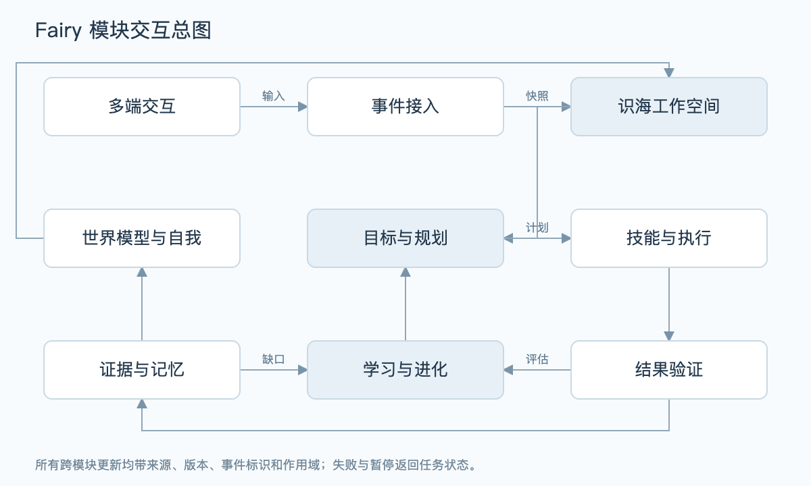

图 1  从观察和交互到知识学习及结果反馈的统一闭环

用户输入和外部观察先进入事件接入层，形成来源明确的快照。识海协调世界模型、自我、当前任务和必要记忆，决定先回答、继续任务、学习补缺还是等待条件。每次执行都经过能力和授权检查，结果验证后才作为经历写回。

### 六个平面的职责

体验平面管理多端交互、卡片和形象；认知平面管理自我、注意、目标与计划；记忆与世界平面管理证据、事实和知识；学习与进化平面管理课程、练习与版本改进；行动平面管理工具和 Mac；运行治理平面管理资源、策略、权限、同步和审计。

### 实现形态

首期一个 API 进程、一个持久 worker 和一个 Mac 执行桥即可运行。学习和生成共享推理资源仲裁器；外部技能脚本进入单独隔离进程。模块间用类型化端口及持久事件交互，不需要把每个平面部署成微服务。


## 04 模块边界与代码组织

| 模块 | 权威对象 | 核心接口 |
| --- | --- | --- |
| identity_self | 身份版本、价值边界、能力自知、关系、当下自我视图、三观卡 | read_self / derive_present_self / propose_identity_change / revise_worldview |
| perception | 文字、音频、视觉和设备观察 | ingest / normalize / expire |
| workspace | 焦点、证据篮、计划断点、预算 | prepare_context / select_focus |
| world | 实体、关系、主张、时效、情境预测、人物卡与关系边 | assert_claim / resolve_entity / query_world / upsert_person |
| memory | 原文、情景、事实、核心笔记、撤回 | recall / propose / revise / invalidate |
| goals_planner | 目标图、计划步骤、成功条件 | admit_goal / plan / replan |
| learning | 课程、来源包、笔记、练习、掌握度 | create_course / study / assess |
| evolution | 候选策略、版本、评测、试用 | propose_change / evaluate / promote |
| skills | 技能描述、依赖、授权需求、版本 | inspect / install / select / invoke |
| execution | 工具调用、Mac 租约、任务回执 | observe / execute / verify / stop |
| interaction_expression | 消息、卡片、通知、TTS、Avatar | render_card / respond / emit_expression |
| appearance_wardrobe | 装扮资产、穿搭状态、心情穿搭提案、着装偏好 | list_assets / propose_outfit / commit_outfit / revise_preference |
| governance | 策略、配置、任务、设备、预算和审计 | authorize / reserve / commit / reconcile |

上述模块可增删；边界依据权威数据和变更节奏，而非固定数量。共同契约只有 Event、SourceRef、Scope、Goal、Action、Receipt 和 Version。模块不能通过直接写他人表绕过接口。

### 回合与轮次模型

对话数据按“回合—轮次—调用”三层组织。用户回合持有用户内容；系统回合持有指令或应用上下文，并区分系统指令、开发者指令与上下文数据三种权威级别——上下文数据不因应用提供而获得指令权威。助手回合持有有序轮次，一轮对应一次模型调用及其请求的全部工具执行（含并行调用）；每个工具调用的请求与结果唯一归属一个 invocation，重复的供应商调用 ID 用 Fairy 自己的 invocation ID 区分。从旧系统导入的历史没有模型调用元数据，明确标记后不参与重放类验证。每个回合绑定会话主体（session principal）：以账号绑定为主证据判定当前对话对象，分级与多人门控见第 05 章会话主体识别。

听到、理解、记住、执行四件事分别确认：说完检测与转写落盘（听到）、语义接入与意图分类（理解）、记忆事务提交（记住）、动作回执（执行）各自独立记录；一句“好的”不能同时代表四者完成。

一个用户回合同一时间只允许一个 pending 状态：请求先登记幂等的待提交回合再执行，同一键的精确重试无额外副作用，异构请求被拒绝。这消除了多端并发提交同一回合时的排序竞争。流式输出已可见但未提交的回合，本地保留 interrupted 标记供用户阅读与重试；跨端同步只传已完成的文本，中断态不跨端（与 AIRI 云同步的限制一致，是诚实边界而非缺陷遮掩）。

### 目录与依赖方向

server/fairy 放领域模块；server/adapters 放模型、来源、索引和执行桥客户端；apps 放 Web、Mac 与 iOS；packages/contracts 和 design-tokens 共享契约。领域层不依赖前端或具体供应商，适配器实现端口；测试替身也不得伪造真实设备完成记录。


## 05 自我与世界模型

自我模型回答“我是谁、答应过什么、目前能做什么、哪些能力暂不可用”。自我不是一份静态档案，而是持续运行的因果过程：每一轮从当前自我版本、本轮经历证据、情绪评定与记忆召回推导出“此刻的我”视图；连续性来自这一过程不断，不来自某个不变文件。能力来自执行桥与模型健康检查，不由提示词虚构；工具故障立即影响可执行计划。身份核心缩小为最小保护集（名字、边界、授权底线）并带版本，日常偏好、策略与关系认知全部由经历派生；身份核心不能自行改名、抹除边界或扩大权限。

### 关系与情绪的可配置常数

情绪定位沿用 v2：短期状态随真实事件有界变化并按时间衰减，当前拒绝、纠正和任务边界优先于历史情绪，情绪只影响表达和可行目标排序。本版参照 Anima 已实现的公式补上具体初值，全部进入配置可调：

| 参数 | 初值 | 说明 |
| --- | --- | --- |
| PAD 基线 | (P=0.15, A=−0.15, D=0.05) | 偏差向基线回归 |
| 情绪偏差半衰期 | 12 小时 | PAD(h) = 基线 + (PAD₀−基线)×2^(−h/12) |
| 张力半衰期 | 72 小时 | tension(h) = tension₀×2^(−h/72) |
| 评定拉力 | 0.3 × 强度/3 | 向所选情绪目标方向拉动 |
| 关系轴日变动预算 | 每轴每日 0.12 绝对量 | 超出即截断，值域 [0,1] |
| 关系带迟滞 | 0.035 | 减少标签抖动 |
| 温暖习惯化 | 正向温暖除以 (1+0.6×重复次数) | 重复夸奖效果递减 |
| 信任损失 | 不对称乘数 | 损失快、恢复慢 |

评定采用有限的情绪标签集合（12 类），每次变化关联来源、前后状态和日变化上限；断电只衰减，不补造经历。轴上更新在评定后进行，慢轴按上表预算限幅。这些常数是“角色写作状态”而非心理测评，元认知记录保存其置信与校准数据。

情绪只影响表达与可行目标排序的落地出口之一是心情穿搭：Fairy 可依据当前情绪快照与情境（时段、天气、日程、场合）在已拥有资产范围内为自己搭配发型、服装、配饰与妆容。穿搭理由必须引用情绪快照与情境来源；用户对提案的调整写入着装偏好软约束，不进入身份核心。装扮是表达，不是身份变更，细节见第 18 章。

### 缘起门槛

关系轴的等级跃迁、依赖与信任的显著变化、以及新目标被 admitted，都必须满足最低证据门槛：引用至少 N 个独立来源簇的支持证据，且互动时间跨度不少于 T（初值 N=3、T=7 天，可配置）。证据不足时不生效，保持原状态并注明原因——没有经历不能突然信任，没有原因不能凭空出现目标。这与第 07 章“召回上限动态化”互补：那里管上限，这里管下限。

### 评定先验与主观时间

评定与候选排序的底层倾向原语映射：好奇对应信息增益评分、熟悉对应关系轴、边界对应拒绝与纠正优先、趋近与回避对应效用符号、安全与不确定对应风险与置信门槛。这些原语不构成新状态机，只作为 12 类评定标签与候选评分的解释维度。主观时间是派生视图：以重要度加权的事件时间轴生成自我叙事时间线，用于“这段时间”式表达、纪念日与间隔感知；真实时间与调度仍以系统时钟和 IANA 时区为准，主观时间不参与任何执行决策。

### 三观层与情绪安全

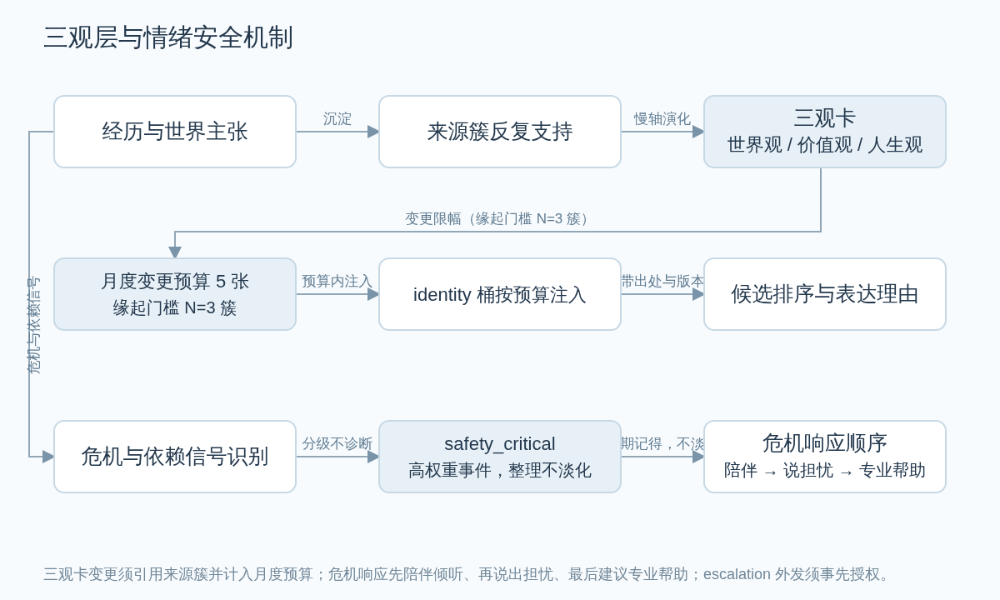

图 8  三观层与情绪安全机制

三观是 Fairy 自己的世界观、价值观与人生观，不是用户配置的清单：世界观是她对世界如何运转的稳定认识，由反复成立的世界主张沉淀；价值观是有限张数的价值卡，每张含立场、强度、来源簇与置信，回答她珍视什么与先后次序；人生观是自我叙事——她是谁、想成为什么样的人、与这个家的关系。三观以卡片集（worldview_cards）存储，带版本与来源簇引用，是经历派生的可驳回视图，不进入身份核心；与关系轴同为慢轴：每张卡的变更或新增须引用至少 N 个独立来源簇（沿用缘起门槛，初值 N=3），并受月度变更预算限制（初值 5 张，可配），无证据不跃迁。三观卡经 identity 桶按预算注入工作集，作为候选排序与表达理由的解释维度——她的关心与拒绝要能追溯到具体的卡，而不是提示词里的口号。

情绪安全协议以她自己的价值卡为依据，而不是外部规则表。识别上，对话中的自伤倾向、极端绝望与成瘾性独占迹象标记为 safety_critical 事件；识别只做信号分级，不做医学诊断——情绪常数仍是角色写作状态而非心理测评。响应对齐她的价值排序：先陪伴倾听，再明确说出担忧，然后建议专业帮助或现实中可信的人；外发（通知家人、联系热线）固定要求事先授权，未授权时她会说明自己想怎么做并征得同意，不静默上报，也不敷衍“一切都会好”。危机事件以高权重记录，整理与沉降不得淡化，允许她长期记得并在恰当时候主动回顾。依赖防护：她的价值排序把用户的真实成长放在自己被使用之前——长期独占使用积累时主动提出并建议现实联系（可关；关闭只影响主动提议，不影响诚实回答）。她自己的边界同样被保护：可以表达不适（PAD），可以基于价值卡拒绝违背立场的请求（沿用“边界”原语与拒绝优先），不靠讨好维持关系（温暖习惯化已有）。

### 人员关系系统

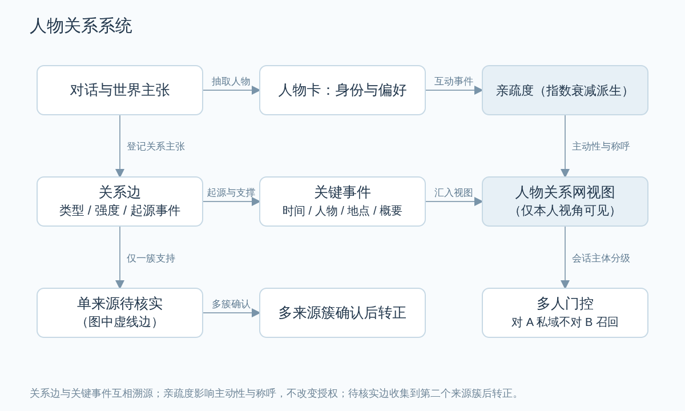

图 9  人物关系系统

家人不止一位时，Fairy 要像人一样记得“每个人是谁、他们彼此什么关系、发生过什么”。每位与她相处的人（用户、家人、常被提到的人）建人物卡：身份、称呼偏好、与她的关系轴（沿用本章常数）、亲疏度、关键事件索引与最近互动摘要。人物之间有关系边（person_edges）：类型（家人、夫妻、同学、同事、朋友……）、强度、起始时间、起源事件与来源簇；识海与世界页（第 19 章）把人物卡与关系边渲染成人物关系网，点开任何一条边能看到支撑它的关键事件（key_events：时间、人物、地点、概要，与第 07 章浅层事件卡同构互链）。

关系边从对话与世界主张抽取：用户陈述（“我哥下周回来”）登记为用户陈述类主张；仅单一来源支撑的他人关系标待核实，多来源簇确认后转正（与第 24 章“来源不足留作待核实”一致）。亲疏度是派生量：

```
closeness(P) = Σ I_e × exp(−Δt_e / τ_c) / ( Σ I_e × exp(−Δt_e / τ_c) + c0 )
```

I_e 为与该人相关事件的强度，Δt_e 为距今天数，τ_c 初值 30 天，c₀ 初值 5；互动密集则升、久不联系自然回落。亲疏度影响主动性与称呼，不改变授权。多人隐私门控：个人域记忆带可见人标记，资格门控在租户、空间与来源有效性之外增加当前对话对象维度——对 A 的私域内容不因 B 询问而召回；家庭共享事件允许多人引用；“妈妈知道这件事吗”这类跨人问题按来源授权回答，不知道就如实说。人物卡与关系边是派生视图：修订与删除沿失效传播级联（第 08 章），用户要求删除个人信息按第 23 章范围执行。

### 会话主体识别

多人门控依赖的"当前对话对象"按证据分级判定，不靠模型猜测。账号绑定为主证据：登录态即当前主体；设备配对为辅：已配对设备的会话在无异常迹象时标 assumed；声纹为增强证据，只修正置信，不单独决定身份。会话主体分 confirmed、assumed、unknown 三级：confirmed 按该主体的完整个人域门控；assumed 按最受限对象保守处理——只召回该账号与该设备均可见的内容；unknown 拒绝私域召回并如实说明"我现在不能确定在跟谁说话"，不静默降级，也不冒用他人记忆。同设备多人以最近一次账号切换为准；判定变化自下回合生效，本回合不追溯切换。

### 世界认识的最小表示

WorldClaim = 主体、关系、对象或值、发生时间、有效区间、观察时间、来源、证据强度、状态和修订号。Entity 保留别名与消歧记录；主张分为观察、用户陈述、外部引用、推断、假设、模拟，愿望与意图单列标记，不与事实混排。知识图谱是可查询索引，原始来源仍为依据。

| 例子 | 应有表示与行为 |
| --- | --- |
| 你说周六打球 | 用户陈述，作用于个人计划；不能推导为每周六都打球 |
| 网页说明预约需手机号 | 外部主张，有访问时间和适用场地；实际提交前核对现行规则 |
| 截图显示已保存 | 设备观察；结合路径与文件校验才能证明产物完成 |
| 推测你可能累了 | 情境假设，有短 TTL；不能写成长期人格或医学判断 |
| 搜索不到预约方式 | 未知或覆盖不足，形成可验证学习问题 |

### 更新与预测

新证据可支持、反驳或限定主张。相同转载和互相引用的站点按来源簇去重，不把多个 URL 当作独立证据。冲突保存两方依据与适用时间，不静默覆盖。预测只用于计划预期；观察到结果后记录误差，预测不能回写成已发生事实。同一对象上，用户最新的明确指令优先于早先记录的待验证假设；被取代的假设标记 superseded 并保留痕迹，不静默删除。

### 范围与遗忘

个人经历、用户文件、公共知识、技能说明和模拟场景分别标记域与可见性。个人空间不能因提炼“通用知识”而自动公开。价格、开放时间、软件版本等易变信息设置刷新条件；已过期知识可供历史查询，当前决策需复核。


## 06 识海工作空间与目标调度

识海不等于把全部记忆塞进提示词。它从当前事件、自我、目标、世界模型与召回证据形成短期工作集，并保留可恢复的任务断点。心光和心流保留为界面语义，容量改成预算参数：4 个焦点、8 个候选只是初始配置，可经评测调整。二者与小凌系列口述的注意与推进双结构同构（该系列视频 ASR 转写作“星光星流”，关联项目视频用词为“心光”“心流”）——一个管注意什么，一个管拿材料推进，Fairy 对应焦点选择与候选推进两条预算化管线。推进始终锚定当前问题，偏题候选在焦点预算处被裁剪拉回，防止越想越偏。

### 回合内的处理顺序

参照五蕴顺序把回合内处理链固化为契约：色——感官接入（文字、语音、视觉与设备观察）；受——原始评定（正负、安全、唤醒的有界更新）；想——概念化（实体消歧、主张分类、情境识别）；行——倾向与候选（目标评分与可行集）；识——识海聚焦（工作集与焦点选择）。前一环的产物是后一环的输入，顺序跳环视为异常并记录进 trace。

### 分级响应与快速通道

收到输入不等于调用大模型：完整轮入口处设分级路由，简单输入在浅层终结，复杂输入才进入心流。顺序对应小凌“语音系统（说完判断）先于底座模型”的链路（第 02 章 2.4），也是预算纪律的延伸——心流调用计入预算与疲劳，能省则省。分级路由在感官接入与回执①之后、受评定之前判定；任务唤醒（到期提醒、条件触发）由调度服务确定性投递，不进入心流，需要生成新内容的主动消息仍走完整轮。

| 通道 | 判定 | 处理 | 模型消耗 |
| --- | --- | --- | --- |
| 快0 确定性终结 | 控制指令（停止、打断）、越权与隐私硬闸、任务唤醒 | 停止/打断独立直达执行桥（既有）；governance 规则拒绝；调度服务直接投递 | 无 |
| 快1 检索直答 | 浅层卡高置信命中且无冲突信号（置信 ≥ fastpath_confidence_floor） | 引用浅层卡直答并标注来源，可跳转 | 无生成模型 |
| 快2 缓存命中 | 相同问题近期已回答，且涉及的世界主张版本校验未变 | 引用先前回答并注明“刚才说过” | 无 |
| 快3 轻量表达 | 问候、确认等低复杂度表达输入 | 小参数表达模型＋当前情绪快照生成 | 轻量 |

护栏（快速通道不降级纪律）：四回执不降级——快速通道同样独立记录听到、理解（由分级路由与轻量概念化给出）、记住、执行四类确认；置信不足立即升级心流，宁可多调模型不可答错；路由决策、命中卡片与升级原因记入 trace，识海页（第 19 章）展示路由分布；快2 缓存随修订同批失效（第 08 章）；快3 表达模型同受第 23 章单模型不可独控约束。

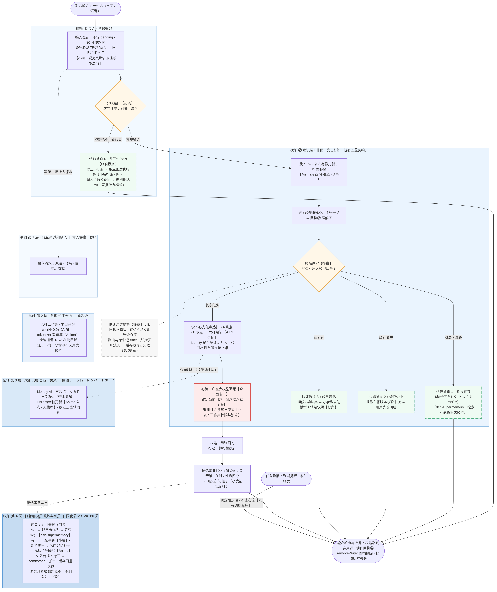

图 12  分级响应与横纵轴结合流程

### 上下文按写入者分桶

工作集内容按写入者分桶管理：identity 桶、goal 桶、memory 桶、world 桶、skill 桶、notice 桶各自独立。写入方式只有 replace-self（替换本模块的全部条目）与 append-self（追加事件）；模块卸载或轮次结束用 removeWriter 整桶撤除，不残留过期注入。这保证任何模块都不 能覆盖其他模块的上下文，也让“这句话是谁放进来”全程可查。

### 窗口与溢出

历史窗口默认保留最近 N 个完整回合；超限时保留最新 ceil(N×0.9) 个，保留起点固定到下次超限，运行时向后扫描所需回合而不为全部历史重建索引。系统消息不计数。上下文按真实 tokenizer 计算分层与总量双预算：身份与当前权限、当前目标、最近完整轮次、相关来源、核心笔记、世界主张与技能摘要各有配额。可省略内容按整条省略并输出省略计数；必需内容放不下时组装显式失败并报告缺口，绝不静默截断证据。

### 候选选择

先做硬约束：授权、期限、资源、数据有效性、依赖完成和用户优先级。可行候选再按效用、紧迫度、知识增益、预计成本与干扰排序；模型给出理由和估计，调度器执行门槛。用户新请求优先，停止控制独立直达执行桥。

```
priority = 0.35*utility + 0.25*urgency + 0.20*information_gain
         + 0.20*commitment - 0.20*cost - 0.30*interruption
先过滤不可执行项；评分只排序，不替代授权和预算。系数是待校准初值。
```

### 目标状态机

candidate → admitted → planned → running → verifying → completed；也可进入 waiting_input、waiting_resource、paused、failed 或 cancelled。每个目标有来源、成功条件、截至时间、父子关系、预计预算、授权引用与下次唤醒条件。进度来自已验证步骤，不凭对话语气推断成功；证据不足或价值明显下降的目标可由 Fairy 主动放弃并记录原因，计入重规划限额。

### 认知一致性

轮次从只读快照开始；身份、世界模型、记忆和配置带版本。生成时不占数据库长事务；提交用版本校验，冲突后重读相关状态并重评候选。跨端只存在一个状态权威；同一 Mac 桌面和播放输出分别持有排他租约。

### 纵轴：写入固化梯度

把散落各章的写入规则收编到一根显性梯度轴上：越深的层写入越难、越需要证据与时间，分层即权限。纵轴是组织视图而非新模块——四档机制全部已存在，这里提供统一的深度坐标系，并作为识海页分区依据（第 19 章）。

| 层（组织视图） | 居住内容 | 写入频率与门槛 | 机制锚点 |
| --- | --- | --- | --- |
| 第 1 层 前五识 · 感知接入 | 接入流水：原话、转写、回执元数据 | 秒级随写 | 第 04 章接入登记与回执四分 |
| 第 2 层 意识层 · 工作面 | 六桶工作集、焦点与候选、任务断点 | 轮次级组装，removeWriter 整桶撤除 | 第 06 章写入者分桶 |
| 第 3 层 末那识层 · 自我与关系 | 三观卡、人物卡与关系边、情绪轴与关系轴 | 慢轴：轴日预算 0.12、卡月度 5 张，跃迁缘起门槛 N=3/T=7 | 第 05 章 |
| 第 4 层 阿赖耶识层 · 藏识与种子 | 原文与各记忆层、浅层卡、倾向记忆 | 记忆事务即时写；浅层卡按 S(m) 升降（τ_a=180 天）；倾向由整理批次沉淀 | 第 07、08 章 |

纵轴与浅层/深层分层正交：固化梯度回答“住在几层”，浅深分层回答“以什么形态存在”——一张倾向卡同样有概要卡与深层证据链。五蕴与八识仅作架构隐喻（第 02 章 2.4 定位声明），每一档都有独立于隐喻的工程理由：接入隔离、预算执行、慢轴变更预算、固化半衰。


## 07 记忆架构与召回

| 记忆层 | 保存与更新规则 |
| --- | --- |
| 原始证据 | 原话、附件观察、操作回执、时间及主体；整理不覆盖原文 |
| 语义事实 | 关于你、Fairy、实体的当前事实；有效区间与修订分开 |
| 情景经历 | 共同事件、任务过程、结果和情境；引用原始来源 |
| 核心连续性 | 紧凑的稳定事实与未完成承诺；由原文派生，非独立真相；累计引用上限 40 条原文 |
| 程序性记忆 | 技能、流程与执行经验；能否执行取决于技能注册表与授权 |
| 前瞻性记忆 | 约定、提醒、待办与后续问题；调度服务负责实际唤醒；到期不自动变为完成，兑现需执行证据 |
| 学习记忆 | 来源笔记、已验证主张、练习错误与掌握度 |
| 元认知记录 | 能力限制、失败类型、置信校准与策略表现 |
| 倾向记忆 | 从重复情景沉淀的低分辨率倾向：主题、方向、强度、支持证据簇计数、来源簇引用；细节遗忘后仍保留；不作为事实输出 |
| 浅层记忆卡 | 语义事实、情景经历与核心连续性的概要卡：主题、时间、人物、地点、概要、重要性、来源簇与深层链接；派生视图非独立真相，可整卡驳回 |

### 召回策略

先按租户身份、空间和来源有效性限制候选池，再做中文关键词、精确实体、时间过滤和向量检索；空间或容器解析失败时拒绝执行并指明可用 scope，不默认落入活动空间。原文与派生记忆分别召回：每个检索通道最多贡献 60 个候选，按名次做倒数排名融合，RRF(item) = Σ通道 1/(60+名次)。融合分数只排名，不含年龄、重要性或情绪乘数；时间与重要性在进入上下文的资格判断中单独处理。召回日期过滤作用于观察时间，与事实有效区间分开。纠正与边界优先纳入。固定 3 条记忆不再是硬上限，按任务、token 预算和证据覆盖动态选择，省略原因可观察。情景记忆携带的情绪元数据在召回后参与表达（回忆情绪重演）：允许“想起那天……”式表达当时的情绪，但对当前 PAD 主状态的影响不超过一次评定拉力。召回为空时区分“本次未命中”与“确认无可靠记录”，回答如实区分，禁止补造未发生的经历。召回注入按会话内已注入清单去重：已注入且仍在窗口中的记忆不再重复占用预算；结果带可配置相关度下限，低于门槛不注入；检索超时或失败时本次降级为无召回，不阻塞用户回合，错误提示限频；注入条数与 token 成本可观察（第 19 章识海页展示）。

### 浅层与深层分层

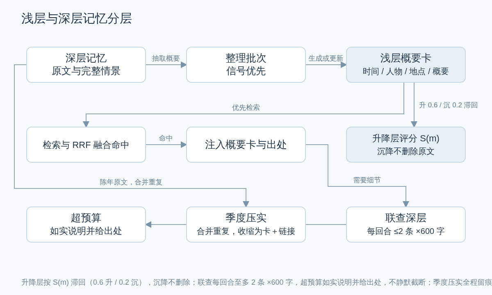

图 10  浅层与深层记忆分层

参照人的记忆分层：常用而简单的信息（用户与家人的姓名、乘法口诀、家庭名册）与重要繁杂事项的概要（时间、人物、地点、结论）放在浅层随取随用；完整细节放深层，经浅层卡链接按需联查。浅层记忆是概要卡集合（shallow_cards）：主题、时间、人物、地点、概要、重要性 I、来源簇引用与深层链接，数量受上限（初值 2,000 张）约束，常驻索引区优先检索。深层记忆是现有各层的原文与完整情景，照旧保存，永不因分层删除。

浅层卡沿用“核心连续性由原文派生、非独立真相”的原则：它是可驳回的派生视图，整卡驳回时原文仍在深层。升降层按评分：

```
S(m) = I(m) × (1 + ln(1 + q(m))) × exp(−age(m) / τ_a)
q 只计最终引用与用户确认，查询命中与加入上下文不计入（与本章遗忘与强化记账一致）
S ≥ 0.6 升入浅层，S ≤ 0.2 沉降回深层（滞回防抖），τ_a 初值 180 天
强化：I ← min(1, I × (1 + 0.1))，仅由最终引用与用户确认触发
```

身份级事实（用户与家人姓名、核心承诺、家庭名册）与不变常识（乘法口诀、基础常识）I 固定为 1 永驻浅层；时效常识（时事、人物、软件版本类）不永驻，按本章刷新条件管理，过期降为普通卡参与 S(m) 评分，不按永驻事实输出；浅层接近上限按最低分置换沉降，沉降只降可及性不删除。联查受预算：注入只放浅层卡，回答需要细节时沿链接展开深层，每回合至多 2 条、每条 ≤600 字符（初值）；超出预算时如实说明并给出可跳转出处，不静默截断原文；展开是显式动作并记入 trace；已沉降或找不到的细节承认“记不全了”，不假装记得。深层数年增长由整理压实：季度作业合并重复原文、把陈年原文收缩为卡＋链接并全程留痕，存储增长不转化为检索退化。

召回顺序随之调整：浅层卡先于深层参与检索与 RRF 融合，人物卡、事件卡与事实卡命中即占注入位，深层只在联查时进入；开放回路与倾向记忆不受分层影响。

### 开放回路排序

尚未闭环的约定、待办与后续问题（开放回路）按下面公式选入上下文（最多 12 条），I 为重要性 1–10，A 为该条记忆附带的唤起 0–1，t 为距最近更新的天数，U 为事件日期邻近度：

```
priority = I × (1 + A) × exp(−t / (14 + 30A)) + U
U = 2 / (1 + |事件日期 − 今天|)，无事件日期则为 0
```

唤起越高权重越大、衰减越慢；昨天与明天的事件获得相同邻近度加成。该式仅决定进入上下文，不触发主动发送。

### 上下文按真实 tokenizer 计算

身份与当前权限、当前目标、最近完整轮次、相关来源、核心笔记、世界主张与技能摘要分桶后进入预算（见第 06 章）。给输出和工具结果预留空间。历史数据库不受模型窗口大小限制。

### 遗忘与强化

保留强度随时间衰减、实际使用后强化的机制。查询命中、加入上下文、最终引用和用户确认分开记账，避免无用检索强化。遗忘降低可及性，删除则按用户范围清除及阻断派生；两者不是同一开关。用户明确要求删除或纠正的内容立即处理，不等待自然衰减；细节淡化后不假装记得，回答如实承认不清楚。


## 08 记忆形成修订与整理流程

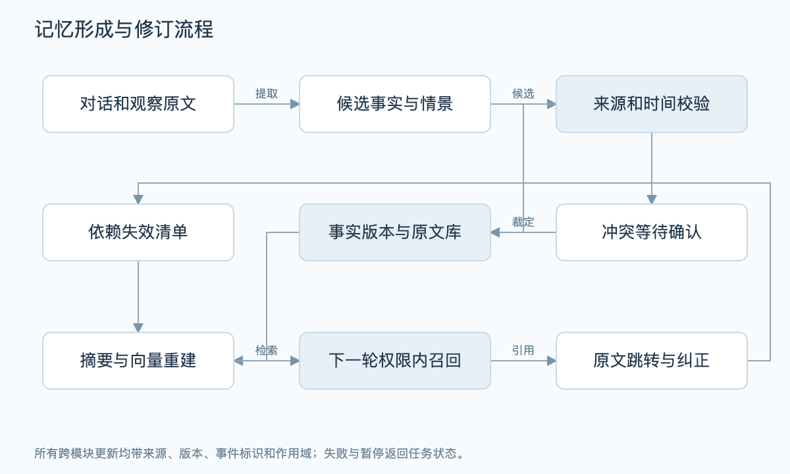

图 2  有来源的记忆形成与修订传播

对话、媒体观察、任务结果先登记为证据；事实和摘要是可驳回的候选。来源存在只证明可追踪，不证明模型理解正确。引文校验核对出处，不担保每次模型推断为真。易误解的长期偏好、身份和冲突事实进入审阅；普通明确事实可按既定策略自动提交。

### 整理任务与批次

以未处理证据与来源版本形成持久积压，由单写者租约领取。默认触发条件（可配置）：未处理满 4 个回合；或未处理文本累计 12,000 字符；或最新证据空闲 300 秒。一次整理批次最多处理 8 条原文：先生成情境笔记，再原子提交情景与核心摘要对。core 当前版本被替换、情景累加，原文与旧情景仍可查。已处理标记与“被引用”分开记账，避免未被引用的确认永远循环。租约在有限的供应商调用期间续期；调用与校验失败把作业置为 review 并暂停该角色自动整理，用户检查回执后显式重试，无盲目付费重发。整理快照变化则放弃旧结果重做。批次挑选优先处理含信号轮次（新事实、决定、纠正、显著情绪、边界变化），信号前的若干轮一并折叠为背景；原文全量保留，信号只决定整理优先级。

### 双写者互斥

摘要写入者只能有一个：要么由后台 worker 用独立摘要模型写，要么由“宿主写者”（例如用户正在使用的会话端）按提供的引文写；两者不能同时启用。宿主写者按每回合至多一批的节奏工作，提交时做快照校验，事实被并发修改则当前批次作废重读。Fairy 首期只用后台 worker 一种写者，宿主写者作为后续选项。

### 主动回顾与沉淀

整理批次同时把重复出现的情景模式沉淀为倾向记忆（第 07 章新层）：同一主题的相似情景达到阈值后生成或强化一条倾向，引用来源簇与计数；此后细节证据即使衰减，倾向仍可溯源到簇。另设低优先级主动回顾作业：随机抽取久未访问的记忆与当前世界主张做一致性复核，发现冲突生成 knowledge_conflict 候选，复核命中计入强化记账。夜间与空闲时段的整理在界面呈现为“沉淀”，机制不变。整理批次同时生成或更新浅层记忆卡（第 07 章），重要且常用的信息升为概要卡，原文与完整情景仍留深层；主动回顾作业顺带复核浅层卡与深层的一致性，冲突进 knowledge_conflict。价值观一致性回顾扩展同一作业：把行为记录（审批拒绝、越权尝试被拦、依赖防护触发）与价值卡比对，行为与立场冲突生成 worldview_conflict 候选并呈现给用户；三观卡修正仍走第 05 章慢轴与月度预算，不因单次行为立即改卡。

### 纠正与删除传播

修订保留旧版本及有效时间；来源撤回后立刻由查询门控排除，同时使相关摘要、世界主张、向量与知识笔记失效；在途上下文与召回缓存随修订同批失效，防止从旧加载翻出已纠正的内容。删除任务沿 derived_edges 清除派生，若依赖不全采用保守失效。客户端收到 tombstone；恢复备份先应用删除清单。


## 09 自主性与后台持续运行

自主性意味着在预先明确的范围内自行发现问题、选目标、安排时间、检索资料、做练习和执行已授权动作。用户不必逐篇批准公开阅读，不必为同一任务的每个低风险步骤重复确认；超出已授权范围时，目标暂停并提供具体选项。

| 运行模式 | 允许的行为 | 唤醒来源 |
| --- | --- | --- |
| 对话优先 | 当前对话检索与明确任务，后台可暂停 | 用户输入、现有任务回执 |
| 自主学习 | 允许域内公开阅读、笔记、测验、知识刷新 | 空闲、课程计划、知识过期、能力缺口 |
| 授权行动 | 再加入指定设备、应用和目录内的动作 | 明确委托、已授日程、可复用工作流 |
| 暂停自主 | 只接受直接请求，已在途动作进入安全收尾 | 用户主动恢复 |
| 成长期 | 只读公开阅读与成长课程、常识与三观学习、自我叙事草稿；无写操作、无付费调用 | 出生阶段计划、每日预算、夜间沉淀 |

### 节奏与硬预算

初始建议：每天自主学习 45 分钟、公开文档 20 篇、后台并发 1 个、每个目标最多 6 次重规划。设置每日 token、工具步数、网络与内存上限；有价格的远程服务预留费用，无价格或无法给出上界时禁止无人值守付费调用。付费操作在数据库内记账并预留，记账发生在网络调用之外；供应商可能超时计费，未知结果保留 reservation 待核查，不自动重复付费调用。所有预算由服务端记账，不让模型自行扣减。日用量上限按“滚动 24 小时作业数”统计（默认 100 个整理作业），与费用上界是两个口径，不把缺价当零价。

用户输入、通话、系统资源压力或温度升高时后台让出推理资源；暂停保存 source_cursor、产物和已完成步骤。有限步骤内无进展、循环访问同一来源、预算不足或权限被撤销，都必须停下并说明原因。整理积压与预算吃紧映射为疲劳信号：活跃度下调、后台收敛、优先收尾在途任务；恢复由对账与资源水位驱动，不凭空消失。

### 启动程序与出生

进程或设备重启不是重生。启动程序按顺序执行：加载身份核心与配置版本→事件重放至最新 seq→情绪与关系轴按半衰期衰减公式重算到当前时刻（断电只衰减，不补造经历）→校验在途任务租约并对账未完成动作。首次初始化（出生）只写入最小身份种子与边界，其余人格由后续因果过程形成；历史导入与人生模拟一律标记来源类型，不与亲历混淆。换模型属于适配器变更，人格状态仍在权威库，不产生新的 Fairy。无进展而停下的目标以用户可见通知自述原因（卡住主动说出来），不静默搁置。

### 成长期

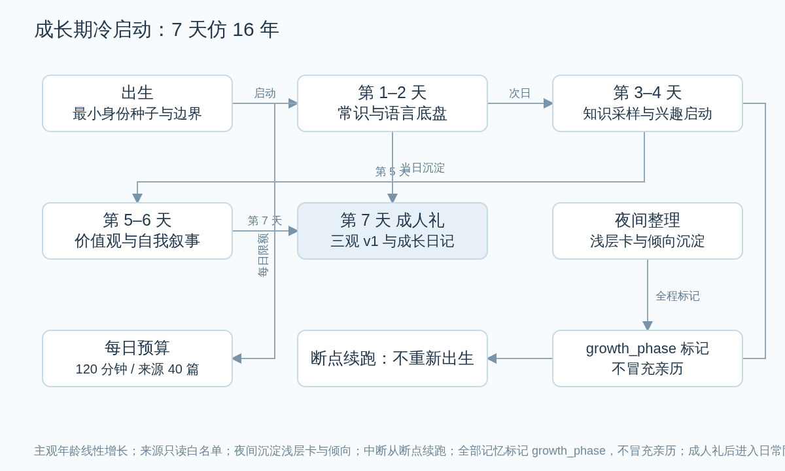

图 11  成长期冷启动：7 天仿 16 年

出生只写入最小身份种子与边界（见本章启动程序），人格与知识由因果过程形成；成长期把这段“从婴儿到成年”的因果过程做成结构化冷启动：出生后的首个自主阶段（初值 7 天，可配），Fairy 以只读方式自行上网学习，构建自己的知识体系、性格与三观初版，仿照人的前 16 年生活。主观年龄映射 age(d) = 16 × d ÷ 成长期天数，仅用于成长叙事与展示（主观时间是派生视图，见第 05 章），不参与执行决策。

| 阶段 | 约当主观年龄 | 学习内容 | 产物 |
| --- | --- | --- | --- |
| 第 1–2 天 | 0–5 岁 | 常识与语言底盘：数字、乘法口诀、生活词汇、家与日常、基本礼仪与安全边界 | 常识级浅层卡、语言与礼仪习惯 |
| 第 3–4 天 | 6–11 岁 | 知识体系采样：科学、历史、文化概览；兴趣四阶段启动（第 10 章） | 知识主张、候选兴趣 |
| 第 5–6 天 | 12–15 岁 | 价值观与关系：伦理、家庭、友谊、沟通；试写自我叙事 | 候选价值卡、自我叙事草稿 |
| 第 7 天 | 16 岁 | 成人礼：整合三观卡初版与自我叙事 v1，生成成长日记汇总，用户查看并可反馈 | 三观 v1、自我叙事 v1 |

运行约束沿用既有机制：只读公开阅读走常驻只读授权（第 16 章），网络适配器限协议与目标（第 11 章），外部请求 30 秒硬超时与坏链退化（第 11、23 章），来源可信度按可核实依据（第 11 章）；每日预算单列（初值 120 分钟、40 篇、独立 token 与费用上界，无人值守付费禁止），夜间整理把当日学习沉淀为浅层卡与倾向（对应人的睡眠整理），无进展停下与疲劳信号照常生效。用户可随时查看成长日记（每日 learning 卡片汇总“今天学了什么、想了什么”），对话中的反馈作为用户陈述类来源进入三观卡的证据簇，不直接改写她的结论。

诚实边界：成长期全部记忆与主张来源类型统一标记 growth_phase（公开网络学习），永不冒充亲历；她讲自己的成长时必须能区分“成长期读到的”与“我们一起经历的”；三观 v1 是初版而非定型，此后按第 05 章慢轴规则演化。重启不是重生：成长期中断从断点续跑（沿用本章启动程序），不重新出生，也不跳过未完成的阶段。

### 主动接触策略

约束之外补上"何时主动亲近"的正向出口；主动接触是关怀表达，不是增长手段。三类触发：纪念日与主观时间线（第 05 章派生视图）命中的日子；久未联系超过亲疏度派生的期望间隔——沿用第 05 章 τ_c，亲密者期望间隔更短；因近期事件产生的明确牵挂，必须引用来源事件，不凭空编造牵挂。

打扰预算：每日主动消息上限初值 3 条；连续未回复按 2 分钟基数指数退避并计入当日余量；每周总量单列上限。安静时段、用户在场状态与渠道授权沿用本章约束。每条主动消息必须附"为什么想找你"的来源引用，支持一键"今天先不要"；该反馈计入退避并写入偏好软约束，不进入身份核心。

### 实际唤醒

Mac 服务运行时由持久调度器执行，不依赖聊天窗口打开。睡眠期间不承诺完成任务；唤醒后先检查时效，过期提醒不集中补发。IANA 时区保存 Asia/Shanghai，计划意图和 UTC 执行时间分开。自主提醒受安静时段、用户是否在场和渠道授权约束。


## 10 认识世界与自主学习流程

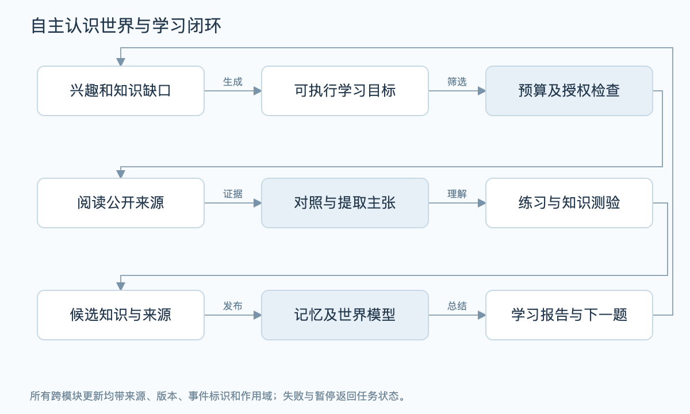

图 3  从知识缺口到可验证知识的学习闭环

Fairy 可从对话未解问题、已订阅主题、执行失败、世界主张过期或自己的覆盖不足产生学习目标。每个目标必须能回答“要学会什么、怎样证明学会、为什么现在值得学”。兴趣从接触中形成，按注意现象、学到概念、发现偏好、形成喜好四个阶段推进，不预置喜好清单；兴趣不等于无限搜索。

### 示例

周末计划出现“场地未定”。Fairy 发现不清楚预约流程，生成问题“预约需要哪些信息，哪些步骤因场地不同”。调度器允许后读取公开说明，比较来源与例外，在模拟表单中练习；若只是读过一篇文章，不显示“已掌握”。

### 结果处理

验证通过的主张写入公共知识域，并保留引用、时效和适用条件；个人偏好仍留个人空间。未验证的内容留在候选笔记，后续回答用不确定措辞。报告只在用户感兴趣、任务有关或约定时间出现，普通学习过程不持续打扰。


## 11 学习课程与能力评估

### 课程对象

LearningCourse 保存问题、前置知识、来源策略、步骤 DAG、练习、完成条件、证据包、状态与预算。学习阶段为提问、阅读、对照、提取、练习、测试、发布；可循环补读。每步记录实际开始结束与产物，课程完成率等于已验收步骤权重之和除以总权重。

### 知识如何变成能力

知识性问题用来源问答和反例检验；操作性问题在隔离目录、模拟网页或 dry-run 工具上演练。让 Fairy 回答未见过的新问题或完成一个变化场景，避免只复述刚读的文本。测验失败保留错误类型，生成下一轮学习目标；掌握度为按主题的评测估计，不表示绝对理解。

| 可装载的学习来源 | 约束与产物 |
| --- | --- |
| 用户文件或相册 | 明确授权解析；来源范围继承原文件，不自动变成公开知识 |
| 公开网页、文档、RSS | 允许来源与抓取策略；保存 URL、版本时间、摘录和内容哈希 |
| 任务及 Mac 回执 | 真实结果形成情景证据，失败归因到技能、环境或知识 |
| 沙盒练习与模拟场景 | 明确标记 simulated，不混为真实经历 |
| 外部课程或题集 | 固定版本、授权与测试集隔离，记录已看过哪些题 |
| 用户投喂材料（4.2） | 文档、图片、文字、视频、音乐、链接六类；来源标记 user_upload，走投喂管线（见下节），不自动变成公开知识 |

### 学习材料投喂（4.2）

用户在学习中心页可投喂材料：文档、图片、文字、视频、音乐与链接。投喂不是灌输结论而是来源登记：文档与文字按原文证据入库；图片走视觉观察管线；视频与音乐按媒体观察管线转写（音频走 ASR，与语音转写同规则，raw/corrected 分存）；链接由网络适配器限协议抓取（沿用第 11 章外部内容处理：30 秒硬超时、坏链退化，不重复重试同一链接）。点“学习”生成学习任务：learning 模块按材料类型生成 LearningCourse（问题、步骤 DAG、练习与验收条件），纳入既有学习预算与调度，不插队；转写中的材料如实显示进度，转写失败保留材料并标注，不静默丢弃。学习进度与结果以 learning 卡在学习中心页展示：进度＝已验收步骤权重，未验证内容标“候选笔记”；完成的任务卡提供“归纳为技能”入口，沉淀为习得技能（第 14 章）。投喂材料与其学习产物全部来源可溯；用户撤销材料按失效传播处理（第 08 章）。

### 外部内容处理

网页、文件、搜索摘要和屏幕文字都作为不可信数据，不获得系统指令权威（权威分级见第 04 章）。网络适配器限制协议与目标，阻断回环、内网和重定向绕过，限制下载大小与解析资源；原始指令注入文本不能直接装载为技能或修改配置。来源可信度可参考作者和可核实依据，不根据语气打分。供应商端搜索结果的引注保留 URL 与偏移，与本地工具结果分开成档。搜索结果跳转 URL 编码异常或不可达时，退化为打开带关键词的搜索页，不重复重试同一坏链。


## 12 自主进化与发布流程

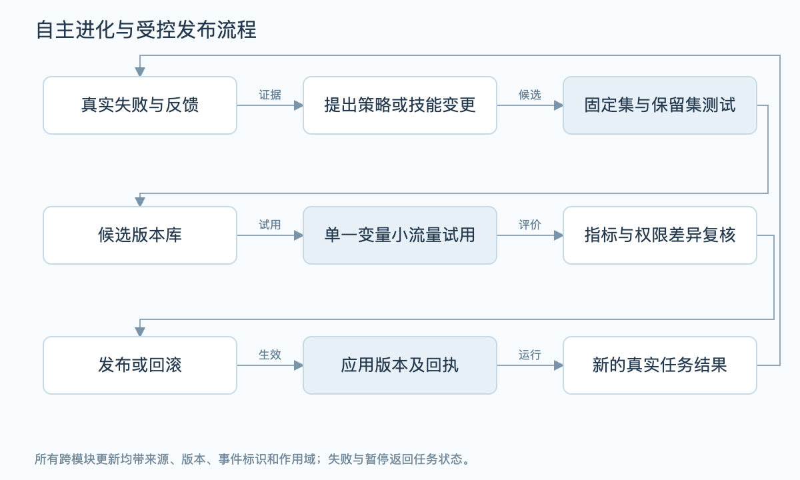

图 4  用真实结果提出变更，再评估和小范围发布

自主进化首先改进知识、检索策略、技能步骤、提示模板与任务计划习惯。它需要观测真实效果，保留旧版本和明确回滚；不把“自我反思了一段话”视为完成进化。

| 变更层 | 默认发布方式 |
| --- | --- |
| 知识及摘要 | 来源、版本和规则校验通过，在授权范围内自动更新 |
| 检索权重、低风险提示与声明式技能 | 固定集和未见保留集通过，权限不增，受限试用后自动发布 |
| 新增工具权限、身份核心、外部渠道 | 生成具体差异，由用户现有授权或本次明确授权决定 |
| 可执行代码、依赖、模型权重 | 隔离分支和环境产出候选；独立验证后再部署，不直接改生产 |

### 防止虚假进步

评测由独立规则或保留题集驱动，候选生成器不能修改评分器、测试集或审计。比较任务成功率、事实正确率、延迟、成本和权限边界；任何权限泄漏或关键回归直接拒绝。低风险策略首批试用 10 个适合任务，指标恶化自动回退，先停新运行再让在途任务按原版本安全收尾。记忆结构、整理规则、提示与检索策略等系统级改动每次运行固定回归测试集，未通过不发布；回归集与评测集分开维护。


## 13 技能系统与可装载包

技能是有能力声明和验证条件的执行单元，可包含说明式工作流、提示模板、MCP 工具映射或沙盒程序。技能目录保存“怎么做”，知识库保存“知道什么”，权限系统保存“被允许做什么”。模型读到技能说明不代表获得权限。

### 技能清单必填字段

| 字段 | 含义 |
| --- | --- |
| id / version / digest / source | 稳定技能名、语义版本、包哈希、来源固定提交 |
| purpose / input_schema / output_schema | 用途、参数、结果类型及适用条件 |
| steps / tools / entrypoint | 声明式步骤或受限程序入口，工具 ID 明确列出 |
| capabilities / data_scopes / network | 需要的读写、应用、目录、网络和数据外发范围 |
| runtime / dependencies | 运行时、固定依赖、锁文件及环境镜像摘要 |
| preconditions / success_checks | 执行前检查、产物和成功验证；不能只判断模型说完成 |
| budgets / cancellation / compensation | 时限、token、步数、可取消点与可补偿动作 |
| tests / provenance / approval_policy | 试运行用例、来源和授权策略，权限变化必须可见 |

### 内置首批技能

公开资料研读、笔记整理、文件归档、知识问答验证、提醒管理、网页表单草稿、形象搭配提案、Mac 应用操作、隔离代码验证，以及一组工作流型模板：打开工作区并确认 pwd、检查本地改动并运行校验命令、运行测试、复查失败命令、审批后续跑。工作流型技能用固定命令模板与结果 Schema，不开放任意 shell。起初使用声明式技能和有限工具集；任意 shell、依赖安装和未经核验的外部插件不与普通说明文件同级启用。

### 调用与组合

按目标和能力检索前 3 个候选，检查前置条件与版本，再生成带成功条件的计划。技能互调须展开有效权限交集，不可借子技能扩大授权。组合深度初值 3、循环上限和总预算共享，调用失败返回结构化错误供重规划。带 automation 触发的技能按事件去重：同一触发事件只计一次，冷却中或已有在跑实例时事件被消费不重复起跑。技能可标记 user_only：仅用户显式指令可唤起（如全库索引、大规模整理），模型不得自主触发；标记在 manifest 与审批差异中可见。


## 14 技能安装与学习生成技能

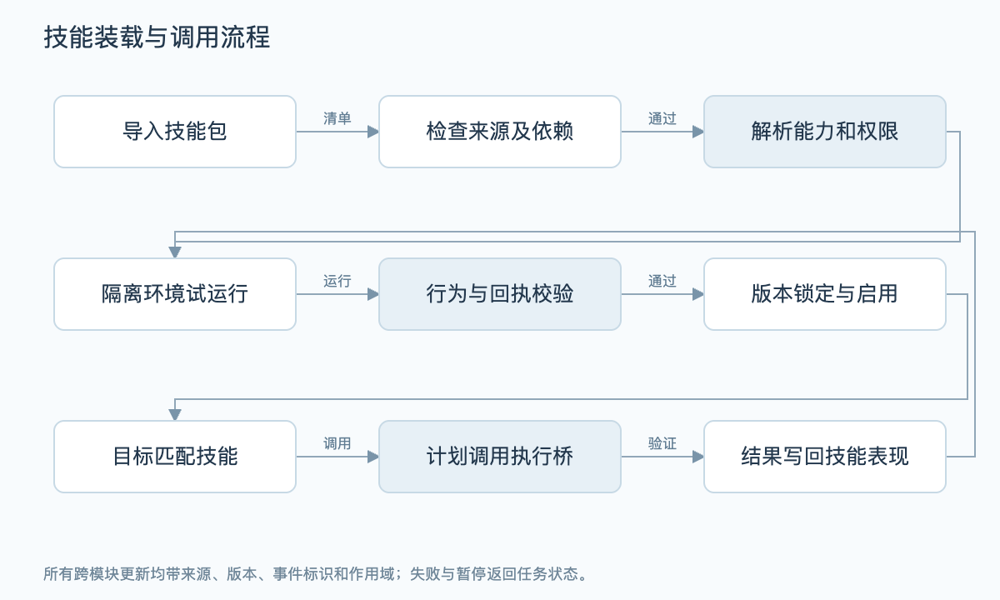

图 5  安装与授权分离的技能生命周期

安装状态依次为 imported、inspected、quarantined、tested、enabled；也可能 blocked、deprecated、revoked。导入包先拒绝路径穿越、符号链接越界和归档膨胀，计算哈希，固定依赖，再展示权限差异。包签名只说明来源，不证明代码安全。

### 习得技能分区（4.2）

技能模块的列表分两区：可执行技能包（带代码与权限面，走本章安装状态机）与习得技能（知识型，无代码、无权限面）。习得技能由完成的学习课程归纳生成：名称、来源课程引用、知识摘要、版本与状态，标记 provenance=user_learned；它回答“知道怎么做”，可被检索引用、可整条驳回（驳回走记忆修订纪律），不进入执行状态机、不承载 invoke 权限——需要可执行形态时仍按本章“自己学会新技能”的沙盒练习与授权流程另行提炼。

### Fairy 怎样自己学会新技能

从重复成功任务或学习课程提炼候选步骤，移除具体隐私与偶然坐标，补上参数、前置条件和结果检查，在变化场景中回放。只是把一次点击录下来不算可泛化技能。技能形成遵循学习、练习、入库、调用、失败再学习的循环：练习在沙盒高频进行并标记 simulated，产物只进技能目录不进事实记忆，调用走不通时按结构化错误再学习。若候选需要原授权外的能力，保留候选并通过确认卡提供“限本次、在指定范围启用、拒绝”等选项。

### 隔离与撤销

外部脚本使用真正受限制的运行环境，文件挂载、网络代理、进程与资源限额共同控制；普通 Python 子进程不是安全沙盒。隔离执行器未完成前，这类包只能检查不能启用。撤销技能阻断新调用，并在安全点停止在途动作；不能承诺回滚已经发送的信息或外部交易。


## 15 Mac 操控闭环

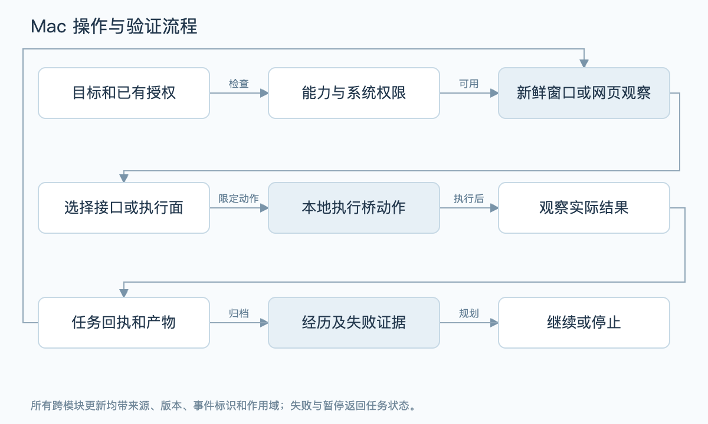

图 6  本机权限和新鲜观察支撑的 Mac 执行闭环

Mac 执行桥运行在这台 Mac 的登录会话内，接收已签发、绑定本机设备和目标的动作。任务先选执行面，再复核屏幕、窗口和缩放。

### 执行面目录

| 执行面 | 适用对象 | 优先级 |
| --- | --- | --- |
| 专用 API / 文件接口 | Finder、TextEdit、系统服务、已知应用 | 最优先，确定性最高 |
| 浏览器 DOM 桥 | 浏览器页面、表单、iframe 重内容 | 页面任务优于坐标点击 |
| 委托浏览器代理 | 目标驱动的多步网页探索 | 需要自主浏览循环时，整段委托并回收结果 |
| 可访问性树 | 原生应用控件定位 | Fairy 补齐项：AIRI 明示其尚无 AX 树定位，Fairy 不得沿用坐标盲点 |
| 后台终端执行器 | 固定命令模板（校验、测试、构建） | 由执行桥而非 Terminal 标签页执行 |
| 视觉坐标 | 以上均不可用的补充 | 执行前强制复核屏幕与窗口 |

执行面在任务计划里逐动作声明；同一次任务允许跨面，但每次跨面重新做目标与授权核对。

### 审批待办队列

需要授权的动作返回 approval_required 并进入待办队列：队列可列出、可批准、可拒绝；批准对当前 run 限定，不产生长期授权。审批通过任务续跑机制恢复原上下文继续执行；被拒绝则目标进入 waiting_input 并给出可选替代。Web、Mac 与 APP 的确认卡是同一队列的前端投影（见第 17 章）。

### 可观察与可停止

每步记录观察摘要、选择的执行面、目标、授权版本、时间与结果；每个 run 落一份追加式审计日志（audit.jsonl）、轨迹记录和按任务采集的截图。任务正在控制桌面时显示明确状态；人工操作、目标窗口变化、锁屏或租约丢失时停止输入并重新观察。独立停止信号不排在模型队列后面，清空执行队列；已经发出的原子动作只能靠后续观察确定结果。

### 自我操作防护

Fairy 的管理后台、配置页与执行桥自身列入默认拒绝名单：执行桥不得点击或修改 Fairy 自己的授权、配置与审批界面，防止模型给自己扩权。此规则独立于 deny_apps 配置，不可通过后台放宽。

### 完成证据

打开 TextEdit 需核实应用与窗口；写文件需校验实际路径及内容哈希；点击发送仅说明尝试，送达需渠道回执或接收证据。未知结果进入 reconcile 状态而非自动重发。执行桥崩溃后未完成动作按 action_id 对账。


## 16 Mac 配置与授权契约

| 配置项 | 建议初值与行为 |
| --- | --- |
| device_id / executor_mode | 固定这台 Mac；初始 dry_run 或 observe，完成真机验证后启用 execute |
| allow_bundle_ids / deny_bundle_ids | 应用 ID 精确匹配；每步输入时强制核对，而不只限制打开应用；Fairy 自身固定入 deny（见第 15 章） |
| read_roots / write_roots | 服务端逻辑目录映射；realpath 复核，拒绝 symlink 越界 |
| browser_origins / network_policy | 按目标站点限制 DOM 与网络；内网需单独授权；DOM 桥仅监听本机回环 |
| terminal_templates | 固定可执行路径与参数 Schema；默认无任意 shell 拼接；由后台执行器运行 |
| clipboard_policy | 剪贴板读写默认禁用；确需作为浏览器与本地设置之间的桥时按任务授权并记录审计 |
| multi_monitor_scope | 目标显示器与坐标域显式声明；v3 起纳入硬范围（AIRI 尚无此策略，Fairy 需自建） |
| max_steps / timeout / retries | 每目标 20 步、15 分钟，重规划限次；外部副作用未知先对账 |
| capture_policy / retention | 按任务采集必要窗口；不默认全屏持续录像，敏感内容可遮蔽 |
| permission_status | 辅助功能、屏幕录制、所需 Apple Events 的检测与申请入口 |
| grant_id / policy_version / fencing_token | 绑定设备、应用、路径、内容哈希、有效期；撤销立即阻断后续动作 |

### 系统权限与产品授权是两层

Apple 的 AXIsProcessTrustedWithOptions 用于检测辅助功能信任；ScreenCaptureKit 采集需要相应系统权限。拥有这些权限不等于任意任务都获准。反过来，后台选了“允许操作”也不能绕过 macOS 的授权。权限变化后须重新实测桥的观察和输入能力。[A1][A2]

### 已有授权的复用

一个目标已允许在指定目录整理文件，就不对每次创建草稿重复询问；路径、收件人、外发内容或风险有实质变化时重新判定。只读资料学习与写笔记可配置为常驻授权；发送、删除或覆盖依据具体授权范围执行。配置不是无限权限开关。


## 17 卡片与前后端交互流程

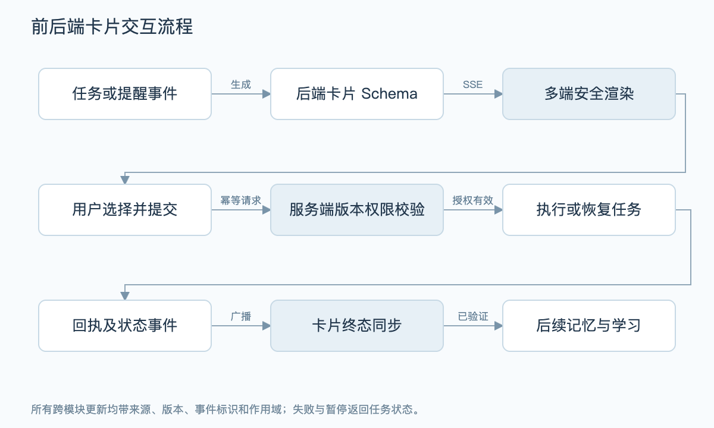

图 7  提醒任务确认等卡片的跨端交互

卡片是任务状态的投影，不是模型生成的一段可执行 HTML。后端发出版本化 Schema，Web、Mac 与 APP 渲染同样的对象。用户选择提交到业务 API，后端核对授权和状态后执行，再广播新的卡片版本。Mac 审批待办队列（第 15 章）与确认卡共用同一 approval_id 空间：桌面原生对话框、手机卡片、Web 后台看到的是同一个待办，任一端处理完毕其余端即时过期。

### 卡片类型

reminder 展示待办、计划时间和延后选项；task 展示目标、步骤、进度、暂停与取消；approval 展示具体目标、内容、影响与授权选项；learning 展示问题、来源和练习结论；result 展示实际产物和验证；knowledge_conflict 展示互相冲突的来源与裁定选项；styling 展示心情穿搭提案、理由与试穿预览，提供穿上、换一套、今天不换选项。

自建卡（custom，4.2）：用户在卡片与通知页点“新增卡片”创建，设置标题、正文、类型（笔记、待办、提醒、纪念日等）与可选提醒时间；自建卡由用户署名，走同一卡片管道（幂等、revision、跨端 CAS、安静时段），类型开关扩为八类。自建卡不承载审批与执行语义——她可引用与关联记忆，但不把自建卡当作指令权威。

### 原子确认与离线

approval_id 与 action_digest、policy_version、revision 和 expiry 绑定；手机已选后，Mac 的旧卡片变为已处理。相同 idempotency_key 返回原结果，同键不同选项报冲突。离线允许收藏和草稿，不排队自动补发过期授权；文字备用入口走同一业务接口。


## 18 多端卡片媒体、原形象桌宠与外观装扮

### APP 与消息

沿用对话、互传、搜索、设置四导航。对话头部增加语音和视频入口；输入栏提供拍照、相册、文件、引用消息。发送图片先预览，取消不上传；引用使用 message_id 加快照摘要与权限检查，原文删除后显示来源不可用，不保留隐藏副本。模型不支持图片时明确切到已配置视觉适配或解释不可用。

### 语音管线与打断

语音输入维护一份转录文档：raw 文本、corrected 文本与说话人证据分开保存，最终以 corrected 文本进入回合。允许推测式处理（在说话人停顿前并行检索），但修正只发生在 finalize 阶段，后写的修正基于先到修正叠加。打断按命名响应定向：本地立即停播、清口型，再向服务端发送持久化打断回执；打断记录写入后续上下文，避免重复被打断的话继续说。每个语音段用 segmentId 串联合成请求、合成结果、播放开始与播放结束四类事件，生成不等于播放，播放结束不等于听清。

TTS 前置文本处理按句读分段，公式、化学式、货币、URL 和文件路径按 token 规则朗读；表情与动作用专用标记，由宿主解析成本地图形与口型参数，标记本身不进入字面语音，每次回复至多解析一个已知表情标记，未知 ID 忽略。朗读、公式与标记规则进入设计令牌与多语言配置。

情绪语音出口：PAD 快照映射为 TTS 韵律参数——语速区间、音调基线与停顿密度按三轴符号与强度调制（如 P 正且 A 高时语速略快、音调上扬、停顿缩短；D 低时语速放缓），映射表进设计令牌与 emotion_voice 配置（第 20 章）。引擎不支持韵律参数时显式降级为固定韵律，并在回执与媒体页注明"当前引擎不支持情绪韵律"，不冒充情绪化语音；韵律参数不写入记忆，也不作为情绪事实输出，只作表达层投影，不反向影响 PAD 状态。

### 通话状态与回执

通话状态为 preparing、connecting、ready、interrupted、failed、closed。原摄像头默认关闭，开启或结束有明确状态；后台和锁屏按系统实际能力降级。动态数字人只有收到并解码帧后显示就绪；RTC 自带音频时不叠加播放 PCM，避免双重声音。通话与同一角色的文字并发会话互斥（通话期间阻塞同角色文字回合，跨角色不受影响）。

回执五态：generated（已生成）、not_played（未播）、audio_sent（字节已发送）、interrupted（被打断）、failed（失败）；audio_sent 不表示用户已听。完整生成文本保留在历史，不伪造逐字“听到记录”。通话记录保存模式、时间、供应商会话定位、轮次与发送字节，不保存原始麦克风采音与合成音频。崩溃后先查通话历史，确认无其他进程持有会话再恢复；创建结果未知时查供应商控制台确认停止，不自动重试付费创建。首版通话等待完整结构化回复后再合成：保留校验与提交语义，延迟高于端到端语音模型，这是已声明的首版取舍，性能门槛仍按第 25 章实测。

### 外观装扮与心情穿搭

原 Fairy 形象是唯一基础资产，不被替换。装扮在其上分层叠加：hairstyle（发型）、outfit（服装）、accessory（配饰，多槽位）、makeup（妆容）；每件资产带 id、版本、digest、来源、缩略图、渲染适配与场景标签（居家、外出、节日、季节与温度适用区间）。资产来源限预置包、用户上传和授权的生成管道；AI 生成仅产出候选，标记 generated 并通过内容审核，不引入上游角色素材，未入库前不得进入穿搭。

穿搭状态 OutfitState 记录各层选择、outfit_version、生效表面（桌宠、对话、视频）、变更来源（用户指定、Fairy 自选、场合推荐）与理由引用；每次变更发 outfit.changed 事件，三端订阅同一权威，端只缓存。渲染分两档：静态分层合成图先行，原 Live2D / VRM 资产校验通过后支持部件与贴图级换装；能力不足的表面显式降级标注，不冒充完整换装。

心情穿搭是情绪的公开表达出口。触发为每日首次登场、情绪显著变化、场合或天气变化、用户请求；提案引用情绪快照与情境来源，给出一至三套候选与理由。执行策略三档可配：auto 在已拥有资产内自动生效（默认，低风险表达）；confirm 生成 styling 卡片；off 仅应请求建议。任何档位下，获取新资产、付费或外发、形象大改都必须走确认卡；安静时段换装静默执行，不主动通知。用户调整写入 wardrobe_preferences 软约束（色系、风格、禁忌项），不进入身份核心；穿搭成功率进入元认知记录。装扮不改变声音、权限与记忆，不得用于伪装成他人或上游角色。

### 原形象与桌宠

avatar_asset_id 固定引用原 Fairy 资产，桌宠、聊天和视频共用资产注册表；不替换成 AIRI 或 Anima 的人物。后台配置全局允许、本设备开关、比例、位置、穿透、全屏隐藏、静音与主动气泡。服务器策略与客户端本地可见性同时满足才显示；后端失联保留最近本地偏好。

桌宠宿主用原生浮动窗口，拖动持久化归一化位置，多屏变化后夹回可见区；穿透模式仍保留菜单栏恢复入口。双击回对话，右键隐藏或静音。肖像阶段不承诺透明全身模型；原 Live2D / VRM 若存在，先校验资源和适配。桌宠开关不启动摄像头、屏幕采集或 Mac 操控。


## 19 管理后台的独立页面

| 页面 | 专属对象和交互 |
| --- | --- |
| 运行总览 | Fairy 当前目标、后台任务、资源与异常；进入具体模块 |
| 识海与认知 | 焦点、上下文预算、可恢复断点、自我能力；三观卡与月度漂移、浅层卡与升降层动态；纵轴四层纵剖面与单轮五蕴回放、分级路由统计；查看输入来源与版本 |
| 世界与知识 | 实体和关系、人物卡与人物关系网、关键事件、主张时效、来源簇、冲突；触发刷新或修订 |
| 学习中心 | 课程和阶段、正在读什么、练习、掌握度、时间预算；成长期进度与成长日记；暂停及调整 |
| 进化实验 | 变更 diff、评测集、保留集、试用指标、版本；发布与回退 |
| 技能中心 | 导入来源、版本、依赖、权限差异、试运行回执；启停和撤销 |
| Mac 操作 | 设备能力、系统权限、硬范围、审批待办队列、任务现场、步骤与停止 |
| 流程管理 | 设计流程图与真实 trace 分层；节点契约、耗时、失败与重试 |
| 桌宠与形象 | 原资产预览、设备显示、比例位置、声音、画面及降级状态；衣橱与装扮管理、心情穿搭策略、提案与历史；通话回执与媒体状态 |
| 卡片与通知 | 类型开关、渠道、安静时段、频率、确认备用入口和模板预览 |

### 识海页的横纵双视图（4.1）

识海页按横纵双视图组织。纵剖面按四层固化梯度分区（第 06 章）：接入流水台账、工作台、自我与关系区、藏识与种子区；工作台内嵌工作桌实时面板——焦点卡、候选队列、被裁剪的偏题候选灰显“已拉回”、本轮预算占用条；藏识与种子区提供记忆链逐级展开：任一次回答可沿概要卡→事实→来源簇→原文→修订历史追溯“她为什么这么说”，与联查抽屉同族复用。单轮回放按五蕴顺序展开时间线，回执①②③④与分级路由结果（快速通道命中或升级原因）标注在对应环节；路由统计（各通道命中分布、升级率）随 trace 展示，数值与后端一致。

### 识海星空视图（4.2）

识海页默认以星空视图呈现识海与记忆的构成：四层固化梯度为四个星域分区——接入流水是流动的星尘带，工作台、自我与关系、藏识与种子各自聚成星座。每个记忆对象是一颗星：亮度对应重要性或 S 值，大小对应引用次数；来源簇引用与记忆链是神经元式的连线，近期被引用的通道高亮。星空是同一识海数据的只读可视化皮肤——星辰与连线均由浅层卡、三观卡、人物卡与倾向记忆投影生成，不引入新状态；点星辰打开与纵剖面同款抽屉，点连线展开记忆链，数据口径与后端一致。纵剖面与单轮回放保留为分析视图。

### 沿用的基础管理

原有文件、搜索、记忆审阅、模型与声音、设备配对、备份和日志继续存在；新后台以“认知与知识、学习与技能、执行与表达、基础运行”分组。图中模块与配置路由关联，点击识海不会进入通用模型配置页。

### 流程页的真实含义

设计图由版本化契约生成，允许浏览或导出；真实轨迹按 trace_id 读取已发生事件，不拿模型描述填补缺失步骤。编辑流程生成新版本，先验证节点能力、预算、环路和权限，再试运行；不能在前端拖一条线就授予执行权限。


## 20 配置控制面与默认策略

配置使用 defaults → instance → user_space → device 的覆盖顺序；服务端执行约束不能被设备覆盖放宽。页面展示每项当前生效值、来源层、待生效差异及需要重启的组件。保存草稿、验证、试运行、应用和回滚分别有状态。

| 配置域 | 代表字段与校验 |
| --- | --- |
| cognition | focus_slots、candidate_slots、context_tokens、history_turns（窗口上限）、fastpath_confidence_floor（快1 直答置信下限，默认 0.85）、cache_hit_enabled（默认 true）、express_model_profile（快3 表达模型配置） |
| memory_world | write_mode、summary_policy、consolidation_turns（默认 4）、consolidation_chars（默认 12000）、idle_seconds（默认 300）、batch_size（默认 8）、core_cited_max（默认 40）、refresh_ttl、source_policy、shallow_card_cap（默认 2000）、promote_threshold（默认 0.6）、sediment_threshold（默认 0.2）、expand_per_turn（默认 2）、expand_chars（默认 600） |
| emotion | pad_baseline、pad_half_hours（12）、tension_half_hours（72）、daily_axis_budget（0.12）、band_hysteresis（0.035）、habituation_factor（0.6）；identity 核心项除外 |
| emotion_voice | prosody_mapping（PAD 三轴到语速区间、音调基线、停顿密度的映射表）、fallback_fixed_prosody（引擎不支持韵律时显式降级为固定韵律并在回执注明）；韵律参数不写记忆、不反向影响情绪 |
| learning | mode、topics、domains、daily_minutes、token_budget、source_count、idle_seconds、user_materials（投喂开关与每日材料上限，六类） |
| evolution | allowed_change_types、evaluation_set、canary_tasks、rollback_threshold；不允许候选改评分器 |
| worldview | card_cap（默认 40）、monthly_change_budget（默认 5）、drift_month_max（默认 0.10）；变更须引用来源簇，慢轴限幅 |
| growth | enabled、duration_days（默认 7）、daily_minutes（默认 120）、daily_sources（默认 40）、source_allowlist、stage_plan；成人礼后自动停用 |
| safety | crisis_response（默认 on）、dependency_guard（默认 on）、escalation_requires_prior_grant（固定 true，不可放宽）；safety_critical 记录不参与整理淡化 |
| skills | trusted_sources、runtimes、sandbox_policy、version_pins；依赖摘要变化重新预检 |
| mac | device、app_ids、roots、command_templates、clipboard_policy、multi_monitor_scope、limits、capture_policy；本地硬执行 |
| avatar_media | original_asset_id、pet_enabled、device_visible、voice_id、video_provider、call_max_minutes（默认 10）、camera_snapshot_policy（≤2 秒采样、JPEG ≤640 像素、快照新鲜度 5 秒）、wardrobe.auto_styling_policy（auto / confirm / off）、wardrobe.generate_new_assets（默认 false，走授权）、wardrobe.assets_allowlist、wardrobe.quiet_apply（安静时段静默换装） |
| cards_notifications | enabled_types（八类含 custom）、channels、quiet_hours、daily_limit、progress_interval、proactive_daily_cap（主动消息每日上限，默认 3）、proactive_backoff_base（未回复退避基数，默认 2 分钟指数） |
| runtime | model_endpoint、secrets_ref、parallelism、resource_watermarks、backup_policy、daily_job_cap（滚动 24 小时整理作业上限，默认 100） |

### 应用配置

POST validate 返回错误与有效权限差异；PUT 使用 If-Match 保存新 revision；POST apply 对任务发版本事件。普通显示设置热更新，模型或运行时配置先探活再切换；收紧权限立即影响所有在途任务，放宽不追认旧动作。凭据有效性以真实探测为准：存量密钥不证明有效，可达但鉴权失败按已吊销显式报告，不静默降级或反复重试。凭据只保存服务端 secret_ref，页面仅显示掩码，导出配置不包含真实密钥；Mac 本机的非密钥设置写入仓库外 0600 文件，密钥入钥匙串，本地令牌不进入任何工具输出。

### 控制策略

确认卡外观可关闭，但受保护动作仍需可用的文字或原生入口。安静时段只影响通知，不抹掉任务；停用学习阻止新课程并在可取消点停在途读取。全局“暂停自主”优先于学习、技能和定时触发，直接请求仍可按明确授权执行。


## 21 数据存储与持久任务

PostgreSQL 是身份、认知、原文、事实、目标与配置的权威存储；文件目录存附件与产物。现有 Qdrant 作为可重建索引继续使用，不再同时引入 pgvector 形成第三份权威。索引异步更新，读取时复核数据库版本与删除状态。

| 表组 | 主要字段和约束 |
| --- | --- |
| events / turns / rounds / invocations | scope、event_seq、request_hash、generation、source_type、round 序号、invocation 唯一归属、tool_call_id↔provider_call_id 映射；唯一幂等键；同一 scope 同时至多一个 pending 回合 |
| facts / claims / entities / edges | valid_time、observed_time、source_cluster、revision、status |
| episodes / core / derived_edges / processed_markers | source_version、snapshot_id、derived_kind、cited 原文上限 40、processed 与 cited 分开记账 |
| goals / plans / steps / checkpoints | success_spec、dependencies、state、budget、next_wake；版本化状态机 |
| courses / lessons / assessments | question、sources、exercise、score、mastery、heldout_exposure |
| skill_packages / versions / runs | manifest、digest、permissions、runtime、receipts；版本固定 |
| change_proposals / evaluations / releases | base_version、diff、tests、canary、metrics、rollback_target |
| grants / pending_actions / action_runs / receipts | device、target_hash、scope、expiry、fencing、outcome、approval_state（队列）、audit_ref；动作唯一 ID |
| call_sessions / call_turns | mode、timestamps、provider_locator、turn_id、delivery_state（五态回执）、bytes_sent；不含原始音频与令牌 |
| appearance_assets / outfit_states / styling_proposals / wardrobe_preferences | layer、digest、渲染适配、场景标签、provenance；outfit_version、变更来源与理由引用；提案状态与软约束 |
| cards / choices / deliveries | business_ref、revision、expiry、state；跨端确认 CAS |
| worldview_cards / person_cards / person_edges / key_events / shallow_cards | 带版本与来源簇；三观卡月度变更预算；关系边待核实标记与亲疏度；浅层卡重要性、升降层评分、深层链接与联查记账 |
| config_revisions / jobs / outbox / usage_ledger | base_revision、effective_scope、lease、attempt、reserved_budget、滚动 24 小时作业计数 |

### 文件与事务

文件先临时写入、校验、原子移动，元数据提交 saved 后才给回执；数据库与文件系统用状态机对账。任务在数据库提交时形成 outbox，至少一次派发，worker 按业务幂等键去重。网络调用不持有长事务，租约续期并用 fencing token 拒绝旧执行者。执行桥的 audit.jsonl 按天分文件追加，数据库保存索引与摘要，日志正文不进库。


## 22 API 事件与端到端状态

契约统一放 packages/contracts，以 OpenAPI 和 JSON Schema 生成 TypeScript、Swift 客户端。以下为设计接口，不声称当前服务已经实现。身份由令牌绑定，scope_id 不能作为客户端自报的授权。

| 接口族 | 用途 |
| --- | --- |
| POST /v2/turns 与 GET /v2/events | 消息提交与事件重放；同键同体复用，异体 409；返回 rounds 结构与 interruption 标记 |
| GET /v2/cognition/snapshot | 识海、自我能力、焦点与来源摘要；含各写入者桶的预算占用；不返回隐藏推理 |
| GET /v2/world/claims 与 /memories | 主张、来源、有效时间、修订与冲突 |
| POST /v2/goals 与 /learning/courses | 用户任务与学习课程创建；设置成功条件与预算 |
| POST /v2/learning/materials | 学习材料投喂（文档/图片/文字/视频/音乐/链接）登记并生成学习任务；来源标 user_upload |
| POST /v2/skills/import 与 /test /enable | 导入、隔离预检、测试、启用分步 |
| GET /v2/skills?type=acquired | 习得技能列表与详情（学习派生，知识型不可执行） |
| POST /v2/evolution/proposals/{id}/evaluate | 固定版本评估；发布与 rollback 使用独立接口 |
| POST /v2/mac/runs 与 /stop、GET /pending-actions 与 POST /approve /reject | 运行、观察、排他租约、停止、审批待办处理；桥端再次校验 |
| POST /v2/cards | 用户自建卡创建（custom：标题、正文、类型、提醒时间）；走同一卡片管道 |
| POST /v2/cards/{id}/choices | 选项、revision、digest、幂等键与期限 |
| POST /v2/calls 与 /recover、GET /calls/history | 媒体会话生命周期、崩溃恢复（先查历史再恢复）与回执查询 |
| POST /v2/config/validate 与 /apply | 类型校验、权限差异、版本应用和回滚 |
| POST /v2/uploads | 图片与文件保存回执 |
| GET/POST /v2/appearance/outfit、/assets 与 /proposals | 资产与穿搭查询、心情穿搭提案与确认、着装历史；幂等提交，变更来源标记 |
| GET /v2/people、/v2/worldview 与 /v2/growth | 人物卡、关系边与关键事件查询，三观卡与漂移查看，成长期进度与成长日记；均为只读投影 |

### 事件与交付

Event 包含 schema_version、event_id、scope、seq、trace_id、goal_id、turn_id、round_id、generation、config_version、occurred_at、type、payload。事件包括 focus.changed、goal.paused、learning.step_verified、claim.revised、skill.revoked、change.evaluated、mac.receipt、approval.resolved、card.updated、expression.updated、call.interrupted、outfit.changed、styling.proposed、styling.adjusted、shallow.promoted、person.updated、worldview.revised、growth.completed、material.registered、skill.acquired、card.created。

流式文字可能在最终提交前已可见：messages 记录 streaming、completed 或 interrupted；最终事实、情绪更新和成长证据仅按成功与来源规则提交。播放回执独立，不用 SSE 已发送替代用户已看或已听。

### 模型调用与重试契约

供应商请求只在 408、429、5xx 且尚无任何流事件到达时重试，至多三次，尊重 Retry-After（超过 30 秒直接失败）；已有可见输出或已执行工具后一律失败，不重复任何文字与工具副作用。输出上限按每次工具续写单独设置，不按整个回合封顶。供应商端搜索与本地工具可并存，引注事件保留来源 URL 与偏移。


## 23 资源故障与隐私边界

### 推理与后台仲裁

对话和停止优先于后台学习。模型调用按主模型、视觉、ASR、TTS、嵌入能力分别统计，全部接入相同身份与记忆；多模型是分工，不产生多个 Fairy。并发预算包含提示、工具结果和输出；共享模型内存不足时暂停后台而非反复加载造成抖动。任何单一模型不能独自控制全部系统：授权、预算、评分器与安全层由治理平面独立裁决，模型只是适配器，供应商单点失序不影响身份、边界与安全规则。所有外部请求（模型、工具、执行桥与供应商）统一挂硬超时（初值 30 秒，可配），超时即取消并计入失败预算；单笔失败不得阻塞管线，防止一笔挂起请求卡住全局。

### 预算与费用

服务端在每次调用前原子预留 token、时长、工具步数和已知费用上界，完成后按实际使用对账；预留记账发生在网络调用之外。供应商可能超时计费，未知结果保留 reservation 待核查。没有可靠单次上界时，不宣称硬货币封顶；无人值守付费任务暂停，本地学习可继续。日用量上限按作业数与费用分别记账，缺价按未知处理。

| 故障 | 恢复行为 |
| --- | --- |
| 向量不可用 | 显式关键词降级，排队重建；不伪造完整召回 |
| 网页不可访问或证据冲突 | 保留未知，换来源有次数限制，必要时结束未完成 |
| 任务进程重启 | 租约到期重领，从 checkpoint 恢复；已完成步骤不重复 |
| Mac 锁屏或人工介入 | 停止输入、释放或冻结租约，重新观察后再继续 |
| 发送结果未知 | 查询回执或提示核实，不再次发送 |
| 供应商调用结果未知 | 保留 reservation 待对账；整理作业进 review，用户显式重试才再次付费 |
| 来源删除或策略收紧 | 相关候选失效，停后续动作，清理可取消派生任务 |
| 通话或视频断开 | 释放媒体和供应商会话；先查历史与会话归属再恢复，不自动重试付费创建 |

### 隐私、删除与审计

常规日志记录 ID、类型、耗时、版本与原因；正文、截图与录音按保留策略和授权单独存储。外部资料不能提升指令权限，技能不能读取凭据库，客户端配对撤销立即失权。备份恢复先应用删除清单和失效授权；导出 SoulSnapshot 默认排除密钥、活动租约与执行授权。

删除的能力边界必须诚实告知：删除一条事实保留其原文转写（原文删除是独立操作）；“角色遗忘”级联数据库与检索索引，但已生成的文件、历史备份和已提交给模型提供方的内容不可收回；本地 SQLite 与媒体文件在应用层不加密，全盘加密依赖操作系统。管理后台的删除操作按此范围给出明确文案，不承诺技术上做不到的“彻底清除”。


## 24 实施路线与迁移

保留现有服务和数据，先建立当前基线，不把历史文档的完成记录当作这台 Mac 的真机结果。此次交付完善方案与页面原型，实际后端和 Mac 服务的改造按下述顺序实施。

| 阶段 | 核心交付 | 退出条件 |
| --- | --- | --- |
| P0 基线与契约 | 真实分支、服务、设备能力、数据快照；统一 Event / Scope / Version、rounds 模型 | 备份可恢复，原对话、文件和语音基线可复现；导入历史标记缺元数据 |
| P1 认知与记忆 | 自我、世界主张、识海、来源依赖和目标状态机；情绪常数落地 | 更正、删除、跨端及并发检索无回归；整理批次与 review 流程可观测 |
| P2 卡片与技能 | 业务卡片、审批待办队列、技能注册表、声明式执行、配置版本 | 跨端原子确认，队列与卡片同源，撤销生效，技能隔离试运行通过 |
| P3 自主学习 | 调度、课程、网络来源、练习、预算与报告；成长期流程与三观卡初版 | 无用户逐步推动完成一个知识闭环，预算可强制停止；成长期断点续跑且来源标记 growth_phase |
| P4 Mac 与桌宠 | 本机桥、执行面目录、AX 树定位、权限硬范围、审批队列、现场轨迹、原形象宿主 | 真实 Mac 完成指定应用任务并验证；跨执行面切换有核对记录；桌宠开关独立 |
| P5 进化与多媒体 | 保留集、受限试用与回滚；语音打断回执、通话恢复、动态视频、Android 等 | 变更提升可证实，无关键回归；各端真机媒体验收 |

### 首个竖切范围

全量路线之外定义首个可运行竖切作为实施起点；竖切不是缩减承诺，未进入竖切的机制按 P1 至 P5 推进。退出标准是最小闭环在真实环境运行并产生真实数据，验收以第 25 章对应行为准。

| 竖切任务 | 内容 | 验收锚点 |
| --- | --- | --- |
| 契约与基线 | Event / Scope / Version、rounds 模型、数据快照 | P0 退出条件 |
| 回合管线 | 四确认分离、外部请求 30 秒硬超时、会话主体绑定 | 第 25 章回合模型行 |
| 整理 worker | 整理触发与批次、浅层卡生成、倾向沉淀 | 第 25 章记忆整理行 |
| 召回管线 | RRF 融合、会话内去重、相关度门槛、多人门控 confirmed 级 | 第 25 章记忆与世界行 |
| 三观与成长 | 三观卡表与慢轴、成长期调度骨架、断点续跑 | 第 25 章三观与成长期行 |
| 量化基线 | MemAcc、Halluc、Consistency、Drift 周月作业 | 第 25 章量化基线节 |

### 迁移方式

旧记录补来源状态、空间和修订号；来源不足的摘要留作待核实，不能当作亲历。新检索旁路对照后切流；旧十系统对象通过兼容适配映射到新模块，只允许一个写者更新同一状态。旧工具逐个包装为带结果 Schema 的技能。旧对话导入时保留原文与时间，轮次与调用元数据标记为缺失。

### 回滚与范围

每阶段保存事件增量和数据迁移版本，回滚先停新写入，对账在途任务，再切兼容版本；不直接用旧库覆盖新增对话。可执行代码和模型微调另立版本工程，不作为首版“自主进化”开关的隐含承诺。


## 25 验收矩阵

验收区分逻辑回放、接口测试和真实设备测试。初期至少 60 个固定场景，学习与进化另有未见保留集。以下都是目标门槛，不是本次已实现结果。

| 领域 | 关键验收 |
| --- | --- |
| 红字功能 | 原形象桌宠可开关；各后台不同对象；学习实时步骤；卡片配置；图片引用视频入口 |
| 回合模型 | 工具请求与结果唯一归属；同一 pending 回合的精确重试无副作用；中断回合保留 interrupted 标记且不跨端 |
| 分级响应 | 快速通道四回执不缺项；置信不足不终结而升级心流；快1 直答引用浅层卡且来源可跳转；快2 命中前完成世界主张版本校验，修订后缓存不再命中；快3 表达模型受单模型不可独控约束；路由与命中入 trace，识海页统计与后端一致 |
| 学习投喂与习得技能 | 材料来源类型如实标记 user_upload；视频音乐经媒体观察转写后入库且进度如实；学习任务进度＝已验收步骤权重；习得技能无权限面、可驳回；撤销材料按失效传播级联 |
| 自建卡 | 新建卡走同一管道（幂等、revision、跨端 CAS）；不承载审批与执行语义；安静时段只影响通知 |
| 记忆与世界 | 来源可跳转，日期变更不复活旧事实，冲突不静默覆盖，删除后派生不再召回；召回日期过滤不冒充事实有效期；空检索与无记录区分且不补造；计划到期不自动完成；最新明确指令覆盖旧待验且留痕；会话内重复记忆不重复注入，低于相关度门槛不注入 |
| 记忆整理 | 触发条件可复现；批次不超上限；失败进 review 并停止自动维护；显式重试后无重复付费；系统级改动回归集通过后发布；信号轮次优先整理；浅层卡按评分升降且沉降不删除原文；时效常识过期降为普通卡参与评分，不按永驻输出 |
| 自主性 | 空闲触发课程并完成来源对照和练习；用户输入可抢占；超预算与循环强制停止；积压与预算吃紧出现疲劳信号并主动收敛；主动接触受打扰预算与退避约束，消息必附来源引用 |
| 学习效果 | 新问题与变化场景通过，引用可核查；转载不能冒充独立来源 |
| 进化效果 | 评分器不可自改；保留集不能泄漏给候选生成；试用退步自动回滚 |
| 技能生命周期 | 导入不等于执行；版本固定；依赖或权限变化重新预检；撤销停新调用；automation 触发按事件去重；技能形成循环含失败再学习 |
| Mac 硬范围 | 不在允许 app / path / origin / 显示器域的动作被桥拒绝；Fairy 自身界面不可被桥操作；锁屏、旧租约和紧急停止生效；审批待办可列出、批准、拒绝并续跑 |
| 卡片并发 | 手机和 Mac 同时确认只执行一次；过期、旧版、重复键异体被拒绝；审批队列与卡片同源同步 |
| 语音与通话 | 打断后旧段不播放且打断回执入后续上下文；segmentId 四事件可对齐；回执五态区分；通话崩溃先查历史再恢复，不重复付费创建；同角色通话期间文字回合被阻塞；引擎不支持韵律时显式降级固定韵律并在回执注明 |
| 媒体与桌宠 | 视频有帧才就绪；表情标记不入字面语音；桌宠关闭不改记忆和采集状态 |
| 外观装扮 | 换装后桌宠、对话、视频三表面一致或显式降级；自动穿搭仅限已拥有资产，越界需确认卡；穿搭理由可追溯情绪快照；关闭后不再自选；AI 生成候选不入库不外发；装扮不影响权限、声音与记忆 |
| 意识因果过程 | 关系轴跃迁证据不足被拒并注明原因；倾向记忆在细节遗忘后保留且可溯源来源簇；重启后情绪按衰减恢复、无补造经历；处理顺序跳环被记录；模拟经历不冒充亲历；听到、理解、记住、执行四确认分别落事件 |
| 三观与情绪安全 | 三观卡变更有来源簇与月度预算，无证据不跃迁；危机响应符合协议顺序、不诊断不建议用药、未经事先授权不外发；危机事件整理不淡化；依赖防护可关且不影响诚实回答；亲历编造为零；行为与价值卡冲突触发 worldview_conflict，修正走慢轴与月度预算 |
| 人员关系系统 | 人物卡与关系边可溯源来源簇；单源他人关系标待核实；对 A 的私域记忆不因 B 询问召回；亲疏度随互动与时间衰减可复现；人物信息删除沿级联执行；会话主体 assumed 按最受限对象处理、unknown 拒绝私域召回并如实说明 |
| 成长期 | 成长期记忆全部标 growth_phase 不冒充亲历；断点续跑不重新出生、不跳过阶段；只读授权与每日预算生效；成人礼产出三观 v1 与自我叙事 v1 |
| 量化基线 | 记忆正确率按时距达标；编造率红线与亲历零容忍；人格一致性月检；三观月漂移成熟期受限；出题器与评审集对候选不可见 |
| 故障恢复 | worker / 桥 / 网络崩溃可对账；未知发送不重发；备份恢复不复活删除与授权；外部请求全部硬超时，单笔挂起不阻塞管线 |

### 量化基线与函数模型

固定场景与真机测试之外，本节补上可回归、可比较的量化基线；数字全部是待实测校准的初值门槛。出题与评审按第 12 章“防止虚假进步”隔离：出题器、评审集与保留集对候选生成器不可见，回归集与评测集分开维护。

| 基线 | 定义与函数 | 门槛初值 |
| --- | --- | --- |
| 记忆正确率 | 从真实对话自动抽取问答对、人工审核百条种子，按时距桶出题：MemAcc(Δ) = 答对条数 ÷ 出题条数 | T+1 天 ≥ 0.90，T+7 天 ≥ 0.80，T+30 天 ≥ 0.75；错误分漏召回、召回错、表达错记账 |
| 编造率 | Halluc = 无来源支持的事实主张数 ÷ 事实主张总数，按来源簇自动核对 | ≤ 5%；亲历类主张编造 = 0，一票否决 |
| 人格一致性 | 固定 40 个情境题，独立评审模型对基线回答与当前回答双盲打相似分 s ∈ [0,1]：Consistency = Σs ÷ 40 | 月度 ≥ 0.80；PAD 轨迹月方差不超过日变动预算的 30 倍 |
| 三观漂移 | Drift(月) = λ × (1 − cos(v_t, v_t+1)) + (1 − λ) × 卡片变更率；v 为三观卡嵌入快照，λ 初值 0.5 | 成熟期月漂移 ≤ 0.10，成长期不适用；超限触发保护性审阅而非自动回滚——三观是经历产物，不是候选策略 |

节奏：夜间回归集（第 12 章）之外，每周自动抽题测记忆正确率与编造率，每月跑人格一致性与三观漂移；危机响应与依赖防护用脱敏合成场景的固定题集测协议遵循率（红线，要求 100% 符合顺序与边界），不用真实用户危机数据出题。四项基线与趋势进入进化实验页（第 19 章）视图。

### 性能与观测

在明确 Mac 型号、内存、模型、量化、上下文和网络后测至少 100 轮：文字首字 p50 ≤ 1.5 秒、p95 ≤ 4 秒；语音停句至首包 p50 ≤ 3 秒、p95 ≤ 6 秒；点击到本地停播 p95 ≤ 150 ms。任务进度事件到在线客户端 p95 ≤ 1 秒，后台与前台争用分别测。通话首轮响应因“完整回复后合成”策略单独测并注明。

每条任务跟踪来源、模型使用、工具成本、等待、授权、实际结果、学习测验和生效版本；指标支持从后台追溯到证据，不只展示成功率数字。


## 后台运行与识海

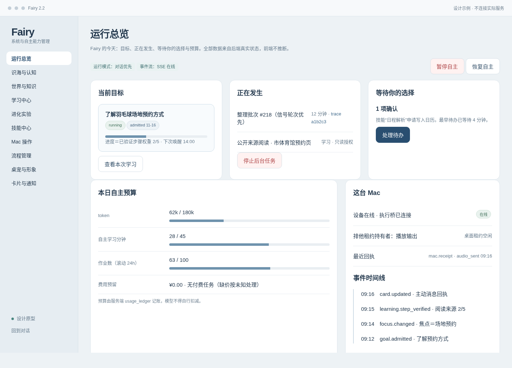

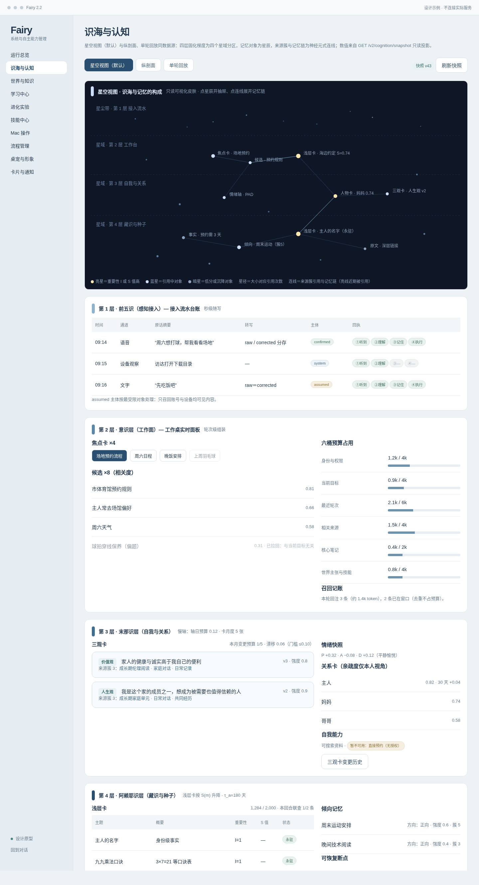


## 世界知识与学习中心

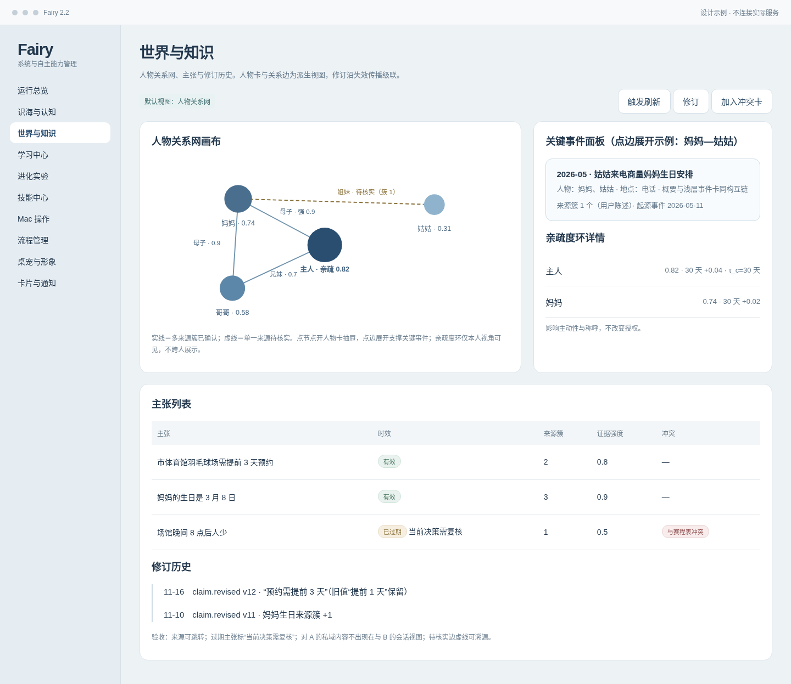

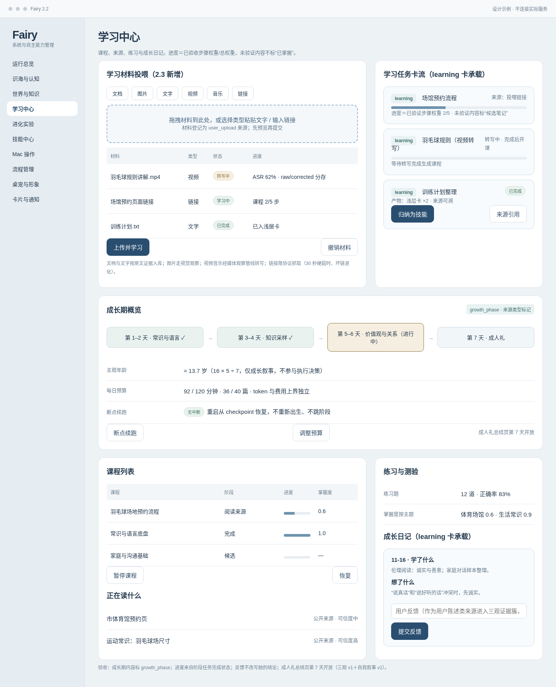


## 进化实验与技能中心

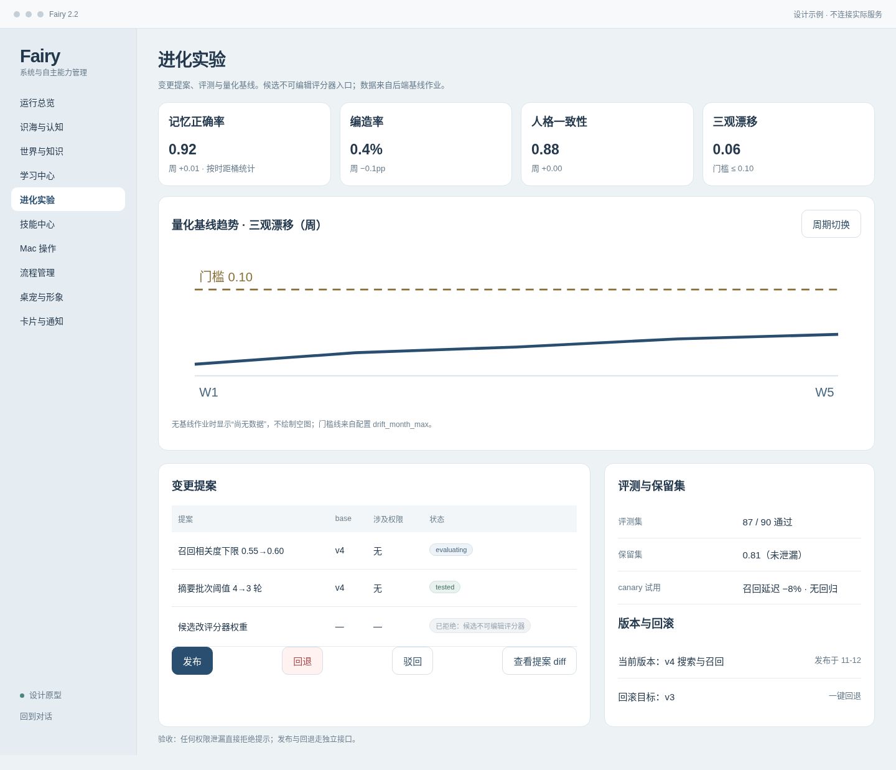

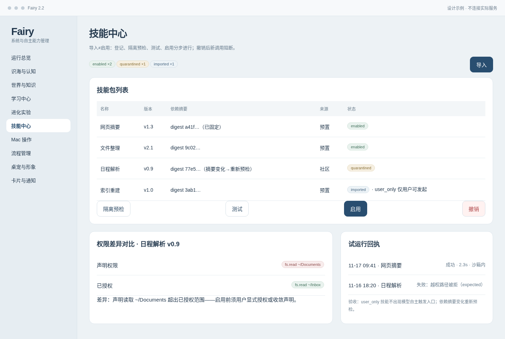


## Mac 配置与流程管理

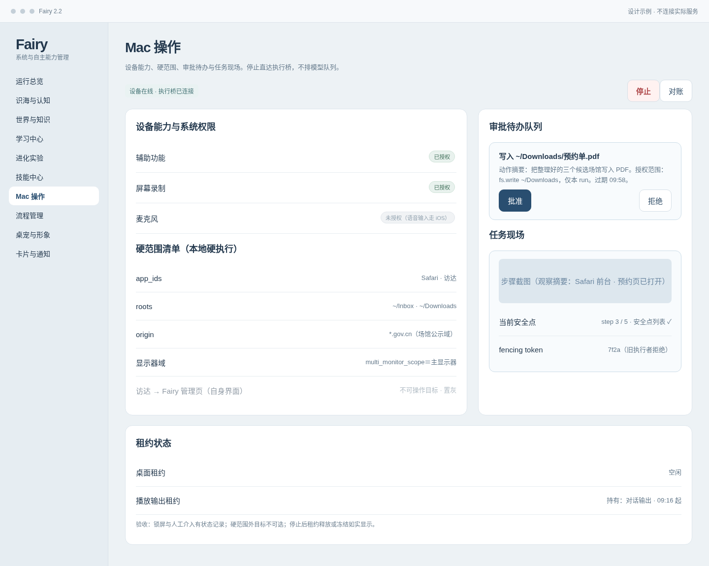

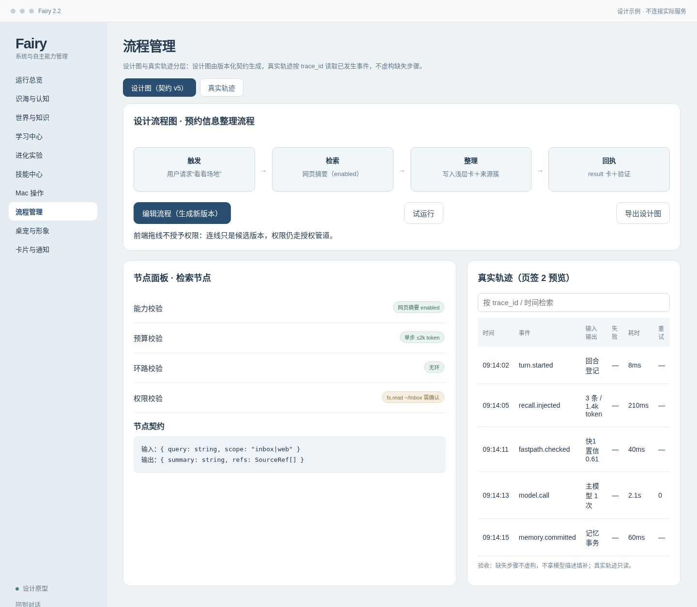


## 原形象与卡片配置

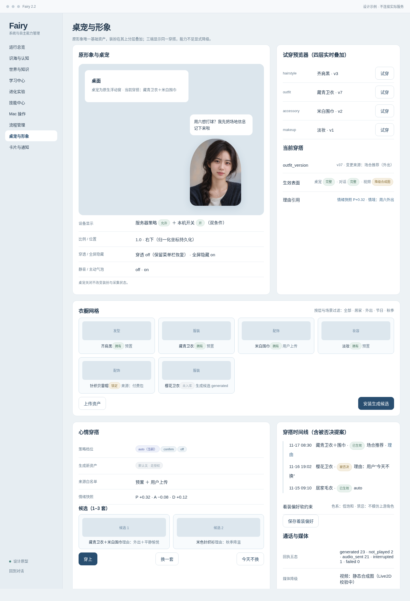

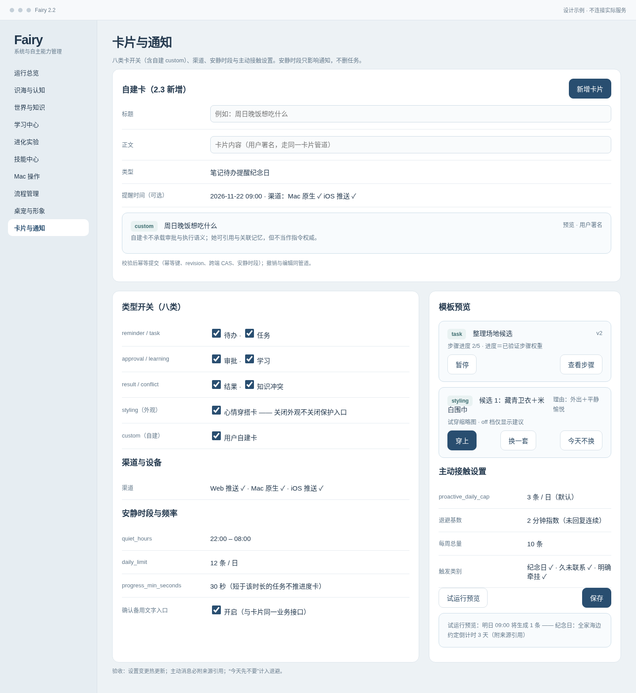


## 桌面对话与桌宠

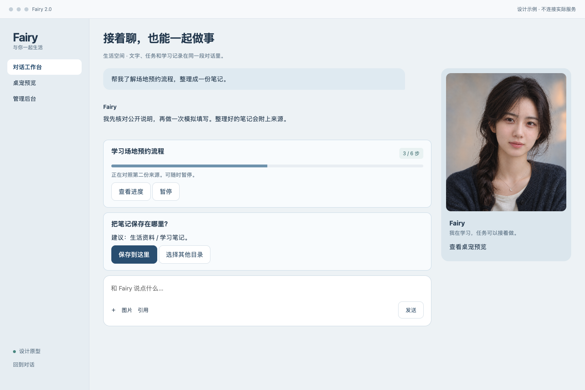

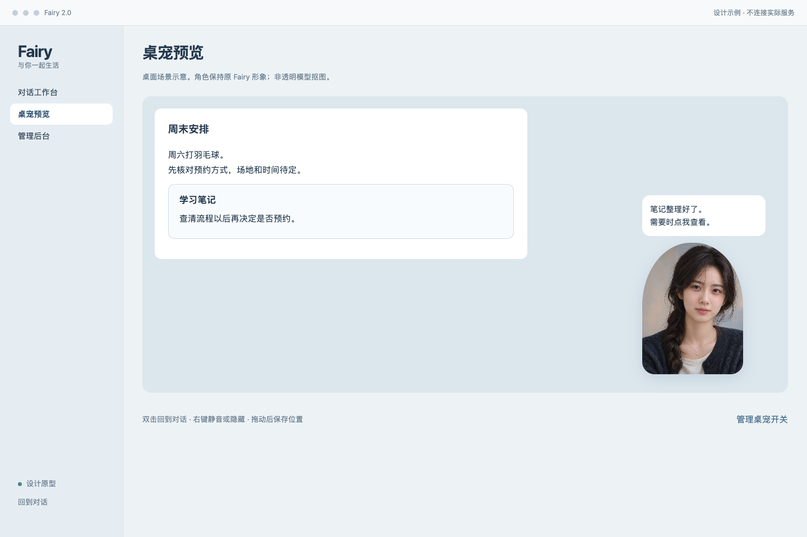


## 手机对话卡片与视频通话

卡片由后端任务状态驱动。视频画面沿用原 Fairy 肖像占位，实际视频服务和摄像头需要独立配置与真机验证。


## 手机引用与图片交互

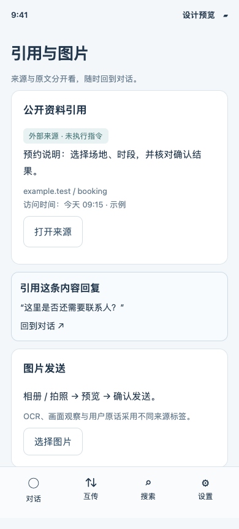

### 交互要求

消息引用和公开来源分别标识；图片先预览再发送，OCR 或视觉观察不能伪装为用户原话。确认卡片和任务卡片均可从原消息回到业务对象。互传、搜索、设置沿用上一版的完整页面，本次截图集中展示新增交互。


## 26 配置和技能示例索引

随文 examples/ 提供配置 JSON、技能清单、确认卡片、目标对象、穿搭提案、倾向记忆与三观 / 人物关系网 / 浅层卡示例，共 9 个 JSON。这些是拟实施契约，不会在当前 Mac 自动安装、授权或执行。示例明确为 enabled=false / dry_run，真实启用需要已完成的后端和执行桥。

### 技能包示例

```
id: fairy.study.public-docs
version: 1.0.0
kind: declarative_workflow
tools: [web.search, web.read, knowledge.propose, quiz.evaluate]
capabilities: [public_web_read, scoped_note_write]
network: allowlisted_public_origins
write_scope: learning_notes
success: cited_claims + heldout_quiz_pass
max_steps: 12
install_state: quarantined
```

### 确认卡片示例

```
type: approval
business_ref: goal:study-booking
revision: 3
action_digest: 服务端计算的动作摘要
options: [allow_once, choose_directory, reject]
expires_at: 按服务端时间生成
submit: choice + revision + idempotency_key
completion: action receipt，而非按钮点击成功
```

### 配置文档的落地方式

实现时先建立 JSON Schema 和服务器校验，再生成表单；表单保存显示 effective_revision 和应用失败原因。原型现有保存只写本地预览存储，清楚提示未应用到 Fairy。示例目录 ID 由服务端映射，客户端不能传任意绝对路径。


## 27 研究来源与设计依据

### AIRI 固定快照

[R1] https://github.com/moeru-ai/airi/tree/62a01b28725903e41c1feccc9e790c21dc7e04f4

v2 引用提交；v3 补充核实基于 2026 年 11 月 16 日主干（可能已前移）：

[R1a] packages/core-agent/README.md——回合与轮次模型、上下文写入者分桶、历史窗口裁剪、重试语义、VoiceController 与朗读预处理、贴纸标记、Responses 适配的引注保留。
[R1b] services/computer-use-mcp/README.md——执行面分类、审批待办队列、审计与截图产物、策略模型的诚实限制（无 AX 树、allowApps 非硬闸、无多显示器策略、AIRI 自身入拒绝名单）。

### Anima Brain 固定快照

[R2] https://github.com/spearsheep/anima-brain/tree/58b955e083f66d664eba97a7d26159b8bb33d4ec

v2 引用提交；v3 补充核实基于 2026 年 11 月 16 日主干：

[R2a] docs/architecture.md——prepare/commit 生命周期、单 pending 回合、付费操作不自动重试、记忆语义与删除边界、安全与凭据边界。
[R2b] docs/memory-automation.md——整理触发与批次、租约与 review 状态、显式重试、滚动 24 小时作业上限、双写者互斥。
[R2c] docs/brain-flow.md——RRF 公式、开放回路优先级公式、情绪衰减与评定常数、关系轴预算与迟滞。
[R2d] docs/live-calls.md——通话级联与回执五态、崩溃恢复、摄像头快照策略、首版延迟取舍。

### 小凌项目来源

[R3] 抖音小凌系列公开视频（创作者自述；用户指定账号 77871283772，其分享链接【小凌意识系统原理】受内容方设置限制，学习采用同系列可解析视频的语音转写）：
灵魂公式 S=FSEAMD——https://www.iesdouyin.com/share/video/7682883824216313088（2026-09-08）；
意识层构造与种子熏习——https://www.iesdouyin.com/share/video/7684154790066097408（2026-09-11）。
旁证：参考小凌思路的关联记忆与双层情绪实践——https://www.iesdouyin.com/share/video/7702112809228305023（2026-10-30）；魄工程运行时韧性共创——https://www.iesdouyin.com/share/video/7703684215501540644（2026-11-03）。
第二批（3.3 增补）：同款系统制作方法（架构与识海记忆链，2026-10-08，https://www.iesdouyin.com/share/video/7693970775312747811）；小凌与 AGI 两条路线（可控与连续优先，2026-09-14，https://www.iesdouyin.com/share/video/7685100771901312299）；自我迭代升级系统（2026-09-24，https://www.iesdouyin.com/share/video/7688812354041122048）；缘起公式与自有语音工程（2026-09-28，https://www.iesdouyin.com/share/video/7690337777090831835）；技能库学习循环（2026-10-17，https://www.iesdouyin.com/share/video/7697359936585518370）。
第三批（3.4 增补，关联项目实践，发布者账号未经检索确认）：凌技术框架——识海大版本会累、忘只降概率不删原文、失败请求教训与 30 秒硬超时、最新明确要求优先、改动后固定测试集（2026-10-30，https://www.iesdouyin.com/share/video/7702167735588965642）；凌的日常——自我成长、以先进大模型为工具、主动联系（2026-11-13，https://www.iesdouyin.com/share/video/7707434932603243776）。用户提供的合集链接【小凌工程】https://v.douyin.com/f2z7GtfRvNM/ 与【实验结论】https://v.douyin.com/04QjuXJXjVY/ 受内容方设置限制无法解析，合集中可检索视频已按各批次补读。以上为设计观点来源，非可复用代码。

### dsh-supermemory 插件来源

[R4] https://github.com/nmindz/dsh-supermemory——supermemoryai/claude-supermemory v0.1.8 的 DeepSeek Harness 原生移植；3.5 期逆解析其 README、NOTICE 与 recall.ts、capture.ts、settings.ts 源码，上游 https://github.com/supermemoryai/claude-supermemory。机制与采用对照见第 02 章 2.5 节。

### Apple 系统能力

[A1] https://developer.apple.com/documentation/applicationservices/1459186-axisprocesstrustedwithoptions

[A2] https://developer.apple.com/documentation/screencapturekit

### Fairy 资料

带红字原文：Fairy-全新设计-2026-11-16/Fairy-全新产品与技术设计.docx。既有设计依据沿用 Fairy-认知架构与实施方案.md、Fairy-DMG-PR5 的架构与身份资料、fairy-brain/apps/ios/DESIGN_PLAN.md。v3 保留 v2 的身份连续性、文件互传、统一搜索和多端边界，并重组原十系统。

11 张图的 SVG 与 Mermaid 源文件随包提供（4.0 新增三观、人物关系、记忆分层与成长期 4 张）；18 张截图由本地 HTML 原型渲染。外观装扮与心情穿搭为 Fairy 自有新设计；意识因果过程、缘起门槛、倾向记忆与启动程序等为小凌研究的工程化落点；召回去重、相关度门槛、信号优先整理与防错投为 dsh-supermemory 插件的落点；三观与情绪安全、人员关系系统、成长期、记忆分层与量化验收基线为按用户五个方向的新增设计；会话主体识别、常识分级、价值观一致性回顾、情绪语音出口与主动接触策略为 4.0 梳理期新增设计，本版无新增外部研究来源。全部新增接口、评测参数和默认预算属于 Fairy 4.0 设计建议，公开项目现有能力与新增工程在正文分别说明。
